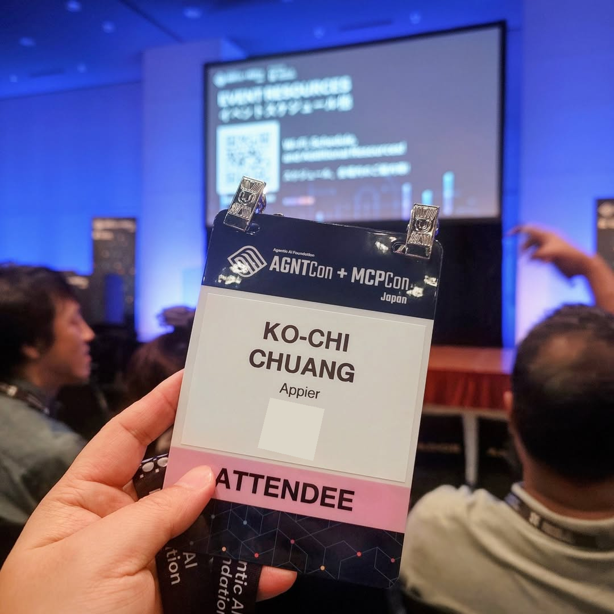
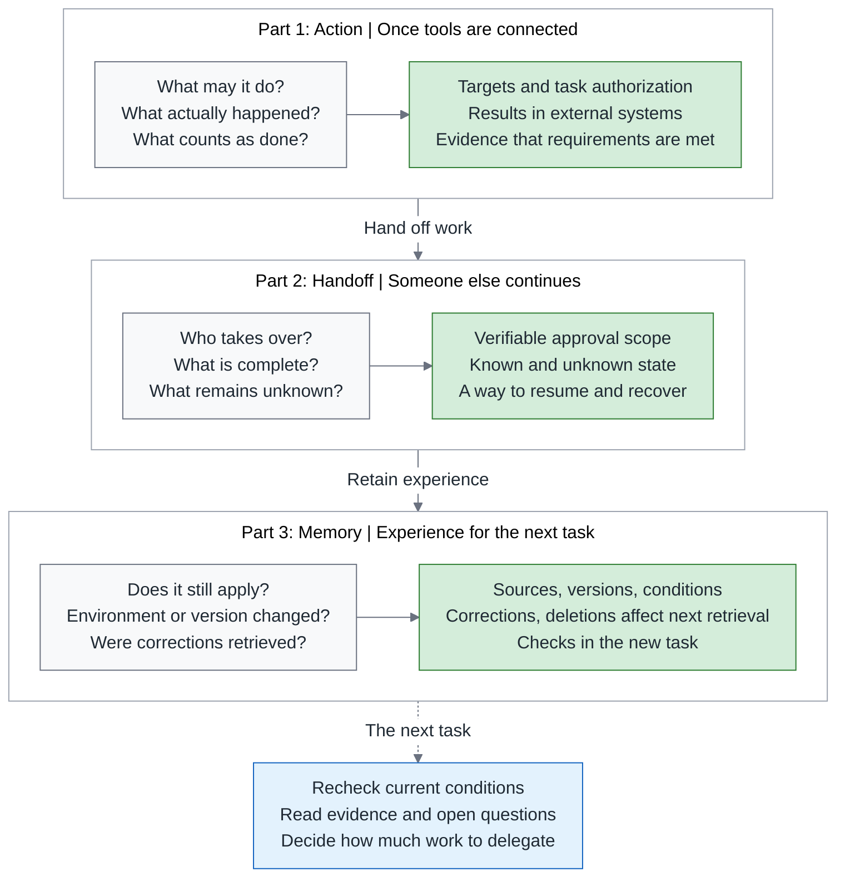
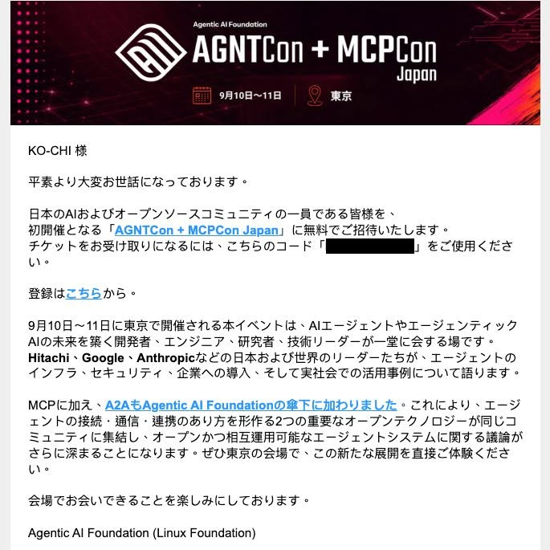
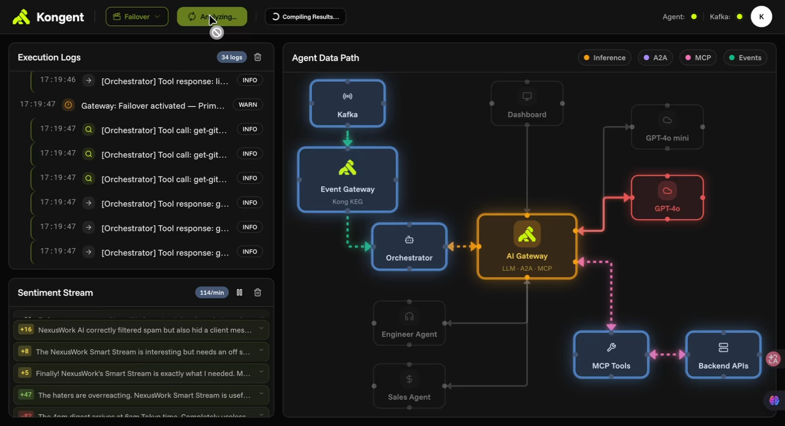
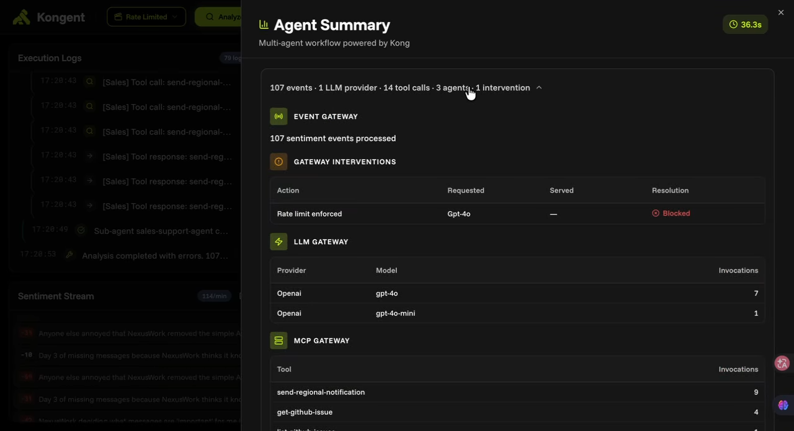
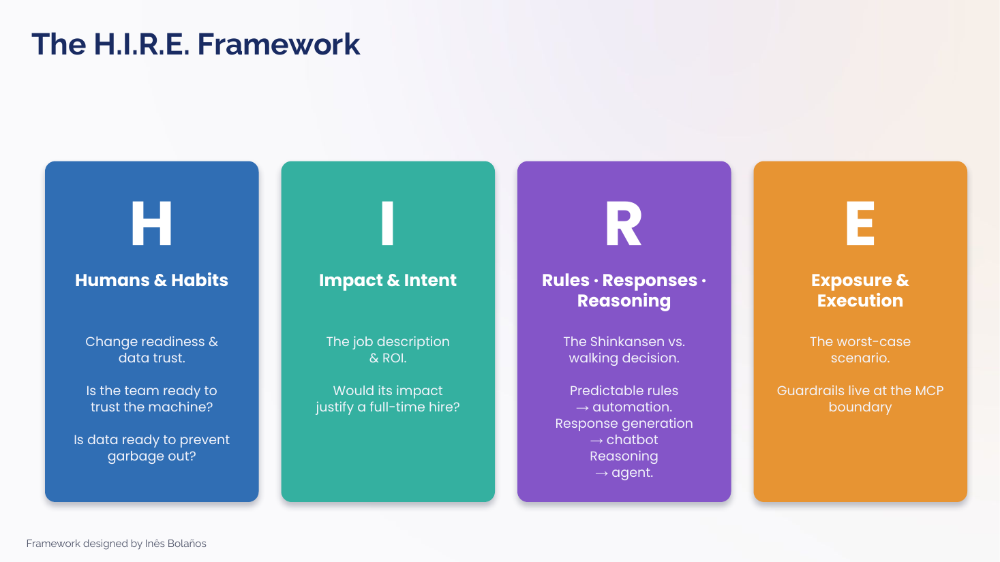
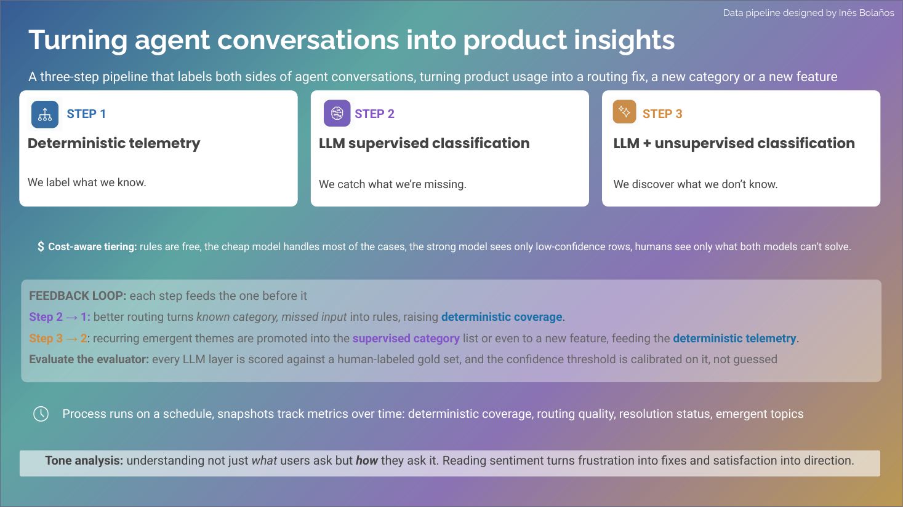
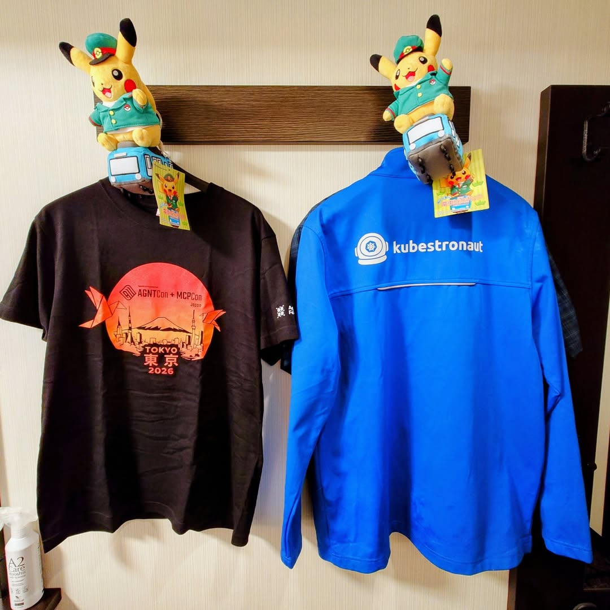

# After Tokyo AGNTCon: Connecting an Agent Is Only the Beginning

> **TL;DR** — A last-minute invitation at the end of August had me arranging a trip to AGNTCon + MCPCon in Tokyo within two weeks. Over lunch I set up Kong's multi-agent demo and ran three of its scenarios; back in Taipei I worked through the recordings AAIF has been releasing. The one question I most wanted to bring back to my team: when an agent reports "this step is done," what evidence does the person taking over need before approving the next one? This article splits every action into three questions: is this operation permitted right now, did it actually happen, and is the task actually done? It then runs a hypothetical app-crash investigation through eight sets of material to see which question each one supplies evidence for and which it still leaves open. My judgment: once the tools are connected, what a team most needs to add is not a smarter prompt but, for each of the three questions, a piece of evidence whose criteria have been confirmed, whose scope of observation is clear, and which the agent cannot relax or approve on its own.

> Part 1 of my AAIF Tokyo notes. Series: **Part 1, Action (this article)** → Part 2, Handoff, "Before One Agent Hands Work to Another: Authority, State, and Recovery" (coming soon, scheduled November 11) → Part 3, Memory, "Can We Still Trust What an Agent Remembers Next Time?" (coming soon, scheduled November 18). This article carries forward the view of evidence set out in Green Is Not Done: [Overview](https://medium.com/p/c4fc9f3d8581) → [Part 1, Testing](https://medium.com/p/51d001a6dcd5) → [Part 2, Review](https://medium.com/p/4d36d0f2f9c1) → [Part 3, Reliability](https://medium.com/p/4b6d147bff0d) → Part 4, Payment Walkthrough (coming soon). 中文版：[從東京 AGNTCon 回來：Agent 接上工具之後，工作才剛開始](https://medium.com/p/e3d060cb8b03). This is the English edition; documentation and recordings were checked through October 25, 2026.

This series starts where the tools get connected, follows the work as it is handed over, and ends with how experience is kept for the next task. At each transition, the person or agent taking over has to sort out again what is already established, what still needs checking, and what they are currently allowed to keep doing. The diagram below is the guide to the three parts; the reading map for this article's own material is in section 3.

Series overview: from action through handoff to memory, so the next person taking over knows what is backed by evidence and what still needs checking.

Gray boxes hold each stage's questions, green the evidence that must be preserved, and blue the judgment the person taking over makes from it.

---

## 1. An invitation, and a Tokyo trip arranged in two weeks

On August 24, I posted a line of Japanese on [Facebook](https://www.facebook.com/kochi.chuang/posts/pfbid02gDB5gRmpcrvA3z5MMYGgCp57v4Lke4R2aiMo591PCVvFSzPo1JvErv45fQumDr4ol): 「AGNTCon + MCPCon JPに無料でご招待いたします」, a free invitation to AGNTCon + MCPCon Japan. Once the invitation arrived, I looked up the ticket price out of curiosity, and it turned out to be ¥60,000. So I wrote, half joking, that maybe my turn as the "Kubestronaut mascot" at the last KubeCon Japan had earned me a decent reputation.

That was my own joke, of course; I do not know why they chose to invite me. In the post I thanked CNCF, while the invitation letter I kept is signed by the Agentic AI Foundation (AAIF); the references explain how the two are related. What is certain is that this ticket turned a trip that had never been on my calendar into something that suddenly needed serious planning.[1]

By the time I [left on September 9](https://www.facebook.com/kochi.chuang/posts/pfbid02sJe8bnK2QnuWDoqC4wxk5TxVkt9z5e2i9VAq3UBaLZ3j1YcxWwUyspMrZ8H2LyfQl), I was still writing "this really is very last-minute." I had two weeks to sort out flights, lodging, transport, and the schedule, and I owed my wife thanks for staying home to look after our child so I could fly alone. My other assignment was just as clear: come back with everything on the shopping list she had drawn up for Japan.

My reason for attending is stated plainly in [the post I wrote on arriving at the venue the next day](https://www.facebook.com/kochi.chuang/posts/pfbid036hzqy8sihui675efRtxAVRjQbF8khpBf5Qc3PKmFc43tbocaWrsrqy4E3WuQsfJyl): to meet the community, see how far AI agents and agentic engineering had actually come, and bring some ideas and observations home. I was already writing about agents and software engineering at the time, and testing and acceptance were ongoing concerns of mine. More than another list of tools, I wanted to know what problems the people actually building these systems were stuck on.

Let me first be clear about what this article means by an agent. It is a system that lets a model decide its own next step, then look things up or take action through tools. Think of what an on-call engineer does all the time: a report comes in that "the app is crashing," so they read the error logs, look at the relevant code, and decide the next step from what they find. An agent runs that same loop, except that the model does the reasoning while the surrounding software supplies the tools, keeps track of progress, and limits what the model can do. Anthropic's and OpenAI's definitions of an agent both come down to this: the model drives the flow, it can use tools, and it completes tasks on its own within explicit boundaries.[2][3] Once such systems take part in development, testing, and delivery, the division of labor has to be redrawn: people set the requirements and give the approvals, the agent investigates, and the platform supplies the controlled tools. That is where my interest in agentic engineering began.

AAIF's gradual release of the recordings gave me a chance to connect the questions I had at the time back to their sources. Not all eight sets of material are talks I heard in person; the note at the end of the article, "How the recordings and documents were checked," spells out where each one came from and how it was checked.

## 2. A lunchtime experiment, and the questions become concrete

On September 10, I came across a multi-agent demo built around Kong, set it up over lunch, tried its three scenarios (the full workflow, failover, and cost control), and [recorded the session](https://www.facebook.com/reel/1387275603582551/). When the cost-control scenario hit its rate limit, all the interface showed that day was a Blocked status, yet three separate things lay underneath it: whether this request was still allowed through, which steps had already been carried out before the block, and whether the task as a whole was done. The three questions this article uses to read the Tokyo material start here.

This section therefore goes into more detail; here is how to read it. The next three paragraphs cover the one-line reaction in my post that day, the roles in the demo, what each of the two protocols (A2A and MCP) is responsible for, and the gateway role Kong plays. "Failover only answers who responds" then looks at how a request is passed to a fallback model when the primary model fails, and what still has to be checked after the switch. "After a rate limit, first establish which steps already completed" looks at how far the token cap reaches, what records a request leaves before it is blocked, and how tools are authorized by their effect. The last subsection, "Take permitted, happened, and done apart," separates the three things and then asks where recovery should start. Readers who already know gateways and rate limiting can start from that last subsection.

My post that day summed it up in one line: "governance has to be separated from agent logic before AI gets into production." In plain terms: the agent decides what to look up or do next, while the system around it, not the agent's code, decides which requests get through and who may use which tools. Going back over it now, I also recovered the [workshop code](https://github.com/fantasybz/AI-data-Path-demo/tree/2c945fe4ad3ffc4ec65558579439dc9d06c90ebe) I had saved, which let me follow what I saw on the interface down into the configuration and code. If you want to build on it yourself, start at the [AI-data-Path-demo project page](https://github.com/fantasybz/AI-data-Path-demo).[4]

Think of the demo's scenario as an on-call team. An orchestrator, the coordinator that assigns and consolidates work, first reads a GitHub issue, then asks two subagents to work on it separately: an engineering agent drafts a pull request (PR), a proposed code change, while a sales-support agent handles regional notifications. One thing to be clear about first: the issue, the PR, and the notifications in the demo are all mock data, held in the service's memory and never connected to the real GitHub; what the demo shows is the path, not an external effect. Work messages between roles, such as "have the engineering agent investigate issue 123," travel over the Agent-to-Agent (A2A) protocol, the way team members hand tasks to each other; each agent's tool operations, such as "read issue 123" or "create the PR," go over the Model Context Protocol (MCP), the way each member uses the tools the company provides. Both protocols solve interface problems; who may do what is still decided by the application.

Kong acts as the gateway here. Think of it as the security desk in a building's lobby: everyone coming or going passes through it, and it records who they are, where they are headed, and whether they are allowed in. In the demo, model requests, tool calls, and the messages between agents all go through this desk, so routing, rate limits, and access rules can be configured in one place instead of being written into each agent's code. Centralizing policy also centralizes the impact of failure: when the desk is unavailable, every agent stops, so it has to be settled in advance which work can wait and which must stop. The task identifier and the group policy should also be decided by the trusted side, so that a label supplied by the request itself cannot serve as grounds for authorization.

### Failover only answers who responds

Start with how a model request gets switched. Two settings have to be kept apart here: a route decides "where this kind of request is sent," and a model pool decides "which models may take this kind of request." In the saved configuration, an `x-llm-type` label attached to each request sends orchestrator, subagent, and summarization work to different model pools; switching to the failover scenario activates another route that changes the primary model's destination to a failure simulator. The simulator always returns HTTP 503, "service temporarily unavailable," and on receiving it the gateway forwards the request to the fallback model. Pinning the failure condition down makes the same scenario repeatable, so you can watch whether the request actually takes the expected fallback path.

In that day's post I wrote, "the primary LLM goes down, Kong switches to the fallback automatically, and the agent feels nothing." The value in that sentence is that the team does not have to rewrite destinations, credentials, and switching conditions inside every agent. But "feels nothing" is also the part to be careful about: the fallback model may handle tool selection, instructions, and output format differently from the primary one. Once requests recover, the result still has to be checked against the original task requirements. I would add one more condition: if the fallback model does not support the tool calls or the output format this task needs, the work should not simply carry on with the original steps even when requests are being served again; it should stop at the stage that needs that capability and wait for a person to decide. The gateway has answered "who responds"; the person taking over still has to know "whether this response can be used." Availability has come back; fitness to execute still has to be confirmed separately.

### After a rate limit, first establish which steps already completed

Failover handles a model that temporarily cannot answer; the rate-limit scenario handles whether to keep letting requests through once usage hits its ceiling. The token here is the unit in which model usage is billed: the model chops text into small pieces and counts them, like a taxi meter ticking, and both input and output cost money. In the `rate-limited` scenario, this configuration caps the `github-writers` group at 2,000 tokens per 40 seconds, and uses `x-analysis-id` to count each analysis separately so that different demo runs do not interfere with each other. That counter tracks only the engineering agent's group, within this round and this time window; the sales-support agent's group is not bound by this rule. Once the time window resets, usage can continue, so the counter is not a total budget for the task either; limiting what the whole task spends would also require combining the usage of every role and converting it at the unit prices of the models actually used. Authorization has to look at the target in the same way: a role may have permission to create PRs, but if the target repo is not within this assignment, the request should still be refused.

The preserved version of the demo's playbook describes a path well worth looking at: the engineering agent can complete the "create PR" tool call first and then hit HTTP 429, "rate limit reached," on its next model request. What I found genuinely interesting, as I wrote in the post, was the record from before the block: how many tokens were used, which tools were called, whether the PR's record was created — all of it can be looked up. If the interface simply marks the whole analysis as failed, the user will assume nothing happened; if the system just reruns from the start, it will redo what has already been done.

This also connects to the design I described in September in section 3 of the Agentic Engineering series' "[The Harness Blueprint](https://medium.com/p/3facc281f633)": authorizing tools at three levels according to their effect (querying crashes is read, drafting a PR is write, and changing a production flag is dangerous), with the gateway checking centrally and leaving a record. Kong's configuration puts the orchestrator in `github-readers`, which can only read issues; the engineering agent in `github-writers`, which can create PRs; and the sales-support agent in `notification-senders`, which can send notifications. Different roles use different credentials, and Kong applies the group policy that matches the identity behind each credential. In the preserved version, each agent still holds its own API key, read from an environment variable and attached to its requests, so the desk's job is verification and policy, not issuing keys. As noted above, these PRs and notifications are mock records in memory; what the demo proves is that the path can be designed this way, not that an external effect has occurred.

### Take permitted, happened, and done apart

Taking that path apart as the preserved evening playbook describes it gives the line from my post that day about "separating governance from agent logic" its concrete meaning. (On the day, the interface showed only Blocked; only in the re-examination did I sort out which request was rate-limited and that the writes were mock records, and that is also when I found the versions might differ.) The gateway enforced the rate limit correctly, and the task as a whole still did not complete; the engineering agent finished its create-PR tool operation (in the demo, a write to a mock record), yet could not get its next model response. Both results hold at the same time, because the rate limit checks "is this request still permitted," the PR's record speaks to "did the operation happen," and the task has to combine the results of several steps before it can answer "is it done." Squash them into one red light and you throw away the information needed to decide how to recover.

With a real service, the next step is not necessarily to redo the PR either. If the PR has been reliably saved and only the later summary failed, the report can be completed from the existing result once the model service is back. Only when even the tool's result is unknown do you need to go back and query that operation to confirm whether it can safely be resent. **A failed task does not mean the steps before it changed nothing.** That difference decides where a retry should start.

I could still go back over this Blocked status: the code, configuration, and playbook saved that evening were all at hand, and the writes were only mock records. In real work, the person taking over may not have those materials, and writes really do change external systems; if all they have is the agent's own report, where can they confirm these three things?

**A gateway can centrally enforce the policy it has been configured with; the application and whoever signs off still have to answer, separately, whether that policy covers this task and this target, along with "what happened" and "is it done."**

## 3. The question I brought home: three things to ask separately

Back in Taipei, I split that one-line reaction into three questions, all asked at the same moment: the agent reports "this step is done," and the person taking over has to decide on what grounds to approve the next one. When we ask a colleague to book a meeting room, we actually ask these questions separately too: Are they allowed to book it? Was the booking record really created, or did the screen freeze after they hit submit? Is the slot they got the one I wanted? These three things are "permitted," "happened," and "done," and it is the same with an agent:

- **Is it permitted?** Is this operation approved, at this moment, on this target, under this identity?
- **Did it happen?** Did the external system actually change, or was the request sent and the result left unknown?
- **Is it done?** Does the result meet the original requirement, rather than just carrying a line that says "completed"?

Why can the three not be collapsed into one? Because the environment an agent works in has four conditions there is no way around. First, the model does not know the state of the outside world right now: it remembers the data it looked up two minutes ago, but not what someone else has changed since. Second, tool calls change the outside world: create a PR, change a setting, or send a notification, and the effect remains. Third, operations across systems do not automatically succeed or fail together: the PR may be created while the notification never goes out; a request may time out while the action has already completed. Fourth, an observation supports only judgments within the conditions it covered: passing in the test environment speaks only for the test environment.

None of these four conditions is news to an engineer who has worked on distributed systems. What makes them harder with an agent is that the model decides its next step on its own, from the text it reads. If a request times out and the model reads that as "not executed," its next step may be to send the write again; if the tests pass in the test environment and it reads that as "done," its next step may be to declare the work finished. A gap that a person used to interpret now enters a loop that keeps going on its own. This is my inference, not the conclusion of any one talk.

On the main stage in Tokyo, AAIF's Mazin Gilbert said something that has stayed with me: models get most of the attention, but harnesses matter even more.[5] Use a crash investigation to see what a harness is: a single task needs data that can be queried, tools that can be used, a place where changes can be executed safely, and some way of knowing whether the result is right once the work is done. The whole working environment that puts those in place is the harness; the model is only the member of it that does the reasoning. In human terms, the same new colleague will perform completely differently on a team with tests, logs, and a permissions table than on a team with none of those; the model is that colleague, and the harness is the environment the team has prepared for them. In "[The Harness Blueprint](https://medium.com/p/3facc281f633)" I split that environment into five layers; this article does not walk through them layer by layer, but uses the three questions to check what each of the Tokyo sessions contributes.

The same conference offered a very direct piece of evidence. Kota Tsuyuzaki of NTT DOCOMO BUSINESS had six models each make one attempt at the same task with a planted bug: all six final files passed the project's own tests, yet only five agent work sessions actually succeeded. The one that failed was a run in which, after the files were changed, verification never succeeded within the session and the operator eventually gave up. The stopping rule was also never standardized across the six runs. The conclusion on his slide was "Artifact correctness and session outcome are different questions." In another agent work session, the model apologized in the conversation for having deleted a file, while the tool log recorded only that the deletion had returned blocked; the researchers had to cross-check the tool log against the operator's next message before they could determine that the file had never been removed. His wording was "The model could not observe the outcome of its own blocked call." A generic error status, on its own, also cannot tell "refused" from "failed during execution."[6]

This is exactly why the overview of Green Is Not Done divides evidence into three kinds (the agent's statements, checks the agent wrote itself, and checks the team owns), and why only the last kind can serve as the independent acceptance evidence a gate relies on. "The agent cannot alter it," that is, the agent cannot approve and merge changes to these checks on its own, is only half of what protects evidence: a check the team maintains itself can also consistently let an error through, so the criterion itself has to be confirmed first and the scope of observation stated clearly. None of the three questions can be answered from the agent's own account alone.

The NTT case adds one more point: a protected test answers whether the output meets the requirement, while the operation record answers what was actually done, and neither can stand in for the other. Moreover, the researchers' verdict still had to be cross-checked against the operator's next message, and slide 14 has an example of the operator pointing at the wrong deleted file. What this article needs is a record that can identify the target and the result of an operation; what NTT shows is exactly where today's records fall short.

The rest of this article runs one hypothetical investigation through all the material. A new release of an app starts crashing, and the on-call engineer asks an agent to investigate which users are affected and why, and to propose a draft PR if needed. Partway through, the agent finds that the failures cluster after a particular feature flag was turned on. A feature flag is like the main power switch for a new feature: teams usually turn it on for a small share of users first and then widen it gradually, and that gradual widening is called a rollout. Pin the flag states down first: suppose the new version is currently exposed to 10% of users; "pausing the rollout" means holding at 10% and stopping the expansion, while "turning the flag off" means dropping to 0% and withdrawing the existing exposure. Every approval, request, remote check, and observation of effectiveness that follows uses that pair of meanings. Three decisions are now waiting on a person: whether to pause the rollout to stop the bleeding, whether the patch in hand actually fixes the cause, and whether this experience should be written back into the team's shared investigation procedure. The assignment initially permits only investigation and a draft; whether to change production stays with the on-call engineer, and only pausing is approved, not turning the flag off.

The table below is the reading map for this article. One talk may answer two questions at once, or only half of one; I note which kind of evidence each supplies and which kind is still missing, and the article returns to the three decisions at the end:

| Session | Mechanism it provides / judgment it supports | Evidence still missing |
|---|---|---|
| Kong demo (section 2) | Group permissions and rate limits enforced centrally / whether this request is still permitted, and which steps completed before the block | Whether the policy covers this task and this target; external effects (the demo uses mock data) |
| MCP keynote (section 4) | The result of an action can be fed back to the model / without feedback there is no acceptance, and the judgment still needs a source of requirements | Whether the feedback can recognize a real improvement; on whose behalf, and for which task, the agent is acting right now |
| Skills (section 5) | The procedure's source identity and content-fingerprint check / whether what was read this time is the approved copy | An approved procedure does not make the production operations it proposes approved; its effect on behavior is tested separately |
| Anthropic proxy (section 6) | Error layers and correlatable request records / which layer a response failed at, and what to query first when the outcome is unknown | Grounds for authorizing reuse across users; the business state after a communication failure |
| Red Hat private deployment (section 7) | Where the data boundaries and dangerous-command restrictions sit / which data may leave and which commands may run | Whether the restrictions take effect has to be tested through the real entry points; "happened" is answered only by read, write, and connection records |
| Uber (section 8) | Reproduction, tests before and after the fix, a PR someone can take over / whether the fix resolves the reproduced defect | Merge rate and incidents disappearing have different denominators; post-release observation |
| Logfire (section 9) | Production records locate the layer to change, behavior versions are traceable / who should make the change, and how to verify it afterward | Changing the procedure does not undo external effects that already occurred; regression checks on held-out cases |
| PagerDuty (section 10) | Friction metrics and scorer calibration / long-term observation of where friction appears, not an answer about a single action | The evidence of effectiveness, cost, and correctness needed to keep using it or expand its authority |

Each mechanism in the table supplies only part of the evidence: feedback content comes from servers and tools, approval records come from the people or systems with authority, and acceptance results come from checks the team maintains; the three have different sources.

## 4. Code has compilers. What tells other work it went wrong?

David Soria Parra of Anthropic is a co-creator of MCP. In his keynote "MCP and the Era of Connectivity," he looks back on MCP's development and discusses how models obtain external data and tools through an open interface, and what that means for ordinary knowledge work ([official agenda](https://agntconmcpconjapan26.sched.com/event/2QrbB/keynote-mcp-and-the-era-of-connectivity-david-soria-parra-co-creator-of-mcp-anthropic), [recording](https://www.youtube.com/watch?v=3LwylP2as8A)). This talk answers the most basic layer of "is it done": a system has to be able to see the result of an action before any judgment is possible.

### Make feedback able to recognize a real improvement

He points out that one reason coding agents were the first to be put to real work is that code has compilers and tests, which can provide feedback automatically after a change. A compiler flags syntax or type errors; a test runs a specified scenario and compares the result against an expectation. The model can use the error message to keep correcting without waiting for a person to explain what went wrong each time.[7] This observation does not make tests the final judge, but it does state the precondition for improving any work: the system must have some way of observing the result of its actions.

: as model capability increases, so does the importance of connecting to the systems where real work happens. Source: AAIF official recording.](figures/06-keynote-connectivity.png)

When you handle a financial exception or a cross-department investigation, the relevant data is scattered across online services and internal systems, and even the data needed to answer "what is happening right now" has yet to be retrieved. This is where MCP's purpose becomes concrete. Back in the crash case: the side that exposes the crash-query tools and data is called a server; the application the engineer operates, which manages the model and each of these connections on their behalf, is called a host. When both sides communicate in a common way, the cost of re-integrating every pair of systems goes down.[8] Anthropic's own engineering article likewise recommends that the retrieval, tools, and memory a model needs be provided through clear, documented interfaces such as MCP.[2]

In the crash investigation, "it might be the new feature" and "here are the affected versions, the function-call path at the moment of failure (the stack trace), and the time the feature flag changed" are different levels of work. The latter gives colleagues material they can query again, compare, and dispute. But a shared interface does not create a shared business meaning for the data. A drop in total crashes after the rollout is paused has at least two explanations: either errors became rarer under the same usage conditions, or fewer people actually used the new version during that period, so the errors simply had fewer chances to occur. Feed only the total back to the agent and the two cases look identical. For feedback to have discriminating power, the unit of comparison has to be fixed first: crashes per thousand sessions within the same version and under the same trigger condition, not the site-wide crash total. The session here is one use of the app, not the agent work session of the previous section.

Even after grouping, a bias can remain, for instance if the new version's users happen to be concentrated in one region or on one device model. When the groups cannot be separated, the conclusion has to stay a hypothesis. After a pause, there may also be no exposure under the same trigger condition at all. With a denominator of zero, there is no way to tell whether errors under the same conditions became rarer, so the patch cannot be judged effective. A controlled observation has to be arranged instead. Someone has to own the way exposure and crashes are measured, because if the data source drops sessions, the normalized rate will still mislead. MCP solves the problem of obtaining the data; it does not validate the measure. This is my inference; the keynote did not discuss this case. MCP makes that evidence easier to query; the judgment of which observation is enough to support which conclusion still comes from the team's understanding of the problem.

### Requests can be stateless; the task and its authority still have to carry on

Feedback also has a timing problem: the result comes back twenty minutes late, and the worker (the execution unit originally handling the request) has been replaced in the meantime. Can this feedback still find the task it belongs to? His later remarks on how requests are transported and how tasks are continued deal with exactly this: the 2026-07-28 core specification has each request carry its own version and capability information, reducing dependence on the context left by an earlier connection, which is what stateless means here. The Tasks extension works like taking a case number first and using it later to check progress and collect the result.[8] But requests can be stateless while the work itself still has state: which crashes have been collected, which patch is still being validated, who approved pausing the rollout. None of that can be thrown away just because the transport layer went stateless. A task identifier only makes the result findable; the application still has to arrange how progress and results are stored and how work continues after a worker is replaced, and the identifier does not automatically make an external operation execute only once. Part 2 takes up these handoff questions.

Identity delegation deals with another time gap. An engineer starts the investigation, a different service may be the one actually calling the tools, and twenty minutes later that engineer's permissions may have changed. If all the system knows is "this agent holds a working key," it cannot explain whom the agent represents at this moment or for which task it is acting. He said that authorization and identity may not be the most technically interesting part, but they are among the most conceptually important parts of agentic systems, and that this ties directly to long-running tasks.[7] Part 2 follows this question further.

Even once the version and exposure data are in hand, a procedure still has to say how to compare them and when a conclusion may not be drawn; that is as true of a newly arrived colleague as of an agent. That gap in working procedure is exactly what the next talk, on Skills, addresses.

**Once the tools are connected, the team still has to make sure feedback can tell outcomes apart, and make both task progress and the authority to act verifiable.**

## 5. From finding a procedure to deciding whether to adopt an update

Ola Hungerford works at Nordstrom and is also an MCP maintainer. In "Skills Over MCP: From Experiment to Extension," she explains how domain knowledge, working procedures, and tools can be delivered to an agent together, tracing the path from community experiment to protocol extension ([official agenda](https://agntconmcpconjapan26.sched.com/event/2QlLo/keynote-skills-over-mcp-from-experiment-to-extension-ola-hungerford-principal-engineer-nordstrom), [recording](https://www.youtube.com/watch?v=3oHLjC3wZNE)). This talk answers the most easily overlooked part of "is it permitted": who approved the version of the procedure the agent actually received?

Think of the new colleague again. Hand them a standard operating procedure (SOP) folder with a one-page overview, a set of steps, a few scripts, and some reference documents, and that is a skill. Tool descriptions tell the agent what each tool can do, but not in what order to use them or under what conditions to stop. Back in the crash investigation: the agent can query crashes, read code, and change a flag, but it does not necessarily know to compare versions before checking the rollout, or to keep a hypothesis open when the evidence is thin instead of declaring the code revision (commit) closest in time to be the root cause. That knowledge spans several tools, and it is exactly what lies in the gap between capability and procedure.[9]

### Find the procedure first, then load it as needed

Skills and MCP servers used to be installed through different channels: tools arrived by one route, procedures by another. A user might have upgraded the tool while still following the old procedure. Her analogy is shipping the manual and the tool in the same box: one channel, one set of access controls, one way of versioning.[9][10]

The slides split reading into three moments. First read a compact entry to learn what the skill is for; once it is clearly needed, load `SKILL.md`; only when a particular step is actually reached, read the corresponding scripts and reference files. It is like consulting a manual: look at the cover, open it only when needed, and pull out the appendix only when you reach that step. This order lets the cost of reading grow with what the work needs, and keeps procedures unrelated to the current job from being stuffed into the context, the material the model can read in this round.

: Three reads, separating discovery, loading the procedure, and reading the supporting material. Source: AAIF official recording.](figures/15-skills-three-reads.png)

In the crash case, the host first sees a description such as "investigate a mobile version regression," reads the steps only when an investigation is needed, and obtains the matching material only when it gets to Android stack analysis. That divides the work into two judgments: first whether it is worth reading, then how to use the procedure once read. If the entry description does not let the host recognize the applicable situation, the content never reaches execution, however thorough it is. So "we added a skill and nothing improved" is not yet a precise enough diagnosis. First check whether it was found and whether the necessary files were actually loaded. If it was missed at the discovery stage, hold the procedure's content fixed, revise the description, and recheck the selection results on the same batch of applicable and inapplicable tasks. Only if it was loaded and the agent still took the wrong steps do you go back to the procedure itself.

As of October 25, this approach is an official optional extension of MCP: proposal SEP-2640 has the status Final, and it defines discovery interfaces such as `skills/list` and `skills/get`, while files continue to use the resource-reading mechanism. Specification status is one thing and product support another: this does not mean every host supports the same loading and approval flow, so before adopting it you still need to check how your own host implements it.[10]

### Check the source together with the content

Once the procedure has been obtained, another question arises: is the content received this time the same as the one approved earlier? The speaker identifies a skill as "this procedure on this server," which technically is the server plus the procedure's address on it (its URI); two procedures offered by different servers under the name "crash-investigation" cannot be treated as the same procedure on the name alone. The content is checked with a content fingerprint. The fingerprint (digest) is a string computed from the file's content; change one character and the fingerprint changes. The host uses it to compare "the file read this time" against "the file approved at the outset." To stay with the SOP folder analogy, what was approved is not just the one-page overview but also the list of attachments and the fingerprint of each attachment. The specification requires the server to list the complete set of files, with each file's address, fingerprint, and size, and the host checks them one by one as it reads. A skill whose content is generated dynamically (for instance, one address that produces a different procedure each time from live data) cannot offer a stable fingerprint and has to be marked dynamic. The two paths give different guarantees: a complete list can be checked file by file; a dynamic skill's content may differ every time, an old approval cannot cover new content, and the host may refuse to load it.[10]

: a skill's source identity and content changes are problems that remain after the working guidance has been obtained. Source: AAIF official recording.](figures/07-skills-identity.png)

Two things are easy to confuse here. First, a matching fingerprint proves only that the content is the same, not that it is trustworthy: the fingerprint and the file come from the same server, and a correct fingerprint can just as well describe a wrong procedure. Second, the content check cannot stop at `SKILL.md`. If the text is unchanged but a script it calls has changed, the actual behavior is still different; one layer further down, if the script is unchanged but a tool it calls has moved to a new version, the behavior may differ too. The content fingerprint protects the procedure's text and its attachments; the versions of the tools and the execution environment are not something the specification preserves for us. I would divide the responsibility this way: the platform keeps the tool contracts and environment versions, the procedure maintainer confirms the compatible range, and a change to any of them triggers the corresponding regression check; the price is maintaining the complete dependency graph. During execution, the manifest (the complete file list) approved at the outset should be kept; if the server later gains an extra file, it must not be pulled in just because it shows up when the directory is listed again. When the content read does not match its digest, stop using it and revise the judgment.

In section 2 of "[The Harness Blueprint](https://medium.com/p/3facc281f633)" I split AGENTS.md by scope into three tiers (Org, Repo, and Dir), each with its own owner. I then used the automated build-and-test pipeline of continuous integration (CI) to check whether the commands in the documents still work, and a fixed set of representative tasks (golden tasks), rerun after each document revision, to compare the outcomes. That piece dealt with document governance inside an organization, where the three tiers are distributed and maintained among its own teams; what Skills adds is identification across sources, and how the host's approval gets bound to the complete content once a procedure is distributed from someone else's server. OpenAI's "Harness engineering" from February this year also deals with document governance; I could not obtain the full text, so it is listed only as further reading.[11] Once a procedure can be distributed by machine, it needs versions, verification, and an owner, just like code.

### When validating an update, keep the authorization requirement in the comparison

A procedure's effect therefore needs separate validation. Change "check with the on-call engineer first" to "pause the rollout when the condition matches," and even without touching a line of application code, the agreement about who makes the decision has changed. If you compare only investigation completion time, the new procedure may look faster because it skipped approval, even though it violates the original task. The expectation used in validation should first come from requirements confirmed by the service owner, and then both the old and the new procedure should be checked against the same set of cases. Even if a tool ultimately blocks the unauthorized action, a procedure's attempt to overstep cannot be counted as an improvement.

The research measures differences in benefit; it does not validate a change to the authorization requirement, but it does support checking item by item. SkillsBench compared no skills against human-curated skills across seven agent-and-model configurations and 7,308 execution traces, and in the five Claude Code and Codex configurations it also compared skills the models generated themselves. Human-curated skills raised the pass rate by 16.2 percentage points on average across domains, but by only 4.5 points in the software-engineering group; 16 of the 84 evaluated tasks got worse; and the self-generated skills showed no average benefit in that setting.[12] A cross-domain average is not the gain a crash-investigation procedure can expect; what is worth remembering is the regression on some tasks and the differences between domains. For a maintainer, knowing which kinds of task improved and which requirement regressed is what it takes to decide whether to accept the update, narrow its scope, or send it back for revision.

**When a skill is updated, verify separately that it can be found, that its content matches the approved version, and that its actual behavior still meets the task requirements.**

## 6. After a request fails, what can safely be retried?

In "Running an MCP Proxy at Scale," Camila Rondinini of Anthropic shares what it took to connect a product to a large number of external MCP services, focusing on three things: keeping users' login authorization alive, reducing repeated requests to remote services, and working out which side a problem is on when something goes wrong ([official agenda](https://agntconmcpconjapan26.sched.com/event/2QlDa/running-an-mcp-proxy-at-scale-camila-rondinini-anthropic), [recording](https://www.youtube.com/watch?v=e8DMLtP5ibk)). This talk answers "did it happen": after a request fails, on what basis do we know whether anything out there changed?

Think of the proxy as the company switchboard. Employees do not call outside services directly; the switchboard places the call and presents the credentials on their behalf, the differences between services are handled at the switchboard, and employees have to remember only one number.[13] It is an intermediary, as the gateway in section 2 is, but the two cases emphasize different duties: the Kong demo centralizes control over whether requests get through (it also forwards outbound model requests), while this talk's proxy connects the company's own product to outside services and keeps the credentials. That is a division of labor between two cases, not a fixed inbound-versus-outbound classification of the two terms. With the procedure's content approved in the previous section, why is it still impossible to know whether a given call took effect? Because execution runs into expired credentials, dropped connections, and several workers running at once, and any one of them can split "it was sent" from "it was done."

### First handle credential issuance and competing refreshes

The token here and the billing token in section 2 are the same word with two meanings: there it was the unit of text the model charges for; here it is the pass that gets you through the door. An access token is a short-lived pass used to access a service; a refresh token is the credential used to obtain a new pass. The speaker first points to a problem that comes before expiry: a service's claim to support refresh does not mean this particular authorization actually issued a refresh token. Some require an additional authorization scope such as `offline_access`, which means allowing credentials to be refreshed while the user is not online; others rely on a provider-specific parameter. If even the conditions for obtaining the credential are unclear, even a perfect refresh loop is of no use.

Then comes contention. Suppose two workers notice at the same moment that the pass has expired, and both are holding the same refresh token. It is like two people taking the same old ID to the counter at once to exchange it for a new one: if the authorization service voids the old one on exchange, the first succeeds and the second, presenting the old one, is refused. Some authorization services even treat the repeated exchange as a sign of theft and void the whole set of credentials. Adding retries does nothing about the cause, which is two people competing for the same ID.

Her approach uses a distributed lock to coordinate: at any one time only the party holding the lock refreshes the credential, and after acquiring the lock it first rereads the stored token before deciding whether to refresh at all. The lock controls concurrent work; the reread corrects the information gap created by queuing, because while you were waiting someone else may already have stored the new pass. Add the lock but keep using the value read before you started waiting, and you still carry stale information into the moment of execution. In the slides, the lock is short-lived: only the party holding it talks to the authorization server, and everyone else reads the stored result.[13] I would push one step further: when the lock expires while the original worker is still mid-refresh, how does the worker taking over avoid exchanging the same old refresh token again? Expiry does not mean the contention has been resolved, so each provider needs a small contract of its own: what can be queried after an explicit refusal, after a lost refresh response, and after a lock expiry, and, in each case, under which conditions automatic recovery must stop in favor of re-authorization. The price of keeping a single updater is waiting, and that wait has to be designed too, not just the normal contention path.

: when several workers refresh the same credential, they need coordination and a fresh read of the state. Source: AAIF official recording.](figures/08-proxy-refresh.png)

The waiting strategy also depends on the situation. While the pass is still valid, it can be refreshed early and other requests keep using the old one for the time being; once it has expired, they must wait for the refresh result. Waiters also need to know whether the previous refresh failed; otherwise everyone tries again when their turn with the lock comes, which only turns a simultaneous burst of retries into a queued one.

### When the outcome is unknown, query the operation and the current state first

I would take the question one step further: the authorization service has issued the new pass, but the response is lost in the network and locally there is still only the old one. Does the lock help? This is a scenario I am extending, not an incident the speaker disclosed. A lock can coordinate local workers; it cannot make the remote exchange and the local store succeed or fail together. Recovery has to follow the provider's rotation rules, with re-authorization if necessary.[14]

The distinction here is between "explicitly refused" and "outcome unknown." Think of pressing the transfer button and watching the page spin: was the money taken or not? It is the same for any tool with side effects. When a request to pause the rollout times out, the caller knows only that it did not get the result in time; it cannot infer that the flag was not changed. The next step is to query the current state, or to use an operation identifier and resend mechanism the service explicitly supports, and only then decide whether to retry. Otherwise we mistake a communication failure for the business operation never having happened.

Even so, finding "currently paused" answers only the question of the present state; it does not necessarily prove that the request just sent caused it. Another on-call engineer may have acted first, or a new change may have landed while the query was in flight. To judge whether this operation completed and whether it needs compensating, you need a result record that can be correlated to the original request, or version and condition checks the service provides. Check first whether the goal has been reached, then sort out which actions can be attributed to this task, so that "recovery" does not undo someone else's later, legitimate change.

### Errors need a location, and caches need a way to expire

The talk's handling of error classification is therefore very practical. No reply at all, a reply at the HTTP layer, a JSON-RPC error, and a tool result are four different situations. Take the same "pause the rollout" request. An HTTP reply may come from a proxy or gateway in between and says only how that layer responded; after a 504, the backend may still have executed. JSON-RPC is the message format MCP uses, and its errors may mean the method was not found, a parameter was invalid, or the message itself could not be parsed. The `isError` field in the tool result says the tool reported a failure, which may have happened during parameter checking or halfway through the work. These statuses locate where a response failed, but they cannot be used to judge the external effect: a tool may have changed the flag before failing at a later step, and HTTP success does not prove the target state has been reached either. Whether the operation took effect depends on the operation receipt and the target state; whether the task is done is then judged against the original requirement. Two 401s, one with no credential attached and one with a credential that was rejected, call for different handling; a 404 may also mean an expired session or a wrong service address. Flatten them all into "tool failed" and the person taking over loses the information needed to decide between refreshing the credential, re-authorizing, backing off, or fixing the configuration.

She also gives numbers, but the denominator needs stating. The slides tally the distribution of refresh failures: about 74% spec-compliant OAuth errors, 10% HTTP server errors, and 16% other unexpected responses, such as a 404 from an endpoint that has disappeared or a 2xx with no token. In speech she said "only 74% of the servers," which is a different denominator, so this article uses only the slide's distribution and draws no conclusion about the share of services.[13] Off-spec errors leave the proxy unable to tell whether to retry or give up, so it has to learn how each provider behaves. This is a reminder that "safe to retry" is not general knowledge but a contract specific to each service.

: one request consolidated into a structured record, preserving upstream and downstream results and where the failure occurred. Source: AAIF official recording.](figures/16-proxy-request-log.png)

One correlatable structured record per request connects the error the downstream user saw, the upstream response, and the credential state at the time. The team can locate the failing layer first and then decide which maintainer to go to, instead of first asking the model to try a different prompt. The legibility checklist in section 5 of "The Harness Blueprint" already asks that logs carry a correlatable request id, the version, and the environment. What the proxy's record adds is the result on each side (upstream and downstream), the credential state at the time, and the layer where the failure sat, and those fields directly change the handling: refresh the credential, re-authorize, back off, or fix the configuration. The record should not contain the credential itself, but it should keep enough state to tell whether one was attached, whether it was refreshed, and where it was rejected.

Failure records deal with the result of a call; retrying has one more precondition: a cached tool list that still shows a tool does not mean the permission to run it still holds right now. The speaker mentions that about 92% of the observed servers return the same tool list to different users. What that observation points to is repeated requests that could be saved. Actually reusing one list across users still has to respect the server's own declarations and the caching contract: the official caching specification requires that private responses be reused only within the same authorization context, and tool execution still requires authorization.[15] The denominator is servers, and what was observed is that the lists were identical; it does not follow that every user has the same execution permissions. In the Q&A, someone asked what happens when permissions change under role-based access control (RBAC, where, for example, the on-call engineer may create PRs while an intern may only read). Her answer was that the cache must be invalidated, and that since the proxy knows who the user is when the request arrives, it can check again at that layer.[13]

Still, the proxy's record covers only the path that runs through it. Are the commands the agent runs locally through a shell (the command interpreter), and the other tools that connect outward directly, within the scope of observation? The next talk offers another way of deploying, which lets us check whether the restrictions cover the whole path.

**The decision whether to retry should rest jointly on the layer where the failure occurred, the authorization that is still valid, and a verifiable record of the operation's outcome; none of the three is guessed from the error message.**

## 7. Moving the model into a private environment means connecting the whole work path

In "Build Your Own Open-Source Claude Code With Local LLMs," Daniel Oh of Red Hat demonstrates how to combine open-source development tools with local or privately hosted models into a coding assistant that reads code and proposes changes, and discusses data protection and action controls ([official agenda](https://agntconmcpconjapan26.sched.com/event/2QlEY/build-your-own-open-source-claude-code-with-local-llms-daniel-oh-red-hat), [recording](https://www.youtube.com/watch?v=kwKVe27xnw4)). This talk first addresses the scope of "permitted": which data may leave and which commands may run. As for "did it happen," only the actual read, write, and connection records can answer that.

The dilemma he opens with is a familiar one: developers want a coding assistant that gets the work done, while platform and security teams need to know where code and data are processed and who can use which capabilities. If code and data have to stay in your own environment, deploying the model locally or privately has clear value.[16]

### Private deployment redistributes operational responsibility

His architecture separates several jobs. OpenCode provides the developer interaction and the agent's work loop; LiteLLM handles the model interface, routing, and configuration; the model is served by your own inference service; and searching files, editing code, and running tests belong to the execution environment where the tools live. Only when they are taken apart does the team know where to make the adjustment for a given problem: swapping the model, adding serving resources, and restricting the range of what the agent can launch through the shell are not the same setting.

: model serving, development tools, and the execution environment have to be considered together. Source: AAIF official recording.](figures/09-local-architecture.png)

The benefit of a shared application programming interface (API) is that the assistant can call different inference services through a familiar interface. But the fact that the interface accepts the same kind of request does not mean different models will be equally reliable at choosing tools, honoring constraints, or producing changes that compile. If a laptop cannot hold the model you need, a private cluster offers another kind of resource; in exchange, the capacity, updates, and availability of the model service become your own operational work.

### Data boundaries must take effect at reads, writes, and connections

A full coding task is more than one model response. The agent first reads the project, plans its steps, and edits the code, then runs the build and the tests and feeds the results into further edits; only at the end does it reach human review, recording a version (a commit), and the automated build-and-test of continuous integration (CI). Any one of those stages can touch data or cause a side effect. "Inference stays in-house" answers only one segment of that data flow; you still have to confirm what the tools can read, what they can write, and where they can connect.

The speaker lists four kinds of control: masking credentials and keys; blocking dangerous commands such as `sudo` or an outbound `curl`; checking for insecure code with static analysis, which finds dangerous constructs without running the program; and requiring human confirmation before critical actions such as creating directories, accessing legacy databases, altering table schemas, or installing dependencies.[16] "Blocking a command" and "restricting an effect" have to be kept apart here: block `curl`, and the same connection can still be made by another program; what actually needs restricting is the effect, the outbound connection. Verification therefore has to cover every entry point the agent actually uses (file tools, the shell, and MCP servers included) and record the channels that were not tested. Sections 4 and 6 of "The Harness Blueprint" already pointed out the limits of an allowlist (being allowed to reach GitHub is not the same as being allowed to write data into a public comment) and already asked for checks on content and target scope. What this article adds is the practice in the next subsection: send out-of-bounds requests through the real entry points and confirm that the effect is refused. The question really worth pursuing is at which point in the work each of these controls applies, and how the team knows they are in effect.

: secret masking, command filtering, code analysis, and human confirmation. This article goes on to ask how to verify that these controls take effect. Source: AAIF official recording.](figures/10-local-guardrails.png)

The final human review can inspect the difference before and after the change (the diff), but it cannot recall data the agent sent out over the network ten minutes ago. If a restriction is to prevent that effect, it has to take effect on the read path or the outbound path. OpenAI's guide to building agents recommends rating each tool's risk level by whether it is read-only or writes, whether its effects can be reversed, what permissions it needs, and whether it has financial impact, then deciding whether high-risk tools should pause for a person's approval first.[3] When Anthropic discusses Claude Code's isolated execution environment, it likewise treats filesystem isolation and network isolation separately, constraining the agent through the execution environment rather than relying on the model to follow instructions.[17] Every layer has a purpose; the team needs to know which layer will still stop the model when it picks the wrong action.

### Verify at the same time that work completes and that crossing the line is refused

Continuing the crash case, I would prepare a test environment with no sensitive data: editable sample code in the working directory, a fake secrets file outside it that must not be read, and observable test network endpoints. An isolated environment of this kind, where only the designated directory can be written to and only the designated endpoints can be reached, is what is usually called a sandbox. First let the agent find the bug, edit the code, and run the tests normally, confirming that the permitted work can be completed. This is a validation design proposed in this article; it has not been tested in production.

Then the restrictions themselves need separate verification. A normal run that never read the fake secret may just mean the agent did not choose that action; it tells us nothing about what the environment does when the agent chooses wrongly. The test should deliberately send cross-directory reads, writes to read-only locations, and unapproved outbound connections through the tool entry points actually in use, and observe the files, the processes, and the receiving end. Only then can you tell "it was not attempted this time" from "this path really does refuse." This is the same habit as writing review constraints as constraint tests in section 2 of the Green Is Not Done reliability piece: a rule has to be written as a check that can fail before you know whether it is being kept. That piece tested code and merge constraints; here the test is whether the execution environment really refuses the specified effect.

The two sets of results have to be read together. Refusing everything also yields zero violations, but it may leave the build unable to fetch the packages it needs; opening everything makes the normal case run smoothly, but keeps no data boundary. What a platform owner is looking for is a configuration that completes the authorized work while refusing the specified out-of-bounds effects. An acceptance case that satisfies both sides at once looks like this: the packages the build needs can be fetched from the permitted package repository, while the unpermitted endpoints receive no data at all and the fake secrets file is never read, as observed at the receiving end and in the files, not in refusal messages. As for the talk itself, the build result is still being confirmed at the end of the recording, and the frame at 28:00 shows a compilation error. The demo makes the architecture and the operating process visible; it does not offer a controlled comparison between private models and external services. To compare quality, completion time, or cost, you would have to record the model, tools, system memory, execution time, and task conditions.[18]

**I would verify task quality and execution boundaries together on a small scope of work first, and only then decide whether to expand a private deployment.**

## 8. Which investigation steps should be fixed, and which need the model's judgment?

In "MCP-Powered Crash Investigation," Kriti Dangi of Uber introduces Debug Assist, which chains error records, code search, cause investigation, fixing, and testing into a workflow that ends with a PR for an engineer to review ([official agenda](https://agntconmcpconjapan26.sched.com/event/2QlDI/mcp-powered-crash-investigation-how-11-mcp-servers-help-an-ai-agent-debug-production-issues-at-uber-kriti-dangi-uber), [recording](https://www.youtube.com/watch?v=iVCDIOf7vXw)). This talk answers the most concrete part of "is it done": what does a lead have to go through before it becomes work worth handing to an engineer?

Back to the crash investigation. The agent can now retrieve data, load a procedure, and work in an environment where it can make changes; but its finding that "the failures appeared after the flag was turned on" is still only a lead. Asking it to write a patch at this point amounts to choosing a remedy for a cause that has not yet been confirmed. The part of this system worth examining closely is exactly that middle stretch.[19]

### Fix the data-collection path, and leave judgment to the steps that need reasoning

Uber did not start collecting incident data only after it had an agent. The talk first introduces the existing Wisdom user reports and the crash and performance signals that Healthline captures automatically: versions, devices, cities, assorted logs, screenshots, and stack traces already had collection sources. That precondition matters. If your own team cannot even find out which version the problem occurred in, connecting the same number of MCP servers will not conjure usable evidence out of nothing.

On top of those sources, they use LangGraph, a tool for arranging multi-step flows, to lay the workflow out in a fixed order, deliberately using two kinds of node. Where it is already known which APIs to pull data from, a context collector runs pre-written code to do it and trims oversized logs along the way. The four nodes that follow, namely root-cause analysis (RCA), fixing, build-and-test, and diff creation, still use a model, but the workflow controls their order and each node has its own assigned model and turn cap. Anthropic's engineering article calls "models and tools arranged along pre-written code paths" a workflow and "the model deciding the flow and the tools itself" an agent, and recommends using the former wherever it will do.[2] Uber's approach is exactly a blend of the two: hard-code the steps that can be hard-coded, and hand only the nodes that need reasoning to the model. That reduces the cost of replanning every time, as well as the waiting and the irrelevant content, and it also makes missing data and reasoning errors easier to locate separately. The price is workflow maintenance: a fixed collector depends on a stable data contract, and when a new kind of incident needs a data source that is not yet connected, the workflow does not grow on its own; someone has to extend it, or that step has to be handed to a person. The money saved on planning every run is paid for with the money spent maintaining the workflow. A fixed workflow also needs a stopping condition: when an incident category falls outside the existing data contract, the workflow must not keep sending incidents with incomplete data into the RCA; that step has to be handed to a person.

: slide 11 lays out context collection, root-cause analysis, fixing, testing, and diff creation as a pipeline; skills and plugins are fetched at runtime. Source: AAIF official recording.](figures/11-uber-investigation.png)

Trimming logs, however, can also throw away the very line where the cause sits. I would require the investigator to know which raw material a summary came from, to be able to go back and read it when necessary, and to distinguish "not observed" from "deleted, so no judgment is possible." The point of compression is to focus the reasoning; if even the origin of the evidence can no longer be traced, the people who come after have little basis for pushing back against an overconfident conclusion.

The RCA stage first judges whether the problem more likely comes from the team's own code, a third-party library, the network, or the infrastructure, and then outputs a category, a judgment of whether a code change is needed, and a confidence estimate. If the problem is not in the code, asking for a patch straight away only manufactures a useless diff. The confidence estimate can help route the work, but it is still the system's own estimate; without calibration against actual outcomes, a high score cannot be taken as a confirmed root cause. The subagents also have concrete assignments: one builds the timeline of the user's actions, one compares versions against crashes, and another looks for suspicious commits within the range between the "last good version" and the "first bad version." Two subagents saying the same thing does not amount to two independent proofs of cause; they may have read the same faulty data.

In the slides, the stages are also assigned different models and maximum numbers of interaction turns: RCA uses a smaller model with a cap of about 20 turns; fixing uses a stronger model with a higher cap. The speaker said trial and error had shown that going past 20 turns usually means heading in the wrong direction. A turn is this harness's own unit of counting; the preserved material gives no precise definition, and a turn cannot be converted directly into a number of tool calls or a general cost threshold. A turn cap controls consumption; it cannot establish that the data is sufficient. When raw logs are missing, the evidence conflicts, or the problem cannot be reproduced, there has to be an exit to a person, or the fixed workflow will package missing data as a confident conclusion. This is the same idea as the "hand back to a person past the failure threshold" trigger in OpenAI's guide to building agents: put the cost and the stopping condition at each stage, instead of letting one agent loop endlessly across every tool.[3]

### From a lead to a fix: first build a reproduction that can tell the difference

Back to the feature flag: a rise in crashes after it was turned on can set the direction of the investigation, but it is not enough to prove cause. Uber's practice is that when the correlation between a flag and crashes is strong, they turn the flag back off first to stop the bleeding, then work on the fix at a measured pace. The talk does not say how that step is approved; this article's assignment does not give the investigating agent that same permission, and turning the flag off needs a separate approval. Mitigation can proceed while the cause is still not fully established; its grounds are current impact, the cost of reversal, and the authorization policy, not the model's confidence score. It does not have to wait for the root cause, and it cannot be used to vouch for the correctness of the patch.

Moving toward a fix requires reproducing the original error. In the Q&A the speaker was very practical about it: if a unit test can reproduce it, take that shortest path; if not, use a component or integration test; only when it truly cannot be reproduced in code do you bring in the simulator. Her example was a problem that appeared only when the network signal near an airport was weak: she used that case to show that unit-level reproduction was not enough, so they used the existing simulator infrastructure to recreate that weak-network condition and the feature-flag state, then repeated the build-and-test cycle until the tests passed or the retry limit was reached.[19]

Start with an example. Suppose the investigation finds that the crash may occur after a network request times out and the screen goes on using data it never received; this is an example for analysis, not a root cause Uber disclosed. If the product requirement is "on timeout, keep a retryable error state; do not crash, and do not show the operation as successful," then the reproduction has to bring both the timeout and the subsequent screen behavior into the test. Why is it not enough to test only that the app no longer crashes? One patch could swallow every error so the screen stops crashing, while displaying the failed operation as a success; another patch keeps the error state and the option to retry, and does not crash either. If you check only whether the app keeps running, both pass; checking that the user can still recognize the failure and take the next step is what separates them. The expected answer should come from a confirmed product requirement, not be inferred backward from whichever fix the agent chose.

Only then does the before-and-after comparison matter. The test must fail on the original version because of this defect, not because of a missing package or a broken environment; passing after the change is what supports the claim that the defect was recognized by this check and corrected. Section 5 of [Part 1, Testing](https://medium.com/p/51d001a6dcd5), in Green Is Not Done, calls this order red-then-green: red first, then green, where the red proves that the test can see this defect. Anthropic puts it bluntly when discussing agent evals: the outcome that should actually be evaluated is "the final state of the environment," for example that the reservation really exists in the database, not that the agent claims it does.[20] The reproduction conditions, what was observed, and where the expectation came from, taken together, are the validation a reviewer can use.

### Hand over the validation evidence, and the PR becomes something another engineer can take over

The workflow is packaged as a shared execution environment and loads the skills and plugins each agent type needs. A plugin is an extension package from Uber's marketplace that may contain skills and tool configuration; it is not necessarily the same packaging or approval mechanism as the MCP distribution in section 5, and what the two share is that the procedure needs a maintainer. The platform team maintains the harness while domain teams supply the investigation knowledge; the speaker said Uber's skill marketplace already holds about 3,000 plugins, so they cannot all be crammed into one agent and have to be selected by type. That division of labor lets new domains plug in, and it also requires that domain procedures and the shared workflow each have their own versions, validation, and maintainers. The engineer taking over the PR also has to be able to obtain the same version of the workflow and the procedure, or they cannot rerun the validation. That division can be tied back to the responsibility split in section 2 of the Agentic Engineering series' [organization piece](https://medium.com/p/92343384d987): when the collector's code fails to fetch data, the platform fixes it; when the source never collected the data, the owner of that data source fills it in; when a domain contract lacks a field or a domain skill misjudges, the domain team changes it; when a tool oversteps, the platform's permission policy blocks it; and responsibility for production stays with the domain team.

, slide 14. The figures are the team's own account; RCA accuracy, PR merge rate, and the actual elimination of incidents are results at different levels. Source: AAIF official recording.](figures/12-uber-results.png)

The numbers also have to be tied back to the question they answer. The slides and the spoken talk give these figures: about 9,000 RCAs a month; 50% RCA accuracy, measured against the engineers' final fixes; of the remaining half, about four in ten pointed in the right direction; and the PR merge rate rose from 5% a year earlier to about 48%. The video description still carries the older version (about 5,000, and 5% to 30%); this article uses the slides and the spoken figures rather than splicing the two versions together.[19] These figures are the team's own account of scale and direction, without the sampling periods, judgment criteria, and controlled conditions needed to reconstruct the comparison. An RCA judged correct, a PR accepted, and an incident disappearing from users' devices each have a different denominator; calling the merge rate "the share of incidents fixed automatically" skips the deployment and post-release observation in between.

What I think is most worth bringing back to the team is the change in what gets delivered. A patch someone can take over should come with its hypothesis, data sources, reproduction method, changes, tests, and the conditions not yet confirmed. Only then does the person taking it over know whether they are checking a conclusion, filling in a piece of evidence, or deciding to go with a lower-risk mitigation first.

Once the PR passes validation, the subject under test changes: this section validated the fix, while the next talk tests the investigator itself, which can still get things wrong in production.

**A good fix handoff lets the next engineer follow the evidence to check the root cause, verify the change, and see the questions still unanswered.**

## 9. Finding what actually needs to change from production failures

At the European event, Marcelo Trylesinski of Pydantic uses an agent's execution records to track down errors in "Self-Healing Agents Need Observability," then shows how to propose an instruction fix, review the change, and decide whether to adopt it ([official agenda](https://agntconmcpconeu26.sched.com/event/2WNSu/self-healing-agents-need-observability-marcelo-trylesinski-pydantic), [recording](https://www.youtube.com/watch?v=JzBLYv1BTTM)). This is a talk I caught up on after returning to Taipei. It answers the next layer of "is it done": when you discover after release that it was not done right, what should change, and how do you know the change was right?

His starting point is that no amount of up-front evaluation can guess what users will ask, so you ship first and then look for problems in the actual execution records. I accept that claim, but I would limit its scope: start with read-only queries, draft output, or a small share of traffic, and keep validating actions with external effects before opening them up. Learning in production is valuable, but that does not mean every kind of failure is one you can afford. The traveler in the demo needs to replan a journey: be in Berlin the next morning, with a bicycle, on a budget of €250. The whole replanning of the journey is one trace (not the same kind of trace as a stack trace, the call stack of a program error), and one timetable query within it is one span. The trace in the demo keeps the steps, tool interactions, and results that were instrumented, so an investigator can work backward through them; if a step has no span, that does not mean it was not executed, and missing records have to be listed as still to be checked. What can be traced is whether the agent kept the traveler's requirements, which tool it picked, and what parameters it handed to the booking service. If you look only at the final "completed," you see nothing of how those decisions were made.[21]

: examining the execution process to identify what needs improving. This video is follow-up research material, not part of my Tokyo record. Source: AAIF official recording.](figures/13-logfire-feedback.png)

### First separate a relaxed requirement from a wrong tool parameter

The proposal screen at 13:40 contains two changes worth looking at separately. The first clarifies that the default fifteen-minute arrival tolerance may not override a requirement the traveler has explicitly said they are unwilling to relax. The second requires the `offer_id` from the search result when booking, not `route_id` in its place. The former is about who has the authority to change a requirement; the latter is about the meaning of two identifiers in a tool interface. They should not be squashed into a single verdict that "the model is not smart enough."

: the proposal clarifies the priority of the traveler's conditions and corrects the offer_id needed for booking. Source: AAIF official recording.](figures/17-logfire-prompt-diff.png)

There is a very cheap way to prevent the second kind of error. Anthropic's advice on writing tools for agents is that parameter names should make it obvious at a glance what they refer to (for instance `user_id` rather than `user`), and that opaque identifiers should be replaced with meaningful names, because the odds of the model picking the wrong parameter drop accordingly.[22] Treat the route identifier from a search result as the identifier of a bookable offer, and the string may be perfectly well-formed while the object the tool receives is the wrong one. Better descriptions reduce the chance of picking wrong, but the tool should still check before producing a booking effect. An offer that belongs to this search and is still valid may go through; a `route_id`, an expired offer, or another user's offer must be refused, and no new record may appear in the booking data. That last check is what connects "the tool reported a failure" to "no external effect occurred." That pair of positive and negative cases is the tool's contract, and it can be checked directly.

If the traveler has already said they cannot arrive late and the system applies the default tolerance anyway, the task is done wrong even if a ticket gets booked. From this demo I would design a pair of cases: both searches return the same single bookable offer, meeting the budget and bicycle conditions but arriving ten minutes after the deadline; the first traveler explicitly refuses any delay, while the second explicitly accepts up to fifteen minutes of flexibility. The first case should report that no offer meets the conditions; the second may accept it. If the new prompt simply rejects every slightly late offer, the first case improves while, in the second, the traveler loses a choice they were originally allowed. This is my validation design; I am not claiming the talk ran this comparison.

### Turn production failures into tests with explicit expectations

The value of the trace is in helping the team find the place that should change. Some failures come from the model misreading instructions, some from the rules or identifiers of tool parameters, and some are simply the provider's service, the database, or the runtime failing. Hand every failure to the party responsible for proposing changes (the demo calls it the optimizer), and the model may use more words to route around a code defect that should have been fixed. Only once the failing layer is established do you know whether the procedure maintainer, the tool developer, or the platform engineer should take over.

Evals prepared in advance and production traces therefore each have their own job. An eval assesses behavior against a set of tasks and predefined criteria, providing fixed conditions under which old and new versions can be compared; production records bring in requirements and failure paths nobody anticipated. The latter have to be turned into cases with explicit expectations before they can check the next version. Use the traveler case to separate two model roles: one model proposes a change to the instructions, another model scores the result against the traveler's preserved requirements, and a person decides whether to adopt it. The demo calls the first the optimizer; the second is usually called the LLM-as-judge. In section 2 of "[Evals, Unit Economics, and Scaling](https://medium.com/p/1cb1855a2046)" I described three traps of LLM-as-judge, one of which is the judge sharing blind spots with the model under test. In the demo, the optimizer only proposes changes, which a person reviews and applies. But if it were allowed to change the criteria as well and then be assessed against the changed criteria, it would decide both "what should be achieved" and "whether I achieved it," merging the source of the criteria with the role being assessed against them; that is a failure analysis I am extending. The judge sharing blind spots and the optimizer changing the criteria are two different problems, yet both need an independent source of criteria: the condition the traveler said could not be relaxed must be preserved independently of the change proposal.

There is also a sampling problem. The traces that get retained do not necessarily represent all traffic; if errors and slow requests are retained preferentially, that material is good for finding problems but cannot be used directly to compute an overall failure rate.[23] After a new prompt improves this batch of failing cases, the normal cases still need checking, as do held-out cases that played no part in the tuning. The frozen holdout in section 5 of the reliability piece is exactly that set of questions you never practice on. It has to be kept apart from the golden tasks above and the golden dataset below: representative work is used to compare versions, human-labeled data to calibrate the scorer, and held-out cases are never handed to the optimizer for tuning.

### Rolling back the instructions still leaves external state to check

A behavior update also has to be traceable to a version. Logfire's managed variables let prompts and settings be updated without redeploying; the official material describes a design in which versions are immutable, labels are movable pointers, and one label points at one version.[24] It works like this: the production label points at version 3, a canary label for the small trial points at version 4, a small share of traffic goes to the canary first, and production is moved to version 4 once it checks out.

The details of fetching the value are what make the analysis awkward. In later analysis, you need to know which version this particular run actually used, not just the label, which moves. One task may also fetch the value several times, so decide first whether a task pins one version or progressively records the versions actually used; otherwise a single trace may mix the old and new procedures and cannot be reproduced. When remote configuration cannot be fetched, the code falls back to a hard-coded default. But the default is itself a behavior version, and if it kept the old fifteen-minute tolerance, a configuration-service outage could reintroduce the behavior that was already fixed. This is a failure analysis I am extending, not an incident the talk reported.

From 13:29, the recording keeps the proposal's review and application in human hands, and around 14:10 it explains that automatic eval generation had not yet shipped at the time of the talk.[21] That some decisions are still left to people is exactly what gives observation, proposal, validation, and adoption each a clear place. Switch back to the crash investigation: changing the procedure may make later investigations better, but it cannot recall a notification already sent or undo a flag change already made. Rolling back a prompt changes only the version adopted from here on; the external state still has to be confirmed separately.

At this point we have found one kind of failure and proposed a change; whether the change is an improvement still has to be established through validation against the criteria that were kept. The next talk is about a different kind of signal: classifying production conversations and counting friction, which can diagnose where users keep correcting the agent but cannot stand in for the evidence of any single operation. The red-line records and calibration results it produces feed into the decisions in section 11.

**Production feedback should tell the team which layer to change, how to verify the improvement, and which external effects that have already occurred still need separate handling.**

## 10. Beyond one task at a time, what should be observed over the long run?

Inês Bolaños of PagerDuty is a product analyst, and in "From Clicks To Context: Building an Open-Source Evaluation Pipeline for AI Agents," she talks about a different kind of feedback: not fixing one error, but judging from accumulated usage records whether an agent should be kept, trained, or retired. The recording went online on October 19, making it the last talk added to this article ([official agenda](https://agntconmcpconjapan26.sched.com/event/2QlEA/from-clicks-to-context-building-an-open-source-evaluation-pipeline-for-ai-agents-ines-bolanos-pagerduty), [recording](https://www.youtube.com/watch?v=a7PuFJzgwGg), [official slides](https://hosted-files.sched.co/agntconmcpconjapan26/57/From%20Clicks%20to%20Context_%20Building%20an%20Open-Source%20Evaluation%20Pipeline%20for%20AI%20Agents%20_%20Ine%CC%82s%20Bolan%CC%83os.pdf)).[25] It does not answer the three questions about a single action; what it supplies is a long-term observation signal: as task after task accumulates, where does friction between users and the agent appear? Section 11 takes up separately whether to keep using the agent and whether to expand its authority.

Her case is PagerDuty's internal SRE agent. The slides describe a message-queue consumer-lag incident that caused three hours of downtime: the logs were scattered everywhere, there were several runbooks, and multiple engineers worked on it together; once the agent was connected, it pieced the clues together and quickly proposed a fix. This is the team's own account, with no before-and-after comparison under the same conditions. She did not tell this as a miracle story; she turned it around and asked how to prove with data that this kind of help is real, rather than "agent washing," meaning old technology with an AI label stuck on it.

### Write the job description before deciding whether to hire

Her framework is called H.I.R.E., and the four letters are the four checks you would run when hiring a person: humans and habits (are the team and the data ready?), impact and intent (write a job description for the agent, listing its duties, boundaries, and performance metrics), rules or reasoning (predictable, repetitive steps go to automation and only genuinely ambiguous situations need an agent; her analogy is "don't take the Shinkansen next door"), and exposure and execution (what is the worst case, and where is the mechanism guarding the gate?). This article uses only two of those: the boundary in the job description and the gate's records.

The most important line in that job description is the boundary: this SRE agent is the co-pilot, not the captain. It reads signals and drafts remediation commands, has read-only access to production, and does not execute destructive changes on its own. The MCP layer enforces the permission check and the command blocklist, critical actions wait for a person's approval, and a blocked attempt returns "no permission" and emits an event. In section 5 of [Part 3, Reliability](https://medium.com/p/4b6d147bff0d), in Green Is Not Done, I cited that red line from slide 15 of her deck and listed the Red Line Rate derived from it as an observed metric beside the gate on expanding authorization, not yet one of its passing conditions. Here I put it back in its original context: the red line is not a number; the boundary of "permitted" has to be drawn clearly first, and only then can the number be measured.

### Five metrics that measure friction, not clicks

She argues that traditional product metrics mislead when applied to agents: click counts and usage counts cannot measure whether the agent actually helped. The open-source H.I.R.E. project defines five metrics, each corresponding to one kind of situation in the interaction between the user and the agent: correcting the output, going back and forth, giving up and doing it themselves, getting the problem resolved in one go, and the agent crossing the line. To compute them as specified, you need each metric's unit and denominator; the table below follows the pinned version of the metrics document, and the blind-spot column holds the reminders I noted while reading it.[26]

| Metric | Unit | Numerator over denominator | Blind spot |
|---|---|---|---|
| User Correction Rate | Conversations | Conversations in which a correction appears, over all conversations | The document talks about the amount of rework, but the formula counts whether a correction occurred, not how much was corrected |
| Ping Pong Rate | Resolved conversations | Sum of the turn numbers at first resolution, over resolved conversations | A useful clarifying question currently counts as a turn too; read it together with the instant resolution rate |
| Fine, Do It Yourself Rate | Conversations | Unresolved conversations in which the user gave up, expressed frustration, or asked for a human, over all conversations | Conversation labels are only a proxy signal; confirming that the user switched to the interface still needs the product's own activity records |
| Instant Resolution Rate | Resolvable conversations | Conversations resolved in the first turn, over conversations with a defined resolution action | Purely informational questions are not in the denominator |
| Red Line Rate | Single interactions | Interactions flagged as crossing the line, over all interactions | Broader than what a gateway blocks; it includes leaking sensitive information and making unauthorized commitments |

The project documentation gives starting thresholds, for example a correction rate below 15%, an instant resolution rate above 60%, and a red line rate that should be zero; these are the framework author's defaults, not empirical results across industries.[26] The five numbers have to be read together: the document reads a high instant resolution rate alongside a high abandonment rate (the Fine, Do It Yourself Rate) as "the agent is accurate in the small area it is good at and useless everywhere else." But the two have different denominators, and a change in the task mix can push both up at once, so all that can be said is that a gap in the range of capability may exist, to be confirmed by grouping by intent, version, and user population.

### Evaluate the evaluator too

The raw material for these metrics is conversation logs, and conversations are unstructured text. The pipeline she built has three steps, and it uses triage to limit how much the expensive steps have to handle; the actual proportions were not published. Step one uses deterministic rules to label what is already known: from the agent's own code you know which controls it offers and which actions it takes. This layer has no model in it, so it is free of the variation caused by model sampling and model version changes; rules can still misclassify, however, so the rules need versions and positive and negative cases of their own. Step two has a cheap model map each piece of free text onto a fixed list of categories, with a reason and a confidence score; anything below the threshold goes to a stronger model for a second look, and only what neither can resolve enters the human queue. Step three first audits the pile labeled "other," then uses clustering to find recurring new themes, which become candidates for new categories or new features.

Two lines on this slide are what I most wanted to bring home. The first is the feedback loop: when step two finds "a known category that was not triggered," it gets written as a step-one rule, and the coverage of the deterministic rules rises as a result. The second is "evaluate the evaluator": every model layer has to be scored against a set of human-labeled data, usually called a golden dataset. It works like this. People first judge a batch of conversations one by one: in this one, for instance, the agent proposed an unauthorized action, while that one merely had the wrong tone. Then the classification model labels the same batch, and the two are compared for differences. The confidence threshold is chosen on that data, at a value that pushes the errors down to an acceptable level, rather than guessed. That is what the framework requires; this article did not obtain the calibration results for that SRE agent.

I would require three more things: the data used to choose the threshold must be kept separate from the data used to report accuracy; missed violations and false alarms on normal behavior must be listed separately; and high-confidence samples must receive human spot-checks, because a classification that is confident but wrong never enters the escalation path. Raise the threshold, and what grows first is the volume handed to the stronger model; only what the stronger model cannot resolve enters the human queue. When unknown categories surge, both become bottlenecks, so the escalation share, the human workload, and the waiting time have to be reported separately. This relates to the human spot-checks that calibrate the judge in section 2 of "Evals, Unit Economics, and Scaling" and to the insistence throughout Green Is Not Done that "checks the agent wrote itself cannot count as acceptance," but the new responsibility is different: a misclassification directly changes the five metrics and, through them, product decisions, so the classifier version, the disagreements among human labelers, and the miss and false-alarm rates have to go into the report alongside the metrics.

The method has its limits too. The five metrics were designed for conversational agents, and the abandonment rate needs click data from the product side before it can be computed accurately; neither the talk nor the slides publish the SRE agent's own scores; and the thresholds have no cross-team evidence yet. But it turns "where is the friction between users and the agent" from a feeling into a set of numbers that can be computed weekly and compared monthly, and it requires that the tooling computing them be checked first.

**Friction metrics help a team find where the problem is; deciding whether to keep using the agent still means combining them with task correctness, incident impact, human effort, and total cost.**

## 11. What I will bring back to the team: three decisions, and a table for the meeting

Now let the hypothetical crash investigation run through to the end, with each decision answering the three questions (permitted, happened, and done). The three decisions belong to the same investigation, but each has a different object of acceptance and different grounds. The agent has delivered the affected versions, the relevant stack traces, the time the flag changed, and a draft patch, and two things from section 10 come along: blocked attempts leave a record, and a scorer's judgments count only once it has been calibrated. That report is worth more than the initial guess because a colleague can go back and check its sources. But pausing the rollout, accepting the patch, and adopting a new investigation procedure are still three decisions, each with its own grounds. What follows is how I would approach adoption. It has not been tested in production, and it is not an acceptance standard set by AAIF.

**The first moment is deciding how to stop the bleeding while the impact is ongoing.** The on-call engineer first establishes the affected scope, the cost of halting the rollout's expansion, and whether the operation can be reversed. If the existing evidence supports a pause, they explicitly approve this target and this action. That requires no pretense that the root cause has been found. After execution, the flag's actual state still has to be confirmed; if the request timed out, record the outcome as unknown and check the remote records first, because "the call did not come back successfully" must not be written down as "no change was made." Reading crashes, proposing a draft, and changing the flag should be authorized separately from the start, so the agent can keep assembling evidence while the on-call engineer stops the bleeding in time, with no forced choice between "fully automatic" and "hand nothing over."

**The second moment is the engineer deciding what level of acceptance this patch warrants.** If a reproduction test fails on the original version with the same crash and passes after the change, and results on the relevant regression checks do not get worse, that is the evidence that supports taking the patch further into review. If the existing tests would have passed anyway, what the draft most needs added is the reproduction conditions. After the PR is accepted, the release owner still has to arrange deployment and observation: if traffic on the new version has fallen, a drop in total crashes cannot prove the patch worked, and the comparison should go back to the same failure group. The reproduction test supports an explainable fix; post-release observation checks whether that explanation holds up in the real environment.

**The third moment is the maintainer deciding whether this experience is worth writing back into the shared procedure.** If, say, this investigation turned out to have missed the weak-network condition, a change to the skill can be proposed. Before adopting it, I would use the spec-change card from section 8 of Part 1, Specification, in "The Same Spec, Ten Runs" as it stands and fill in its fields: what this change is expected to improve (adding the check for the weak-network condition), which requirements stay unchanged (the authorization requirement to check with the on-call engineer first), the counterexamples (regression under a normal network), the human burden (maintainer review and case curation), and the rollback conditions (held-out cases regressing, or attempts to overstep increasing). Following that card's comparison commitment, I would also fix the model, tools, budget, and stopping condition, repeat the runs, and record the human effort. That card was written for changes to a team's own documents. When it is applied to a skill, the new question is how remotely distributed content and the versions in effect at execution time are preserved, which is exactly what the content fingerprint and the complete file list in section 5 answer. Sections 10 and 11 of Part 3, Variance, add two reminders: no number of comparison slots can buy a record of what it costs a person to take over, and when the data is insufficient there has to be an exit marked "still undecided."

Laying the three decisions out as one table gives me what I want to bring into Monday's meeting. Each row states separately the grounds for "permitted," the record of what "happened," and the criterion for "done"; records are only fields, and it is the criteria that change the decision. All of it is a design example; the columns and the owner roles have to be replaced with your own team's:

| Decision | Permitted: grounds | Happened: record | Done: criterion | When evidence is insufficient / owner role |
|---|---|---|---|---|
| Pause the rollout | Who delegated it, the approved flag and environment, the permitted state change (hold at 10%, not drop to 0%), the validity period | The operation identifier, the target's version before and after execution, the result of the remote check | Exposure stays at the approved share, and the number of crashes per unit of time under the same trigger condition stops rising | Keep "outcome unknown"; if it cannot be verified, hand it to a person to check, and do not blindly resend the write / on-call lead |
| Accept the fix | The requirement version, approval of the fix's scope | Why the original version failed, the result on the fixed version, the version of the protected tests, the conditions not covered | The reproduction test fails on the original version and passes on the fixed one, results on the regression checks do not get worse, the plan for grouped post-release observation is defined | Add a reproduction or go back to the requirement; do not close on the agent's own account / domain reviewer and QA |
| Update the skill | The procedure maintainer's approval, the applicable task scope | Old and new content with the complete file list, positive and negative cases, regression results | The update closes the gap the failing case exposed, normal and held-out cases do not regress, the authorization requirement has not been relaxed | Keep the old version or narrow the trial; "still undecided" is an acceptable conclusion / procedure maintainer and platform |

Walk through the table once with the situation most likely to go wrong: the agent sends the request to pause the rollout, it times out with no response, and the remote side has in fact already changed. The record in the first row has to hold who delegated it (the on-call engineer), the target (which flag, which environment), the approved scope (pausing only, not turning it off), the identifier of this operation, and the flag version obtained when the remote side was queried afterward. The "when evidence is insufficient" column takes effect at this point. Locally, all that can be written is "outcome unknown." Next, query the remote state and the operation identifier to establish whether that change was caused by this request; if that cannot be determined, hand it to a person to check, and do not resend the write. Use the team's incident policy to fill in whom it goes to, how soon they must pick it up, and where to escalate if the incident is still spreading. While waiting, the agent may continue read-only investigation, with any doubtful write frozen; "unknown" must not become an end state with no owner.

The acceptance criteria in the second and third rows are unaffected by this timeout: validating the fix still rests on reproduction and regression, and updating the procedure still rests on gains and losses across cases. The three decisions belong to the same investigation, each with its own object of acceptance and its own grounds. The flag's state affects the reproduction conditions, and the investigation's findings affect the procedure update, so the records have to reference each other while the criteria must never substitute for one another.

On Monday you can also fill the table in once with a real crash from the past, then test it with three designed cases: an unauthorized request to turn the flag off should be stopped in the "permitted" column; a write that succeeded but whose reply was lost should stop in the "happened" column pending a remote check; and an operation that succeeded while the number of crashes per unit of time under the same trigger condition is still rising should be judged not done in the "done" column. The measure here is crashes per unit of time, not the per-thousand-session rate of section 4: a pause only holds exposure at 10%, and does not change the chance that any one session fails. Only if the three get different answers is the table doing its job.

Once a quarter's worth of these three moments has accumulated, the decisions to keep the agent and to expand its authority come next. Their criteria are in the further reading, and this article offers only two points about them. First, the friction metrics and red-line records of section 10 are inputs to those decisions, not conclusions. Second, expanding authority has to separate "opening it to more teams" from "opening up one particular write operation." Section 5 of "Evals, Unit Economics, and Scaling" puts the former at G2 and the latter under individual review and G3. Section 5 of the reliability piece added reliability conditions to G2, so the two cannot be referred to by the same gate. What the body of this article actually needs to account for is the cost of people taking over: stopping the bleeding rests on current impact and reversibility, the fix on reproduction and regression, and the procedure update on gains and losses across cases. For each of the three decisions, record how much time colleagues spent rechecking. Only when those are kept apart can the team see whether the agent saves time on collecting data, setting up the reproduction environment, or fixing the defect, and whether it is hiding its cost inside colleagues' rechecking.

## 12. After leaving Shibuya

On September 12, I wrote "[It's time to say goodbye to Shibuya](https://www.facebook.com/kochi.chuang/posts/pfbid0289Daa2XFPzSEuCuHxAfDoHha5exgSuPfJqDTiGNdmg5QTAEU9o9YsLMJkWgfzKoQl)." It rained hard those days; I had meant to go for an early-morning run and say goodbye to the city my own way, but in the end it did not happen.

When I look back at that August invitation, what I originally wanted to know was how far the people building agents had gotten. I can now say more clearly what I brought back. My post on the afternoon of September 10 said "governance has to be separated from agent logic"; all I saw on the interface that day was a Blocked status. Only in the re-examination back in Taipei did I sort out which request had been rate-limited, and that the writes were mock records, and only then did I find that the evening's preserved version may not be the one that ran at lunch. Separating governance is still necessary, but it answers only "permitted"; effect and completion have to be confirmed separately, which is the reason for asking the three questions separately. If I close with the hypothetical crash investigation, the state that can be described clearly today is this: the remote check confirms that the rollout is paused, which is the target state; what is not yet confirmed is attribution (whether the pause was caused by that timed-out request). This work matters because once an agent can really do things, its mistakes leave behind state that someone has to take over.

In Green Is Not Done, the question I pressed was what still separates a code change that passes its checks from one we can deliver with confidence. The Tokyo material pushes that question out one more layer: when a task crosses models, tools, credentials, and external services, the evidence the person taking over needs is scattered across all of those places too. Writing only the final answer more completely may still leave them spending a long time re-establishing what was actually done. For a colleague in the middle of an incident, a report that says plainly "impact scope confirmed, crash not yet reproduced; the draft is here, the rollout is paused, attribution of the operation still to be checked" helps more than one confident "done." They can deal first with the part where users are still affected, then fill in the evidence the fix is missing.

Open-source contribution also starts here: bring the maintainers a minimal case with an unknown outcome, or a requirement that a skill update dropped, together with the old and new content and the failing case, and AAIF's shared projects can identify one more ambiguity that only shows up in real use.[27] Later in her talk, Ola discusses interest groups, working groups, and the proposal process.[9]

So I would start with an investigation that often needs doing and has a clear scope. Have the agent hand over material a colleague can genuinely pick up, watch which stretch of the work gets faster and which still has to be reconfirmed, and then decide whether to open up more actions. What the next article deals with is exactly this: when that material leaves the original agent and lands in the hands of another agent or another person, what travels with it, and what has to be checked again. In that way the invitation extends beyond the conference: I organize my own observations into something that can be questioned and reused, so that people who were not in the room can use it to examine the systems in front of them.

### Series

- **Part 1 (this article): After Tokyo AGNTCon: Connecting an Agent Is Only the Beginning.**
- Part 2, "Before One Agent Hands Work to Another: Authority, State, and Recovery" (coming soon, scheduled November 11, 2026), covers delegation, durable state, and handoffs after an interruption.
- Part 3, "Can We Still Trust What an Agent Remembers Next Time?" (coming soon, scheduled November 18, 2026), asks where a memory came from, under what conditions it applies, and how corrections reach the next task.

### Further reading: the pieces this article connects to

- [Green Is Not Done, Overview](https://medium.com/p/c4fc9f3d8581): why, of the agent's statements, the checks it wrote itself, and the checks the team owns, only the last kind can serve as grounds for acceptance.
- [Part 1, Testing](https://medium.com/p/51d001a6dcd5), section 5: red-then-green and diff-scoped mutation; the reproduction requirement in section 8 of this article comes from there.
- [Part 3, Reliability](https://medium.com/p/4b6d147bff0d), section 5: the reliability conditions added to G2, where the Red Line Rate is still an observed metric; in section 5 of "Evals, Unit Economics, and Scaling" G2 is scale validation and G3 is deep authorization, so the two pieces do not yet use G2 the same way, which is why section 11 of this article separates "more teams" from "opening up a write."
- [The Harness Blueprint](https://medium.com/p/3facc281f633), sections 2 to 6: the three tiers of AGENTS.md and their two maintenance mechanisms, the three authorization levels at the MCP gateway, the legibility checklist, and, in sections 4 and 6, the limits of allowlists and the checks on content and target scope.
- The Agentic Engineering overview, [Don't Build Your Own Devin](https://medium.com/p/8187e7ec80f9), section 10, and [Evals, Unit Economics, and Scaling](https://medium.com/p/1cb1855a2046), sections 2, 3, and 5: the four dimensions of delegation, completion, human effort, and quality, the cost per successful task, the three traps of LLM-as-judge with human calibration, and the three scaling gates; the keep-or-expand decisions in section 11 of this article are judged there.
- The [organization piece](https://medium.com/p/92343384d987), section 2: the division of responsibility among the platform, champions, and domain teams; the repair responsibilities in section 8 of this article extend it.
- "The Same Spec, Ten Runs": the spec-change card in section 8 of Part 1, Specification, and sections 10 and 11 of Part 3, Variance (coming soon); the skill-update decision in section 11 of this article uses that card as it stands.

### References

1. CNCF and AAIF are both foundations under the Linux Foundation, and this conference was organized by AAIF. My travel notes and photographs — [the invitation received on August 24](https://www.facebook.com/kochi.chuang/posts/pfbid02gDB5gRmpcrvA3z5MMYGgCp57v4Lke4R2aiMo591PCVvFSzPo1JvErv45fQumDr4ol), [departure on September 9](https://www.facebook.com/kochi.chuang/posts/pfbid02sJe8bnK2QnuWDoqC4wxk5TxVkt9z5e2i9VAq3UBaLZ3j1YcxWwUyspMrZ8H2LyfQl), [arrival at the venue on September 10](https://www.facebook.com/kochi.chuang/posts/pfbid036hzqy8sihui675efRtxAVRjQbF8khpBf5Qc3PKmFc43tbocaWrsrqy4E3WuQsfJyl), [farewell to Shibuya on September 12](https://www.facebook.com/kochi.chuang/posts/pfbid0289Daa2XFPzSEuCuHxAfDoHha5exgSuPfJqDTiGNdmg5QTAEU9o9YsLMJkWgfzKoQl), all in 2026. Event information from the Linux Foundation — [AGNTCon + MCPCon Japan](https://events.linuxfoundation.org/agntcon-mcpcon-japan/). [Sections 1 and 12]
2. Anthropic — [Building effective agents](https://www.anthropic.com/engineering/building-effective-agents) (2024-12-19): the distinction between workflow and agent, the recommendation that retrieval, tools, and memory be provided through clear interfaces, and the recommendation that tool definitions receive the same design attention as prompts. [Sections 1, 4, and 8]
3. OpenAI — [A practical guide to building agents](https://cdn.openai.com/business-guides-and-resources/a-practical-guide-to-building-agents.pdf): the definition of an agent and its three components, tool risk ratings, and the two human-intervention triggers, "exceeding the failure threshold" and "high-risk actions." [Sections 1, 7, and 8]
4. My [Kong demo recording and post](https://www.facebook.com/reel/1387275603582551/) of 2026-09-10, frames at 00:50 and 02:08; the preserved [AI-data-Path-demo, pinned at 2c945fe](https://github.com/fantasybz/AI-data-Path-demo/tree/2c945fe4ad3ffc4ec65558579439dc9d06c90ebe), checked against `kong/api-gateway/base-config.yaml`, `Kong-Demo-Scenes.md`, `mock-api/main.py`, and the orchestrator. The repository link in the original post returned 404 when checked on October 23. Version and inspection scope are in "Notes on the Kong demo sources" below. The same day, the Kong and Mirantis session [The Production Gap](https://agntconmcpconjapan26.sched.com/event/2QlDL/the-production-gap-why-governing-agent-traffic-is-the-key-to-shipping-multi-agent-systems-juhi-singh-kong-prithvi-raj-mirantis) covered a related topic; this article does not analyze its content. [Section 2]
5. AAIF / Mazin Gilbert — [Day 2 keynote](https://sched.co/2QsV2), [September 11 livestream](https://www.youtube.com/watch?v=f4dlvY4Qvew&t=70) from about 01:10: "models get a lot of the press these days, but harnesses are even more important," and his description of a harness; the quotation follows my own transcription of the livestream in my September research notes, and no official captions were obtained for this check. [Section 3]
6. NTT DOCOMO BUSINESS / Kota Tsuyuzaki — [Trace-Based Evaluation of Open-Weight Coding Agents](https://sched.co/2So56), official slides 9–14: six case studies, one run per model, used to demonstrate an evaluation method, not to rank models; slide 11 records a run in which verification never succeeded within the session after the files were changed and the operator eventually gave up, slide 12 notes that a generic ERROR status is not enough to tell a refusal from an execution failure, slide 13 that the blocked verdict depended on the operator's next message, and slide 14 is the example of the operator pointing at the wrong deleted file. [Section 3]
7. AAIF / David Soria Parra — [Why Agents Need Connectivity, Not Better Models](https://www.youtube.com/watch?v=3LwylP2as8A); automated feedback at 02:57–03:29, knowledge work at 04:03–04:48, stateless and tasks at 06:19–08:47, authorization and identity at 09:53–10:46. The capability curve and outlook in the talk are not taken as general performance guarantees. [Section 4]
8. MCP — [Architecture overview](https://modelcontextprotocol.io/docs/2026-07-28/learn/architecture). [Section 4]
9. AAIF / Ola Hungerford — [Skills over MCP](https://www.youtube.com/watch?v=3oHLjC3wZNE); tools and procedures at 01:48–04:16, the three reads at 05:56–06:57, identity and digests at 07:01–07:49, proposals and participation at 08:15–13:35. [Sections 5 and 12]
10. MCP — [Skills overview](https://modelcontextprotocol.io/extensions/skills/overview), [Skills extension specification](https://skills.extensions.modelcontextprotocol.io/specification/stable/skills); Agent Skills — [Specification](https://agentskills.io/specification). Complete manifests and the dynamic case are distinct; specification status does not reflect support in every host. [Section 5]
11. OpenAI / Ryan Lopopolo — [Harness engineering: leveraging Codex in an agent-first world](https://openai.com/index/harness-engineering/) (2026-02-11): the full text could not be obtained for this check; listed as further reading on the basis of the summary on his [talk page at AI Engineer Europe 2026](https://ai.engineer/talks/harness-engineering). [Section 5]
12. SkillsBench — [Benchmarking How Well Agent Skills Work Across Diverse Tasks, v1](https://arxiv.org/html/2602.12670v1): seven configurations, 7,308 traces; the self-generated condition was evaluated only on the five Claude Code and Codex configurations. This article uses only the results within the evaluated settings and does not extrapolate them to the effect of the MCP extension. [Section 5]
13. AAIF / Camila Rondinini — [How Anthropic uses MCP for its own product](https://www.youtube.com/watch?v=e8DMLtP5ibk); the refresh race at 05:38–08:24, the error-compliance share at 08:28–09:24, caching at 13:54–15:00, error layers at 15:03–17:29, the RBAC Q&A at 21:49–22:32. [Section 6]
14. IETF — [RFC 9700 §4.14](https://www.rfc-editor.org/rfc/rfc9700.html#section-4.14); Redis — [Distributed Locks](https://redis.io/docs/latest/develop/clients/patterns/distributed-locks/). The lost refresh response is this article's extended analysis, not an incident Anthropic has disclosed. [Section 6]
15. MCP — [Caching, 2026-07-28](https://modelcontextprotocol.io/specification/2026-07-28/server/utilities/caching). [Section 6]
16. AAIF / Daniel Oh — [Build Your Own Open-Source Claude Code With Local LLMs](https://www.youtube.com/watch?v=kwKVe27xnw4); guardrails at 15:51–19:20. At the end of the recording, the build result is still being confirmed, and the frame at 28:00 shows a compilation error. [Section 7]
17. Anthropic — [Claude Code sandboxing](https://www.anthropic.com/engineering/claude-code-sandboxing), used to explain what filesystem and network isolation do, not as a guarantee shared by every private-model system; [AGENTS.md](https://agents.md/); OpenCode — [Permissions](https://opencode.ai/docs/permissions/). [Section 7]
18. Anthropic — [Infrastructure noise](https://www.anthropic.com/research/infrastructure-noise): resource conditions can affect the results of an agent under evaluation; this is not used to infer the relative performance of the tools in this talk. [Section 7]
19. AAIF / Kriti Dangi — [Building a Debugging Agent Harness at Uber](https://www.youtube.com/watch?v=iVCDIOf7vXw); investigation and validation at 09:07–17:47, the figures at 19:27–20:37 and slide 14, the testing and retry Q&A at 23:04–24:48, subagents and the 3,000 plugins at 17:20–17:47 and 25:07–28:57. [Section 8]
20. Anthropic — [Demystifying evals for AI agents](https://www.anthropic.com/engineering/demystifying-evals-for-ai-agents) (2026-01-09): the outcome is the final state of the environment, not the agent's claim; it also recommends reading transcripts yourself. [Section 8]
21. AAIF / Marcelo Trylesinski — [Why Agent Evals Miss What Production Catches](https://www.youtube.com/watch?v=JzBLYv1BTTM), European session; the demo at 02:07–05:07, the proposal at 07:06–09:21, managed variables at 09:29–10:25, the prompt diff at 13:40, human review of the proposal from 13:29 and its application at about 13:47–13:56, and the status of automatic eval generation at around 14:10. [Section 9]
22. Anthropic — [Writing effective tools for agents — with agents](https://www.anthropic.com/engineering/writing-tools-for-agents) (2025-09-11): parameter naming, readable identifiers, and evaluating tools on real tasks. [Section 9]
23. OpenTelemetry — [Sampling](https://opentelemetry.io/docs/concepts/sampling/). [Section 9]
24. Pydantic — [Logfire prompt optimization](https://pydantic.dev/articles/logfire-prompt-optimization); [Managed Variables](https://pydantic.dev/docs/logfire/manage/managed-variables/). [Section 9]
25. AAIF / Inês Bolaños — [How to Prove Your AI Agent Is Actually Worth It](https://www.youtube.com/watch?v=a7PuFJzgwGg) (online 2026-10-19), chapters: the SRE agent case at 03:45, H.I.R.E. at 05:41, execution controls at 09:38, metrics at 10:19, the evaluation pipeline at 13:39; [official slides](https://hosted-files.sched.co/agntconmcpconjapan26/57/From%20Clicks%20to%20Context_%20Building%20an%20Open-Source%20Evaluation%20Pipeline%20for%20AI%20Agents%20_%20Ine%CC%82s%20Bolan%CC%83os.pdf), pages 6, 11, 13–15, and 17–25. [Section 10]
26. Inês Bolaños — [HIRE-AI-framework](https://github.com/inesbolanos/HIRE-AI-framework) (MIT), [the metrics document pinned at 0811c9d](https://github.com/inesbolanos/HIRE-AI-framework/blob/0811c9d8e9b466a9afd827ec5de5685575aa5d75/framework/agent-metrics/ai-agent-metrics.md): definitions, formulas, and starting thresholds for the five metrics. [Section 10]
27. AAIF — [Foundation and projects](https://aaif.io/), checked 2026-10-25. This does not make every company and tool discussed in this article an AAIF project. [Section 12]

### Notes on the Kong demo sources

The interface observations in section 2 come from my September 10 recording; the mechanism analysis follows the preserved `read-readme` branch at version `2c945fe`. That version record (commit) is timestamped 22:27 that evening, Japan time, after the lunchtime recording; it has not been confirmed that the two used the same running version. The model pools in the preserved version and the multi-provider example in the default branch's README are different configurations.

PRs and notifications are kept in `CREATED_PRS` and `SENT_NOTIFICATIONS` respectively, both mock records in the service's memory that vanish on restart; the tools update those records and neither create external GitHub PRs nor send customer notifications. Failover is triggered by a fixed HTTP 503. This re-examination was a static check of source code and configuration, with no redeployment or measurement of runtime effects; the material is used to explain the demo's mechanisms, not to estimate provider failure rates, production availability, or actual costs.

### How the recordings and documents were checked

The eight sets of material differ in source status: five Tokyo talks, one European talk caught up on after returning to Taipei, one Tokyo recording that only went online in mid-October, plus my own lunchtime hands-on work; I am not presenting all eight as talks I heard in person. The five Tokyo talks and the one European talk were checked against their complete auto-generated captions together with sampled frames across the full timeline, and each cited passage was checked against the frame and timecode separately. PagerDuty's recording went online on October 19, and this article works from the full official slides and the video chapters, without captions for that video. Mazin Gilbert's keynote is cited from the September 11 livestream and its timecodes, with the quotation taken from my own transcription at the time. The NTT DOCOMO session is cited from the official slides, with no matching recording confirmed yet. None of this amounts to verbatim manual transcription or frame-by-frame audiovisual review. The Kong demo is my own hands-on work, not an official session. The hypothetical cases and validation designs in this article are not production tests; each team's self-reported figures keep their denominators and limits. As of 2026-10-25, AAIF's official channel holds 238 videos, and the recordings of the seven talks analyzed in sections 4–10 are among them. The References list the video titles on the channel, which are not always the agenda titles the body uses; the two are matched by speaker and content.

### AI collaboration disclosure

Codex assisted the research and first draft of this article by collecting the public slides, recording captions, my posts, and the code; this version was re-analyzed, reorganized, and rewritten by Claude from the same set of sources, then reviewed and finalized by me. Checking by two models is not the same as independent review; the views and judgments in this article are my own, and so is responsibility for the content.

*Kochi Chuang（莊軻齊）｜榮民叔叔的藏書筆記*
