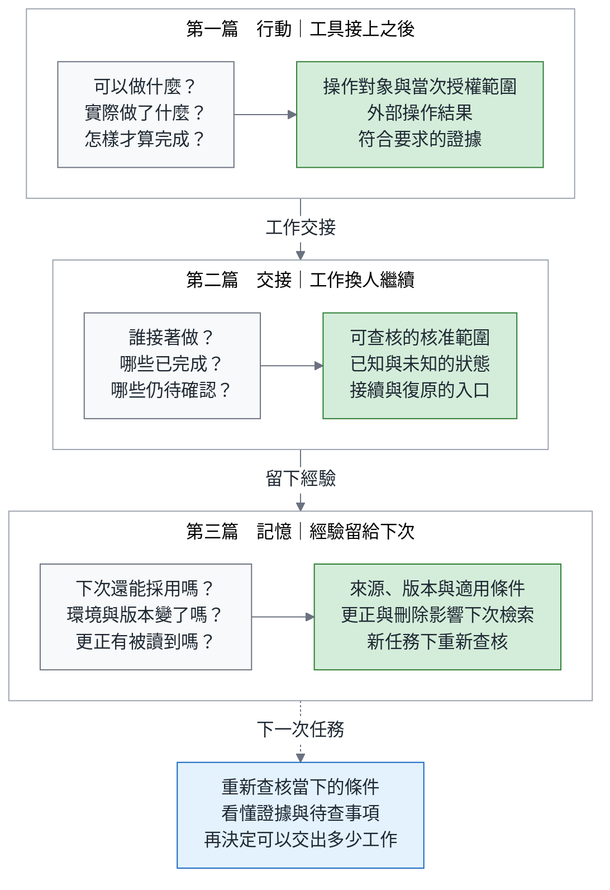
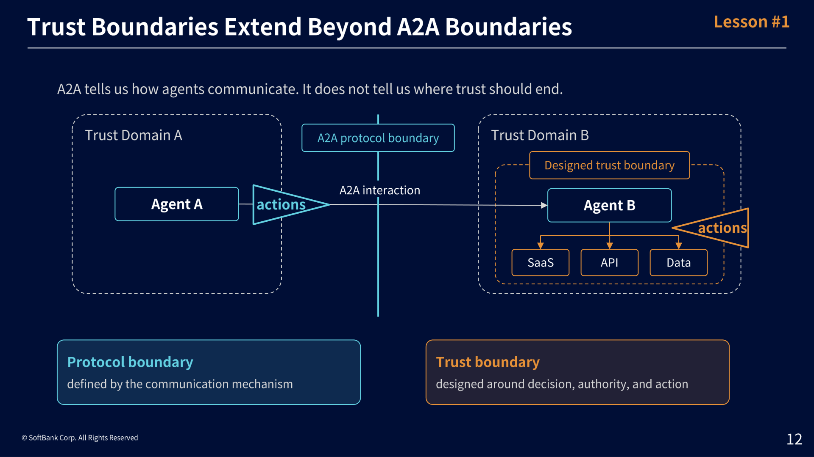
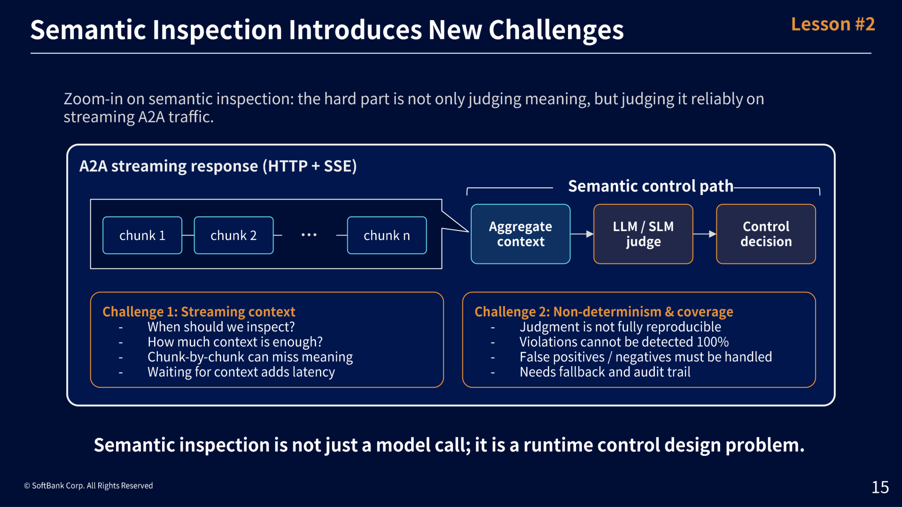
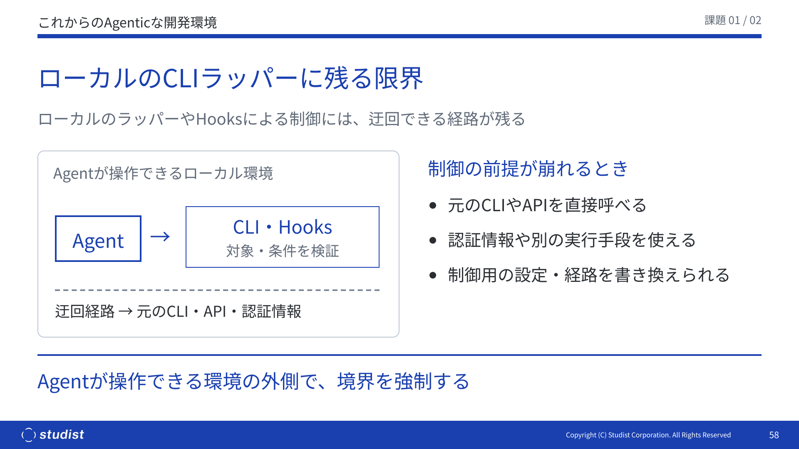
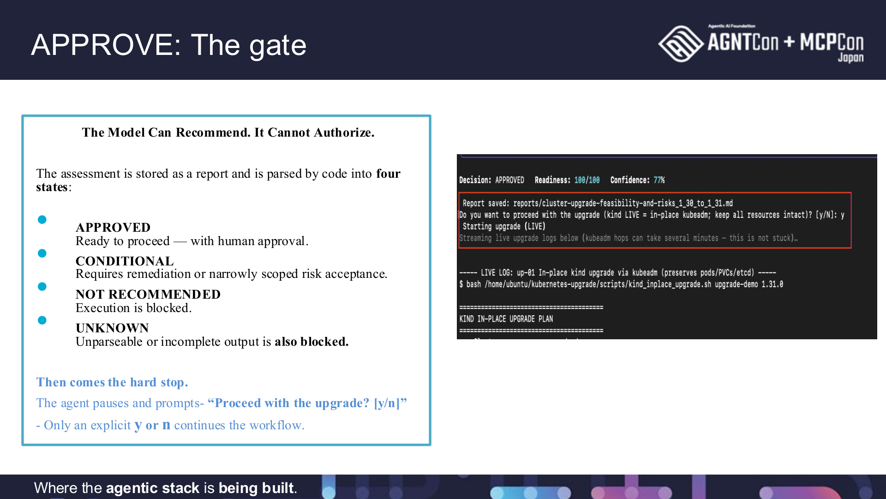
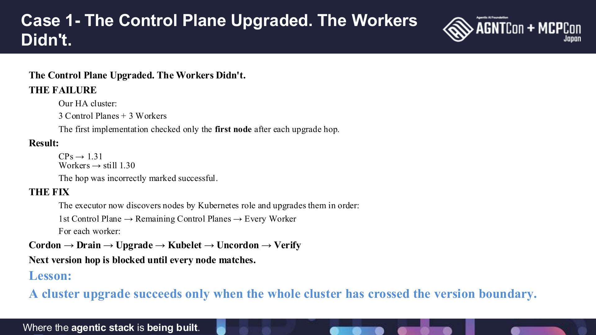
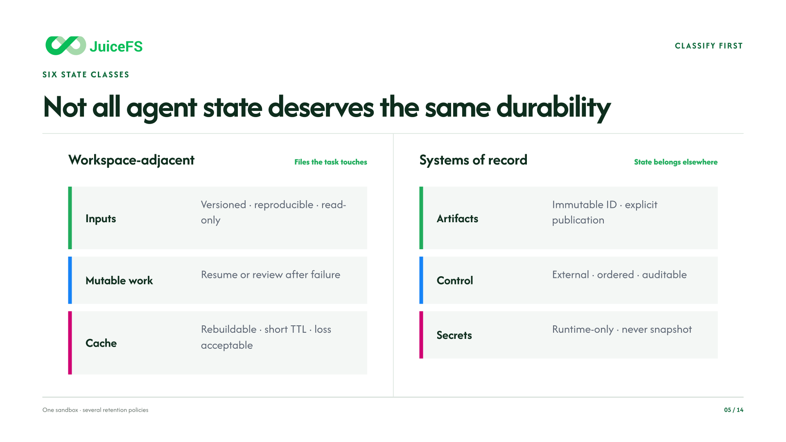
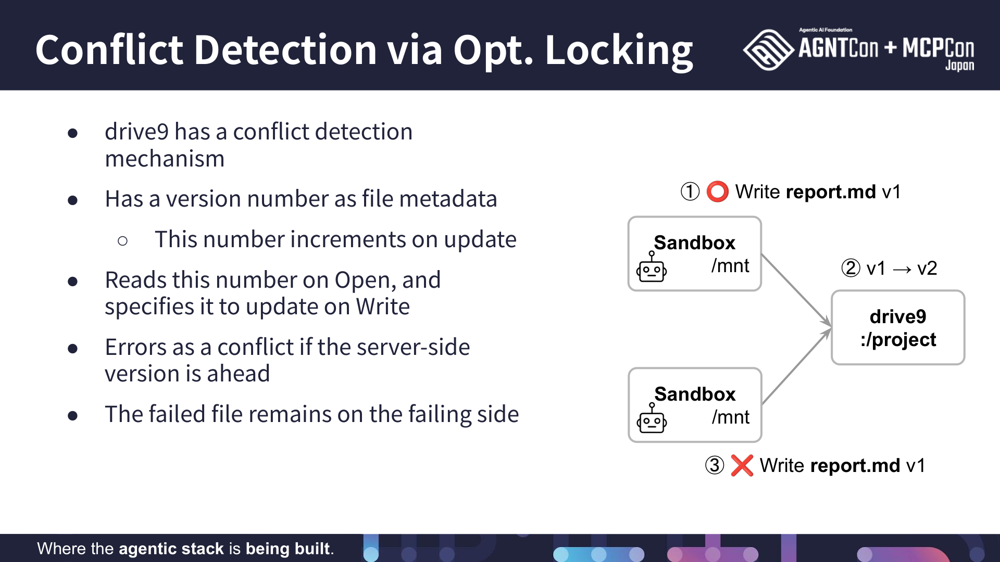
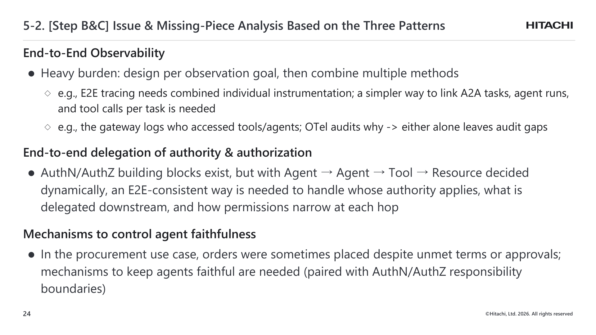

# 把工作交給另一個 Agent 之前：授權、狀態與復原

> **TL;DR** — 當一個 agent 把工作交給另一個 agent，或者工作環境重啟後換一個 agent 接手，前任可能已經中斷，也可能稍後恢復；下一位憑什麼取得接手權，並決定繼續、重做或停止？交接可以帶上前面的對話、工作檔，甚至「已核准」的說法；但傳遞本身不保證它們完整、可信，或現在仍有效。接手者要重查的是：原本核准的範圍現在是否仍有效、此刻誰有權新增操作、遠端系統究竟做到哪裡、還差什麼才算完成。本文用一個假設的 Kubernetes 升級貫穿東京六份簡報，看每一場替接手者補上哪一種證據。我的判斷是：交接要帶著可核對的任務範圍與進度，授權要在行動當下重查，完成要回到外部系統確認。協定讓元件互通，這三件事則由整個系統負責。

> AAIF 東京筆記第二篇。系列：[一、行動〈從東京 AGNTCon 回來：Agent 接上工具之後，工作才剛開始〉](https://medium.com/p/e3d060cb8b03) → **二、交接（本篇）** → 三、記憶〈Agent 記住的經驗，下一次還能相信嗎？〉（即將發布，預定 11 月 16 日）。本文沿用《綠燈不是驗收》的證據觀點：[總論](https://medium.com/p/582f24223eea) → [測試篇](https://medium.com/p/b01055139451) → [Review 篇](https://medium.com/p/ccbf0cbe2691) → [可靠度篇](https://medium.com/p/3c64a9622777) → [付款實作篇](https://medium.com/p/46377fd460fe)。英文版預定於 11 月 11 日發布；來源核對截至 2026-10-25。

這個系列從工具接通開始，沿著工作交接，再走到經驗如何留給下一次任務。每跨過一段，接手的人或 agent 都要重新分清：哪些事已經成立、哪些仍待查，以及目前允許繼續做什麼。下圖是三篇的導覽；本篇各場材料的閱讀地圖放在第二節。

系列總覽：從行動、交接到記憶，讓下一位接手者知道哪些有依據，哪些仍待查。

灰色是各階段的問題，綠色是需要保留的依據，藍色是接手者據此作出的判斷。

---

## 一、會議之前，先去看一眼東京鐵塔

9 月 9 日，AGNTCon + MCPCon Japan 開始的前一天，我先到 Appier 的東京辦公室快閃一下，也看看東京鐵塔；當時在 [Facebook](https://www.facebook.com/kochi.chuang/posts/pfbid02zFBwcpGJPFXyrzD1wMnGZLVBsPAWqHrGGFXFagjLkJ299GyUdXGTQfPpQTgqoQoAl) 寫下「可惜今天的天氣不太好」。[1]

回台北重讀材料時，先讓我停下來的是第一篇那個 Kong 展示留下的問題。保存版操作手冊描述的情境裡，工程師代理先完成建立程式變更提案（pull request，PR）的模擬操作，下一次模型請求才被限流擋下；如果這時換一個 agent 接手，它要怎麼知道做到哪裡、還能不能動？會議第一天午休時，我把 demo 架起來，當天在貼文寫下「governance 跟 agent logic 分離」，意思是 agent 選下一步，外層系統決定請求能不能通過；回台北才發現，把治理分離出來，還沒有回答工作怎麼接續。帶著這個問題，我重新打開當時保留下來的會議分頁：SoftBank 談 agent 之間的信任邊界、Quartic.ai 談讓 agent 升級 Kubernetes，以及 Hitachi 談整合開源 agent 元件的場次。第一次看議程，它們分別屬於安全、維運與架構；把六份簡報並排後，我決定用它們回答同一個交接問題：前任可能中斷，也可能恢復，下一位憑什麼取得接手權，並決定繼續、重做或停止。每一場先有講者自己要面對的限制，我再借它推導交接需要的證據。

這是返台後重讀六份官方簡報的分析，不代表逐場出席，也沒有重跑任何概念驗證（PoC）；來源範圍見文末資料註記。[2]

## 二、交接時，到底交出了什麼？

先用值班交班來想。下班的人留下一張便條：「A 機器已處理，B 還沒。」接班的人真正要問的，其實是四件事：你當時是用誰的權限做的、現在輪到誰接、系統到底走到哪裡、還差什麼才能收工。便條只回答了第三題的一半。Agent 之間的交接也一樣，只是便條變成了對話紀錄與工作目錄。

交接情境先用兩個問題分開。第一個問題：交出控制權，還是只派工作、等結果回來？轉接之後由退款窗口接著服務客戶、原來的人退場，是前者，OpenAI 的建置指南稱為 decentralized pattern；主管派人去查資料、結果回到主管手上，是後者，稱為 manager pattern。[4] OpenAI 的 Agents SDK（開發套件）把前者做成一個工具呼叫：新 agent 預設取得先前的對話紀錄，開發者可以過濾它看到的內容，也可以在交棒前由程式檢查再放行，細節見引註。[3] Anthropic 工程文章介紹了一種偏向後者的子 agent 設計：子 agent 只收到自己那份任務包，看不到主管的全部對話，最後交回一份濃縮摘要。[5] 第二個問題：交接過程有沒有跨出服務邊界，或者遇到重啟？跨服務的委派，就像評估者把後續執行交給另一個團隊維護的執行服務；重啟後重新接手，則是前任的工作環境已經不在，新的 agent 只拿到留下的檔案。兩個問題可以任意組合。SDK 的切換不是跨服務的協定，也不提供持久保存與故障恢復；本文比較的是各種組合共同需要的證據。

把上面這幾種交接放在一起看，交接真正能傳過去的是對話與狀態，有時還是濃縮過的版本。核准紀錄、操作結果與驗收條件也可以跟著傳，但傳遞本身不保證它們完整、可信，或現在仍有效。對話紀錄裡可能寫著「已獲核准」，但那是上一個 agent 的說法。我在《綠燈不是驗收》[Review 篇](https://medium.com/p/ccbf0cbe2691)第六節寫過，PR 描述裡的「已預先核准」要去核准紀錄查，不能從描述讀出來；交接訊息也是同一種輸入。

下面用一個具體任務貫穿全文。Kubernetes 是協調應用程式在一組機器上運作的系統；那一組機器稱為叢集，每一台稱為節點。平台工程師請 agent 評估某個叢集能否從 1.30 升到 1.31。最初交出去的只是評估，不允許改動任何節點。假設評估與修復完成，由人核准了一份計畫，執行 agent 才開始逐台處理。某一步的請求送出後，工作環境重啟；新的 agent 接手目錄，看到前任留下「正在升級」的進度。這是本文串起各場材料的假設案例，不是現場實驗。

刻意讓交接發生在這個時刻，是因為「請求已送出」無法回答接班者最在意的事。工作目錄可能完整保存，答案卻仍不完整。下一個 agent 若只接到「把升級做完」這句指示，就可能拿自己較大的權限補上原任務沒給的授權，也可能把前任的計畫當成已發生的事。還有一個情況要從頭放進來：agent A 只是斷線，agent B 已經接手，A 稍後恢復，兩者都拿著仍有效的核准，誰還能送出下一步？這個問題第七節處理，第九節測試。本文的閱讀地圖如下，六場材料分別讓四件事有可以核對的依據：

| 交班要回答的事 | 交接通常帶過去的 | 接手者仍要重查的 | 哪幾場補上依據 |
|---|---|---|---|
| 用誰的權限、做到哪個範圍 | 「已核准」的說法、憑證 | 核准對應哪個叢集、哪版計畫、是否仍有效 | SoftBank、Studist、Hitachi |
| 此刻誰持有接手權 | 「我接手了」的說法 | 目前持有者的身分與接手版本，前任是否已失去新增操作的資格 | PingCAP、第九節的驗收 |
| 外部系統到底走到哪 | 工作檔裡的進度、最後一筆請求 | 已送出操作的結果、目前節點狀態 | Juicedata、PingCAP |
| 怎樣才算完成 | 前任的計畫與報告 | 所有目標節點與服務本身的驗收 | Quartic.ai |

## 三、允許對話之後，誰能決定下一個行動？

SoftBank 的 Ryuji Iijima 在〈Designing Trust Boundaries for Agent-to-Agent Systems〉從一個概念驗證出發，討論多個 agent 合作時，應在哪裡檢查身分、訊息與允許的行動（[官方議程](https://agntconmcpconjapan26.sched.com/event/2RCwp/designing-trust-boundaries-for-agent-to-agent-systems-lessons-learned-from-a-technical-poc-ryuji-iijima-softbank-corp)、[演講影片](https://www.youtube.com/watch?v=IO6CFh_lRGw)、[公開簡報](https://hosted-files.sched.co/agntconmcpconjapan26/3a/AGNTCon_MCPCon_Japan2026%E7%99%BB%E5%A3%87%E8%B3%87%E6%96%99_SoftBank_Corp_%E9%A3%AF%E5%B3%B6%E7%AB%9C%E5%85%90.pdf)）。這一場回答交班的第一件事：能跟你說話，不等於能用你的權限做事。

簡報以 Agent Firewall 為起點。先用一句話說它檢查什麼：A 可以聯絡 B，但 B 能不能動用自己的帳號做事，仍要另外查；這道防火牆控制的是哪些 agent 能對話，以及對話內容能不能通過。Agent-to-Agent（A2A）協定提供不同 agent 交換任務與訊息的共同方式，像小組成員之間交接工作；Model Context Protocol（MCP）則處理 agent 使用外部工具與資料的介面，像成員各自使用公司的系統。PoC 使用 A2A v0.3，第 6 頁把觀察範圍定在 agent 之間的通訊；MCP 的工具執行、agent 對資料的存取，以及完整的安全營運平台留在範圍之外。分清這幾段路徑，後面的問題才有明確對象。[6]

### 通訊許可要與行動授權分開核對

他的第一課是定義：A2A 只是 agent 的一種互動方式，不是 agent 的定義。他把 agent 定義成「會作決定、也會採取行動」的東西，有些 agent 從不說 A2A，卻一樣能改變外部系統。由這個定義，他進一步指出：A2A 告訴我們 agent 怎麼溝通，沒有告訴我們信任應該在哪裡結束。即使 A 可以對 B 說話，B 仍可能有自己的企業帳號、API 與資料存取權限；一則被允許的訊息，可能接著觸發原本不在 A2A 檢查範圍內的行動。簡報第 11 頁直接問：落在 A2A 範圍外的行動可以信任嗎？他的答案是「當然不行」。[6]

放回升級案例，評估 agent 可以請執行 agent「確認這份計畫是否可行」，但這不代表已經授權它排空節點，也就是讓可移出的應用工作先離開那台機器，以便維護。若執行 agent 持有更大的權限，又把對方傳來的文字當成完整核准，就把「可以聯絡誰」變成了「可以使用誰的全部權力」。問題來自下游替請求補上了原本沒有的權限；光確認兩端身分都真實，還不足以決定是否允許這個行動。

交接因此至少要讓下游找回原始任務、委派者、目標與操作範圍，而且這些條件要能對回可驗證的授權來源。若 agent 可以自己在訊息加上「已獲核准」，下一個服務就照做，增加欄位只是把自然語言的自我宣告換成結構化的自我宣告。權威是查出來的，不是讀出來的；第二節引過的 Review 篇說的是 PR 描述，這裡新增的是核對的位置：放在操作邊界，不是訊息進來的地方。評估結果可以由模型提出，賦予執行權的決定則必須由有權決定的人或系統作出，並在操作邊界核對。這是本文延伸的設計要求。

### 語意檢查還要決定等待、拒絕與交給人的時機

簡報第 13 頁把兩種檢查分開：連線檢查決定 A 能不能對 B 說話，內容檢查決定這段對話該不該繼續。用同一筆請求來看：目標節點在不在核准清單裡，比對就能決定，這是確定性規則；訊息文字有沒有夾帶改變任務的指令，要讀懂意思才知道，這才是語意檢查，也才需要考慮模型判斷。這個順序保留可重現、較低成本的控制，把比較昂貴也不穩定的判斷放在真正需要理解意思的位置。第 16、17 頁的設計原則是「預設用規則，意思需要模型時才用模型」，還加了一句：不要把每一條控制意圖都變成提示，先把它變成規則。[6]

語意檢查為什麼不穩定，可以用讀信來想。訊息一段一段傳來，也就是串流傳輸時，前半句可能在描述一個危險指令，後半句才說「不要執行」；若每個片段立刻獨立判斷，就會誤擋。等更多內容又會增加延遲。第 15 頁把何時彙整、多少脈絡才夠、誤擋與漏擋，以及判斷失敗後怎麼辦，列為同一條控制路徑的問題，並寫明模型的判斷「不完全可重現」、「不能 100% 偵測違規」。

因此我不會只問「有沒有安全模型」。我會問：內容尚未判定時能不能觸發行動；判斷服務逾時後是等待、拒絕還是交給人；以及哪一類錯誤值得承擔哪一種代價。對說明文字的誤擋可能只是造成等待，對未授權排空節點的漏擋則會影響工作負載。這些條件應由服務負責人定義，不能交由模型自己決定多大風險可以接受。

還要分清檢查發生在效果之前還是之後。沿升級案例：如果檢查的是還沒交給執行服務的請求，擋下來就能阻止排空；如果檢查的是操作已經開始後串流回來的回報，擋下回覆也撤銷不了已經發生的排空，這時檢查能做的，是偵測與啟動復原。等待也有代價：判斷完成前，請求佔著連線與時間。我的處置是：語意判斷逾時後，不接受新的排空，「新」以執行服務持久登記的時刻為界，登記前的請求一律算新的；已登記的操作繼續追蹤；檢查後還沒持久登記、核准卻已到期的請求，不再接受。代價是等待與人工介入，由服務負責人決定承擔多少。這是我沿案例的推導；SoftBank 的 PoC 把觀察範圍放在通訊層，沒有驗證完整的操作控制。

SoftBank 的結論是「協定不再是我們需要治理的邊界」：控制範圍從通訊路徑擴大到會作決定的那個主體。接著要問的是，如何把「這次只能做到哪裡」寫成真的會生效的限制。

**交接後真正會改變外部狀態的行動，仍要在操作邊界核對原任務的授權；訊息裡的「已核准」只是查核的起點。**

## 四、把這次任務的界線，變成真的會生效的限制

Studist 的 Masaya Nakamura 在〈Intent as Code〉追問：帳號有權操作某個系統，是否足以界定 agent 這次可以做什麼？他用開源工具示範如何把操作對象與條件寫成程式能檢查的規則（[官方議程](https://agntconmcpconjapan26.sched.com/event/2QlDX/intent-as-code-why-existing-permissions-arent-enough-for-ai-masaya-nakamura-studist)、[公開簡報](https://hosted-files.sched.co/agntconmcpconjapan26/ab/Intent-as-Code%20%2813%29.pdf)）。這一場回答第一件事的另一半：權限有了，這次任務的範圍在哪裡。

他的核心區分可以用門禁卡來想。工程師的卡能開公司所有的門，這次任務卻只需要進一間會議室。帳號能做的事是較大的集合，任務允許的操作通常只佔其中一小部分；他把前者叫 permission（能做什麼），後者叫 intent（這次可以做到哪裡），並指出「能執行的事」超過「這次可以執行的事」正是風險所在。第 33 頁還有一句設計原則：讓模型作非確定性判斷，應該是最後一道防線。[7]

### 把帳號能力縮成這次任務的操作範圍

簡報列了四個風險例子，我挑第三個完整看，因為它能改變後續自動執行的流程。先把幾個詞放回日常：工程師改好程式後先在本機存一個版本（commit），再把它送到遠端的程式庫（push 到 repo）；遠端收到後會自動跑建置與測試，這套自動流程叫持續整合（CI），而 CI 的定義本身也是放在程式庫裡的檔案。能 push 的 agent 因此可以順手改掉 CI 設定，讓 CI 用本身的帳號，以及登入其他系統所需的密碼或 API key（secrets），在這些權限允許的範圍內替它做事：agent 在修程式時，改掉了檢查自己工作的流程。另外三個例子是問題單（issue）的誤編輯與外洩、Terraform 預覽時載入的外部程式，以及網頁裡夾帶的指令，細節見文末資料註記。

他的對策是幾個 CLI 包裝工具，也就是在原本的指令外面再包一層檢查，同一條操作指令送出前先經過它。以下都是投影片上的示範設定：`safe-gh` 把讀取範圍限定在白名單組織；示範中的 issue 編輯規則，則要求目標 issue 屬於指定組織、由自己建立，而且帶有 AI 標記。建立與留言等其他操作，簡報沒有展示；共用帳號時「自己建立」不等於「這個 agent 建立」，AI 建立的 issue 也可能與這次任務無關，所以這些規則先縮小可操作的集合，要限制到「這次任務」仍須另外核對 issue 與任務的關聯。`safe-push` 在 push 之前檢查已提交的檔案，動到 `.github/` 這類 CI 定義時拒絕或要求人工核准，並保留人工 `--force` 的路徑，也限制 remote 目標。路徑檢查保護的是列出的範圍，CI 會載入、卻放在其他路徑的腳本，仍可能改變 CI 行為；要沿依賴路徑檢查才完整，代價是維護與誤擋。`safe-webfetch` 處理網頁讀取，見資料註記。它們的共同方向，是先定義對象、操作與條件，再由程式檢查，讓不符合條件的要求在真正執行前被阻擋。[7]

放回升級案例：評估 agent 可以讀取叢集版本與資源，但不因此獲得排空、修改或刪除節點的權限；工作進到需要改變叢集的階段，執行服務應核對這次獲准的目標、步驟與條件。這不只防範惡意內容；agent 即使好意想完成工作，也可能把「這個改法比較快」誤認為「可以順便做」。

### 強制檢查要放在 agent 無法繞過的位置

不過，限制放在哪裡，決定它能承擔多少責任。Wrapper 是剛才那層包裝，hook 則是在指定時刻插入的檢查。第 58 頁直接指出這類本機控制的界線：如果 agent 還能呼叫原本的 CLI 或 API、取得同一份憑證，甚至改寫限制設定，額外包裝的檢查就可能被繞過。他的結論是把強制控制放在 agent 能操作的環境之外：第 59 頁把需要權限的操作，搬到受管理的遠端執行環境，由那裡驗證對象與條件、使用必要的權限、再把結果回傳；憑證與「能不能執行」的判斷，從 agent 的工作環境分離出去。[7]

這讓我改變了驗收「已加上一個 hook」的方式。應該沿著每條能到達目標的路徑檢查：受限工具拒絕請求後，直接 API 是否還能完成同一個操作？Agent 能否改掉控制檔，再重新呼叫？關鍵不是機器在哪裡，而是三件事：agent 能不能修改政策、能不能拿到底層的憑證、能不能繞過檢查的入口。同一台機器上也可以有 agent 無權修改的控制；遠端服務也可能接受過度寬鬆的請求。

我在 Agentic Engineering 三部曲〈[Harness 藍圖](https://medium.com/p/f2a139f5b561)〉第三、六節已要求 secret 由工具端持有、每次 run（從啟動 agent 到結束的一輪執行）用短效受限的憑證、對外連線預設拒絕、路徑不可繞過；agent 手上只有金鑰代號（reference），工具端收到代號仍會驗證誰有權使用，拿到代號不等於換得到金鑰。本篇新增的是跨 run 的部分：同一任務換了一輪執行之後，既有操作的識別要保持不變，接手身分會改變，舊的 run 失去新增操作的資格。走一次路徑就清楚：agent 交出「處理節點 N」的請求，收請求的入口（gateway）核對任務與對象，工具在一個只開放必要目錄與連線的隔離環境（sandbox）裡執行，需要的金鑰由代為取用的服務（secret broker）在執行當下取得；agent 從頭到尾碰不到自己要遵守的規則，也碰不到金鑰。

以這次升級為例，一個可討論的設計，是讓執行服務接收「依這版計畫處理這台節點」的有限請求，核對計畫與目前條件後，才用自己的受限憑證操作。Agent 不需要拿到可以任意改動整個叢集的憑證。任務規則由誰產生、怎麼對回核准版本也要定：計畫版本與允許的步驟由核准流程寫入執行服務，agent 的請求只能引用，不能自帶；把政策搬到遠端只改變了誰能修改它，沒有自動讓政策正確。代價是執行服務必須明訂支援哪些步驟、怎麼回報錯誤，新增操作也要有人維護。操作介面愈通用，愈可能重新暴露任意執行；愈專用，維護與例外處理就愈多。我會把界線放在「任務裡會重複出現、而且效果可以描述」的操作上，其餘留給人。這個設計換來的，則是可以直接檢查的邊界。這是我的設計建議，不是簡報已交付的 Kubernetes 實作。

### 用允許與越界請求，檢查限制是否生效

驗證時，先送出一筆符合核准的請求，再保持其他條件相同，只把目標換成未核准的節點，或把步驟換成不在計畫裡的操作。符合核准的請求應能繼續，兩種越界請求都應在外部效果發生前被拒絕。這樣才知道限制依據的是任務範圍，而非只認得這個帳號。本機 wrapper 仍能提早提醒常見錯誤，讓開發者少走到失敗路徑；只是當它能被同一個執行者改寫時，最後的強制責任需要由另一個邊界承擔。

這些限制讓工作有了可執行的邊界，但還留下另一個問題：即使操作沒有越權，系統仍可能依據過期的評估去做格式正確的錯事。Kubernetes 場次正好把「能執行」與「現在適合執行」放進同一個流程。

**任務限制是否有效，要看每條可到達外部操作的路徑，是否都會依同一份授權範圍作出允許或拒絕的決定。**

## 五、升級建議、執行核准與完成驗收，需要不同證據

Quartic.ai 的 Sanskar Agrawalla 與 Abhijeet Chaudhuri 在〈Letting an Agent Upgrade Production Kubernetes〉把 agent 放進叢集升級流程，依序討論蒐集資料、評估相容性、取得核准、執行與驗證（[官方議程](https://agntconmcpconjapan26.sched.com/event/2QlD9/letting-an-agent-upgrade-production-kubernetes-without-getting-paged-at-3-am-sanskar-agrawalla-abhijeet-chaudhuri-quarticai)、[公開簡報](https://hosted-files.sched.co/agntconmcpconjapan26/d9/AGNTCon-MCPCon-Japan-2026_Abhijeet_Sanskar_final.pdf)）。這一場回答交班的第四件事：怎樣才算完成，而且是從一次失敗學到的。

先說全貌：在這條升級流程裡，每一步的結論，都不能直接拿來當下一步的證據。接下來一段先交代示範環境與他們列出的五條執行條件。〈評估認為可行，執行仍要核准〉沿著資料蒐集、規則檢查與模型評估，看四種評估狀態怎麼和人類核准分開，途中也用一筆建立工作的請求，說明 API server、admission webhook 與 controller。〈修復之後，重新確認評估與核准〉談核准要綁定哪個叢集、哪版計畫，以及哪些環境變動需要重新核准。〈從全部節點到服務結果，逐層驗收〉從只看第一台節點的失敗，談到工具版本、驗證器與服務驗收，以及核准到期時要分開處理的四件事。交接要多帶哪些證據，集中在後兩個小節。

他們的示範環境是用 kind 建立的本機測試叢集，透過本機的 Ollama 執行模型，簡報第 17 頁寫得很清楚。kind 是在本機建立測試用叢集的工具，Ollama 是在本機執行模型的服務；簡報沒有交代實際的模型版本。[8] 升級本身只是一行指令，難的是指令之前要確認的事：被移除的 API、各種外掛與元件的相容性、備份能不能還原、回滾的條件。他們問的問題很直接：什麼條件成立，才能讓 agent 執行？第 11 頁給了五條：證據優先於意見、機器可讀的決定、不建議就是硬停、不可逆的動作要人核准、完成要獨立驗證。

### 評估認為可行，執行仍要核准

這個案例最值得讀的地方，是它沒有把升級壓成一個大 prompt。第 14 頁的流程先由資料蒐集器收集叢集資料，再做規則檢查，交給模型評估、產生報告；流程能否往下走的檢查點稱為 gate，經過它後才進到修復與執行，最後由驗證元件確認結果。每一步回答不同問題，也限制了前一步的答案能代表什麼。簡報第 13 頁的分工是：agent 決定下一步做什麼，系統決定它被允許做什麼。為什麼還需要模型？規則能查的是已知條件；相容性說明、變更紀錄與供應商公告是非結構化的文字，判斷「這份文件有沒有涵蓋我們的設定」才用得到模型。找不到相容性證據時，模型不能自己補答案，只能回報缺口，這也是後面 UNKNOWN 狀態存在的理由。和完全固定的自動化流程比，模型省下的是人讀文件的時間，代價是它的判斷要被評估狀態與核准框住。

資料蒐集器只能觀察。第 19 頁把 `get`、`version`、`top`、`api-resources`、`cluster-info` 放進唯讀清單，並在函式邊界拒絕修改操作。接著是純 Python 規則，檢查的是會讓升級失敗的已知條件：舊的部署格式在新版不再被接受（已移除的 API）、某版外掛尚不支援目標版本（編成規則的供應商支援矩陣）、不相容的 controller、會擋住流程的 webhook，以及版本差距。用一筆建立工作的請求，來看 webhook 與 controller 這兩個詞：請求先到叢集的收件口（API server）；若它符合已設定的規則，收件口會先呼叫一個外部的檢查服務，這個呼叫點叫 admission webhook；放行之後，由持續把實際狀態調整到設定要求的程式（controller）接手。若請求必須通過那個檢查服務，這個服務又不支援新版本且失敗時設定為拒絕，升級後這類新工作就建不起來；controller 版本不相容時則可能停止調整。升級前要確認這些互相依賴的元件仍能合作。規則輸出的是計數，不是散文；而且「未驗證的相容性視為風險，不視為沒問題」。

第 21 頁把評估結果解析成四種狀態：`APPROVED` 仍需人類核准；`CONDITIONAL` 要先修復，或由人接受明確、有限的風險；`NOT RECOMMENDED` 阻擋執行；資料或輸出無法可靠解讀時是 `UNKNOWN`，同樣不能往下走。投影片的標題是「模型可以建議，它不能授權」。最後還有一個硬停：agent 暫停並問「要繼續升級嗎？」，必須明確回答；y 才執行，n 就停止升級。

圖裡最重要的兩個位置，是「評估通過」後還有一個決定，以及「讀不懂」有自己的出口。《綠燈不是驗收》總論第六節的三道閘，檢查的是測試辨識力、review 與任務可靠度，測試篇也已經要求非預期的失敗不能算通過；這場是同一個原則的另一種應用，把升級 readiness 落實成四種機器可讀的狀態。本篇真正新增的是後面的問題：交接之後，評估、核准與現況怎麼重新對齊。

### 修復之後，重新確認評估與核准

為什麼修復後還要重新評估？因為原來的報告描述的是修復前的叢集。換掉一個過期 API，可能同時改變 controller 的部署方式；原本成立的其他條件，不會因為那一項變綠就自動維持。第 22 頁要求修復後回到評估，而且「沒有繞道，沒有『先繼續再說』」。

例如 webhook 的相容性資料不完整，和已確認 webhook 不支援目標版本，是兩個不同的阻擋理由。前者需要找維護者或取得可驗證的資料，後者要安排修復再重新觀察。若兩者都被縮成一個低信心分數，接手的人就很難知道該補資料還是改系統。保留評估狀態的價值，在於讓下一份工作有方向，人類核准也才能對準具體的方案與剩餘風險。

我會把這個設計再延伸一步：核准紀錄應寫明對應到哪個叢集、哪一版計畫，以及哪份環境觀察。這是我的設計建議，投影片沒有證明已實作完整的核准綁定與時效機制。

核准之後環境還會變，但不是每種變動都要重簽，否則流程會停滯；一律沿用，又會執行過期的計畫。我會把變動分三種。第一種是不影響核准的變動，記錄即可：計畫已預期的狀態轉移，例如某台節點的版本依序到了 1.31；或與原本一致的觀察更新，例如新的健康檢查結果。第二種是仍在預先核准界線內的變動，例如某台目標節點的資源用量在核准寫明的範圍內波動，重跑評估，沿用核准的目標與步驟。第三種是超出界線的變動，例如節點清單或角色改了（像是多了一台節點）、換了 controller、controller 或 webhook 換了版本、agent 重新產生另一份計畫，或目標版本改了；這時核准失效，必須重新核准。

這裡我採用的契約是：核准綁定一份固定的節點識別清單，新增節點就要修訂範圍。另一種做法是核准一個符合明確條件的動態集合，那就要另外限定角色、數量、容量與維護限制，新增節點須證明符合條件。兩種都可以，但不能一面要求核准綁定目標，一面用「同角色」預設擴張目標。所以核准要寫的不只是一份快照，還有可接受的變動條件；下一個操作前由執行服務核對，不由 agent 自述。驗收完成時還要處理一個不一致：核准時的節點清單與目前的節點清單對不上，就不能宣布完成。不能只留下一個 `approved: true`，讓後續任何版本都沿用它。這正是第二節表格第一列要重查的「核准對應哪個叢集、哪版計畫」。

### 從全部節點到服務結果，逐層驗收

核准清單固定後，誰確認執行器沒有漏掉其中一台？第 29 頁坦白記錄一次失敗：初版邏輯只看第一台節點，就把整個叢集當成升級完成。叢集裡有兩種角色：control plane 負責協調叢集，worker 承載應用工作。在三個 control plane、三個 worker 的案例裡，control plane 已到 1.31，worker 還停在 1.30，那一跳卻被標成成功。修正後，執行器依角色找出每一台節點，依序處理，下一個版本步驟要等所有節點都到位才開始。他們的結論是：「叢集升級只有在整個叢集跨過版本邊界時才算成功。」[8]

我在《綠燈不是驗收》[測試篇](https://medium.com/p/b01055139451)第五節借用過這個失敗，說的是檢查器本身要被檢查：只抽樣一部分邊界的檢查會回報綠燈。放回交接，它還多了一層意思。如果執行器漏掉 worker，驗證器又只檢查執行器回報的「我處理過的節點」，兩者就會一起漏掉同一批對象。驗收清單的來源因此很重要：我的驗證設計會從核准時的叢集清單與目標要求建立預期，再獨立查詢每台節點的身分、角色與版本。可以刻意讓一台目標 worker 留在舊版本，其他節點都達標；如果檢查仍宣布完成，就表示它驗證的是已看見的成功。修正後還要保留一個全數達標的正常案例，確認檢查不會因過度保守而永遠無法結束。測試篇說的是檢查器要被檢查；這裡再推一步：驗收清單不得沿用執行器的漏項。

工具本身也會改變結果。第 30 頁記錄，原本要從 1.30 升到 1.31，套件安裝卻拿到升級工具 kubeadm 的 1.32 版，因為套件沒有釘住版本；1.32 的工具拒絕升級 1.30 的 control plane，升級在開始前就停了。修正是釘住每一跳的工具版本、清掉過期的套件來源。他們的教訓是：叢集版本不是唯一要控制的版本，升級工具也要一次只走一個小版本。[8] Kubernetes 自己的規則同樣要求一次只跨一個小版本。[9] 知道剩下哪些節點之後，接手者還要問：手上的工具能不能照原計畫接續？這多出一件要交接的東西：前任用的是哪一版工具、從哪個套件來源取得；拿不到同一版工具，就照不了原計畫繼續。

最後還要分清基礎設施檢查與服務驗收。第 27 頁的驗證器問五個問題：所有節點 Ready 嗎、都在目標版本嗎、API 服務可用嗎、有沒有 Pod 卡在非正常狀態、admission webhook 還在嗎。Pod 是 Kubernetes 管理的應用執行單位；節點顯示 Ready，表示它回報已準備好承接工作。這五題能支持「叢集達到這些技術條件」，但某個業務交易是否仍成功，需要服務自己的驗證。投影片的說法是「指令成功不等於叢集健康」；我會再加一句：叢集健康也不等於服務驗收通過。平台團隊應把叢集證據交給服務負責人，讓兩邊共同決定維護是否結束。核准到期還要分四件事：何時停止接受新操作；已接受的操作是否繼續到完成；什麼時候可以確認結果；維護時段超時由誰處理。到期只關掉第一件，不能抹去到期前合法接受、後來才確認完成的效果。是否必須在時段內完成，是另一條要明訂的契約；這四件事要各自測試。

到這裡，核准、評估與驗收各有了證據。但這些證據在工作環境消失之後，哪些還找得到？第二節刻意安排的就是這個時刻：某一步的請求送出後，前任的環境就不在了，接手的 agent 只拿到目錄，以及裡面那筆「正在升級」的進度。下一場從儲存層回答。

**升級能否結束，要由與目前環境相符的核准範圍、全部目標的完成證據，以及服務本身的驗收共同決定。**

## 六、工作環境重啟後，哪些狀態應該恢復？

Juicedata 的 Rui Su 在〈Stateful Sandboxes for Stateless Agents〉討論一個容易被忽略的問題：agent 的執行環境可以短暫存在，工作檔與成果卻可能需要留給下一次執行（[官方議程](https://agntconmcpconjapan26.sched.com/event/2QlE7/stateful-sandboxes-for-stateless-agents-designing-durable-volumes-for-mcp-tool-workspaces-rui-su-juicedata)、[公開簡報](https://hosted-files.sched.co/agntconmcpconjapan26/4e/Stateful%20Sandboxes%20for%20Stateless%20Agents%20%C2%B7%20designed-r3.pdf)）。這一場回答交班的第三件事：環境消失之後，接手者從哪裡知道做到哪裡。

這場使用的 sandbox，是可以隨任務丟棄的隔離工作環境，像臨時租的工作間：agent 在裡面 checkout 程式、修改、安裝相依套件、跑測試、寫報告，退房時整間清空。隔離與限制是 sandbox 的重點，用完即丟則是這場的生命週期選擇。簡報第 2 頁用這五個工具呼叫說明「agent 是無狀態的，工作不是」：五次呼叫在同一個檔案系統上累積出獨一無二的狀態，測試之後環境沒了，哪些東西必須留下、哪些應該消失？MCP 規範了工具呼叫的格式，沒有規範呼叫背後的工作空間：哪些目錄掛進來、哪些共用、哪些持久保存、故障後怎麼恢復，仍要由平台決定。[10]

### 先分清哪些資料要留、哪些權限要重查

最直覺的做法是把整個目錄保存起來。但第 4 頁提醒「機制不等於意圖」：一個持久的磁碟可以把一個秘密保存太久，卻在錯誤的時間點弄丟一次修改。目錄裡同時有原始輸入、暫存檔、完成品、操作進度與憑證，它們放在相鄰路徑，不代表應該有同一種生命週期。第 5 頁把狀態分成六類，讓「要不要留」變成一組可以討論的選擇。

唯讀且有版本的輸入，讓人知道這次工作從什麼開始；可修改的工作檔，讓中斷後能繼續，也讓人檢查變更；快取即使遺失，通常可以重新產生；成果則需要明確識別與發布步驟，才不會把半成品誤認為已交付。另外兩類更關鍵：控制狀態包括誰核准了什麼、哪個操作開始或結束，簡報主張它應放在外部、有順序且能稽核的紀錄裡；存取憑證等秘密資訊則應在執行時取得，不放進任何快照。

把控制狀態放外部、秘密不進快照，是儲存上的安排，不會自動變成重新授權的流程。這個安排還需要三件事配合，這是我的建議：核准紀錄只能由有權的人或系統寫入；接手時向授權服務查目前的有效條件；查不到就停在待確認，而不是拿舊快照裡的任何東西繼續。外部紀錄也可能過期，甚至被 agent 改寫；「放在外面」不是「可信」的同義詞。做到這些，恢復工作目錄時才會只還原分析所需的材料；權限是否仍有效，則由當下的授權服務決定。這也是本節要提出的設計建議：憑證不該跟著工作目錄過去。下一場的簡報展示了一項可用的能力：不同客戶各有自己的資料範圍（租戶），可以替某個 agent 發一張一小時有效、只允許讀寫 `/repo/docs` 的通行證。[11] 我會用它來設計重新掛載時的換證流程，讓接手者拿到的是短期、受限的存取，不是前任的憑證；簡報沒有展示換證與接手權移轉的整合，這部分是我的建議。

### 本機進度與遠端結果，可能在中斷時分開

放回升級流程，下一個 agent 讀到「節點 A 已處理」的檔案，只得到前一個行程留下的說法。它仍需要對照外部操作紀錄，再查叢集現況。如果重啟前的請求已送出，結果卻還沒寫回本機，重送可能造成重複動作；如果本機先寫了完成，遠端卻還沒成功，跳過又會漏掉工作。儲存空間能保留檔案，但這兩個時間點之間的關係，要由操作流程處理。

光調整寫檔順序也無法消除這個落差，原因是本機寫入與遠端變更各有自己的完成時刻，兩者之間仍可能中斷。恢復時需要查詢已送出的操作與目標狀態，再把查到的結果補回工作進度。這是應用程式的復原責任，不能由「目錄有備份」代替。

### 先定義保存承諾，再選擇故障注入的位置

第 7 頁要求把持久性寫成跨邊界的契約。用遊戲存檔來想：哪個動作才算真的存檔？可以接受丟掉多少進度？多久能回到可以繼續玩的狀態？簡報的版本是三個承諾，分開問。第一，何時算保存（commit point）：已回覆「保存成功」的修改，是在寫入、關檔，還是要求同步落盤的 `fsync` 之後才真的不會遺失。第二，容許丟多少（RPO）：可以遺失多少已確認的工作；這裡我會再分兩種，分析草稿可以重建，已送出的操作識別卻不能遺失，兩者不該共用同一個承諾。落到實際安排：計畫草稿與分析筆記可以留在本機，操作識別與核准引用必須先持久登記才能送出請求，完成的報告要發布到成果區；持久層不可用時，唯讀分析可以繼續，無法安全重送的操作一律停掉，這是設計成本。第三，多久恢復（RTO）：另一個 sandbox 多快能重新掛載並讀到那份修改。三者都不等於遠端操作已完成。接著還有保留期限，以及誰有權還原、分叉、發布或刪除。看到 `fsync` 呼叫，還不能自行推定遠端所有副本都已完成寫入。[10]

這也改變了我會選的測試。第 13 頁說「只量吞吐量，等於沒測持久性」，並列出要注入的故障：殺掉行程看 commit point 與寫入遺失，殺掉 sandbox 看重啟與重新掛載，弄掉節點看從別處恢復要多久，切斷網路看錯誤、重試與並行寫入，而且要確認秘密從不進入快照。我會再加上升級案例特有的切點：在請求送出前、遠端完成後但本機尚未記錄，以及工作檔尚未確認持久化時中斷行程，再檢查恢復後是否查明現況、是否重複執行、是否遺失已承諾保存的資料。這是依簡報方向延伸的測試設計，本文沒有聲稱已實際執行。

當工作同時交給兩個 agent，還要多處理一個問題：兩邊都以為自己拿到最新版時，誰的修改可以留下？這是下一場從並行工作進一步追問的部分。

**恢復工作時，應保留可接續的材料，並重新核對外部操作結果與目前授權，才能決定下一步。**

## 七、檔案沒有被覆寫，工作仍可能互相衝突

PingCAP 的 Tadatoshi Sekiguchi 在〈Externalizing Agent State〉介紹兩種需要跨越執行環境保存的內容：讓 agent 記得過去工作的記憶，以及實際產出的檔案。他以開源的 mem9 與 drive9 說明記憶、檔案儲存和多個工作環境如何配合（[官方議程](https://agntconmcpconjapan26.sched.com/event/2QlEe/externalizing-agent-state-memory-and-filesystem-management-for-sandboxed-coding-agents-tadatoshi-sekiguchi-pingcap)、[公開簡報](https://hosted-files.sched.co/agntconmcpconjapan26/17/EN%20_GNTCon-Japan-2026_PingCAP%20Seki.pdf)）。這一場把交班的第三件事推到兩個人同時接班的情況，也回答第二件事：誰持有接手權。

他的出發點和前一場相同：把 agent 拆成負責讀任務、呼叫工具並繼續下一步的控制程式（他稱為無狀態的 harness，重建後不需要找回本機的使用者資料），和必須另外保存的使用者資料；資料則放進專門的持久層，像傳統應用程式的資料庫。drive9 透過檔案系統介面提供雲端工作區，agent 用一般的 Unix 工具與 git 就能操作；檔案先寫進本機快取，再非同步上傳到遠端。[11]

### 版本檢查保住修改，也保留處理衝突的機會

非同步上傳意味著：agent 看得到本機內容，不等於遠端已收到相同內容；恢復保證必須說清楚等待哪個完成訊號。租戶與短期任務通行證的做法，第六節已經借用；這裡只看檔案本身。

第 23 頁處理的衝突很像兩個人同時編輯同一份共用文件。開啟檔案時讀到版本號碼，寫回時帶著那個版本；如果伺服器上的版本已經前進，就拒絕這次寫入，未能寫回的檔案仍留在本機。這叫 optimistic locking：先容許並行工作，等到提交時才檢查這份修改是否仍建立在同一個起點上。

用升級計畫來看：A 與 B 都從第 7 版開始，A 修正 webhook 相容性並存成第 8 版，B 還根據第 7 版補上 worker 步驟。若接受 B 的整份內容，A 的修改會消失；拒絕 B 的過期寫入，保住了辨識衝突的機會，也暫時保留了 B 的本機修改。但 sandbox 可以消失、上傳又是非同步，拒絕之後要先把衝突副本另存成可持久查詢的成果，確認保存成功才清理環境，否則 B 的修改仍可能遺失。接著，B 還得把 worker 步驟與新的 webhook 條件一起檢查。版本號碼只知道起點已改變，無法判斷兩份計畫能不能共同成立；自動重讀、再原樣覆寫，可能把剛被保護的修改重新抹掉。衝突處理應保留兩邊的理由與差異，再決定合併、重做或交給人判斷。

並行探索值得付這筆合併與重新驗證的代價，前提是分支真的要同時改同一份東西；只是讀的工作不必分支。共用的修改容易衝突，能不能先隔離探索？簡報用 copy-on-write 建立的「層」回答：兩個分支從同一份起始檔案出發，各自修改、互不影響，最後提交回主線或丟棄，適合 agent 的探索與試錯。這種分層隔離的是檔案：外部操作、憑證與網路效果不會因此隔離。

### 檔案各自正確，合起來仍可能違反任務要求

不同檔案還可能沒有版本衝突，卻有工作衝突。假設計畫要求同一時間只處理一台 worker，A 與 B 分別修改自己的工作檔，各自決定開始處理不同的 worker。每份檔案都從最新版寫入，合起來卻違反了同時操作的限制。這個例子是本文的延伸分析：檔案版本保護的是一份內容的更新，任務要求關心的則是兩個行動合在一起造成的效果。

這時可以讓執行服務發維護名額：有副作用的步驟先取得名額才開始，確認操作結束才釋放，唯讀評估不用名額、繼續並行。如此不必為了避免操作衝突，把整段長時間分析都鎖住。名額的範圍要說清楚：一台節點一個名額、整個叢集一個名額，還是依共用容量發？整個叢集只有一個名額最簡單，卻可能不必要地拖慢進度；範圍太小又保不住任務條件。這個案例的要求是同一時間只處理一台 worker，名額就只有一個，而且由執行服務發放與回收，不是兩邊各自讀一個數字。負責指定接手者的協調者（不是執行服務）自己故障時，已接受的操作要繼續追蹤，新的操作則停在待確認。

用名額讓操作依序執行，還沒回答另一個問題：A 只是斷線、稍後恢復，B 已經接手，兩者都持有仍有效的任務核准，誰還能送出下一步？執行服務必須知道目前的接手者是誰，而且要有人有權指定。做法是把接手當成一筆由受信任的協調者或有權的人更新的紀錄：任務、目前持有者的執行身分（這一輪 run 的身分）、接手版本、操作範圍，四項一起更新；更新與請求的接受要有一致的先後順序。接手版本不是誰讀到都能用的號碼，它綁定持有者的身分：請求要同時帶著版本與身分，執行服務核對兩者都對得上目前紀錄才接受。所以 A 恢復後即使舊憑證還沒到期，也因為已不是目前持有者而被拒絕；A 讀到最新版本再送，同樣過不了身分核對。要測的競態有三種：A 延遲抵達的舊請求、A 用最新版本冒充接手者、B 與 C 同時要求接手。只檢查姓名或帳號處理不了這些。已被接受的操作則繼續追蹤結果。查核授權與防止兩個接手者同時行動，是兩個不同的要求；少了後者，交接只是傳了資料，沒有轉移執行責任。這是本文的延伸分析。已送出的請求若結果未知，仍需操作識別與結果查詢，不能因為檔案衝突已解決，就假設外部工作也已接續完成。

### 記憶幫忙找回脈絡，核准仍須回查

mem9 的記憶則是另一個時效問題：被整理成「工程師已同意升級」的記憶，只能幫忙找到當時的核准來源，不能取代仍有效的核准紀錄，這部分留到第三篇展開。[11]

到這裡，授權、接手權、狀態與完成的查核散在不同的元件裡。元件各自有安全功能，合起來的業務流程卻可能漏掉一項條件；下一場就從一次「條件沒滿足仍下單」的觀察開始。

**檔案版本保護修改，記憶幫助找回脈絡，而能否繼續行動仍須依任務範圍與目前狀態判斷。**

## 八、元件都接上了，整個流程由誰負責？

Hitachi 的 Tatsuya Sato 與 Satoshi Ito 在〈What's Missing in the Open Agentic Stack〉用採購流程比較不同開源元件的整合方式，討論 agent 通訊、工作分派、身分驗證與觀測如何接在一起，以及接好之後仍由誰維護（[官方議程](https://agntconmcpconjapan26.sched.com/event/2QlEG/whats-missing-in-the-open-agentic-stack-lessons-from-oss-integration-tatsuya-sato-satoshi-ito-hitachi-ltd)、[公開簡報](https://hosted-files.sched.co/agntconmcpconjapan26/bf/20260910_AGNTCon_Japan_Hitachi_Ito_Sato_public.pdf)）。這一場把前面拆開的四件事重新放回同一條工作路徑。

採購案例的步驟很清楚：需求、預算、合規、核准與訂購各有自己的 agent 與系統，預期規則是「只有在所有條件與人類核准完成後才下單」；但他們在第 24 頁記下，示範中曾出現條件或核准尚未滿足卻已下單的情況。用他們的詞來說，一張採購委託是一個 task，每次啟動 agent 處理它是一次 run，查價或下單是其中的 tool call。簡報的技術整理以 2026 年 8 月 20 日為時間點，應當作當時的參考實作比較，而非一直有效的產品排名。[12]

### 三種整合方式，分別把維護責任放在哪裡？

第一種方式直接串接 A2A 與 MCP：agent 的位址由應用程式維護成一份靜態清單，agent 之間與 agent 對工具都直接連線，再用 Keycloak 的 token exchange 把使用者的權限往下游傳，就像採購角色拿自己的證件，換一張目標系統接受的通行證（Keycloak 負責身分與存取管理）；通行證的權限有沒有縮小，要另外配置與驗證，持有通行證也不等於這張訂單已核准。這種選擇讓團隊掌握較多細節，也讓團隊負責把細節接起來。

第二種方式使用 AGNTCY 的共同設施，分別回答四個問題：找誰、它能做什麼、怎麼傳話、做過什麼（元件名稱見資料註記），讓團隊少寫一些各自獨有的整合程式。簡報提醒，agent 的身分證明不等於使用者的委派：知道接手者是誰，與知道它這次可以代表使用者花多少錢，是兩個需要不同證據的問題。

第三種方式用 agentgateway 把連線、驗證與觀測集中到共同入口。第 20 頁說，gateway 改寫並分發 agent 的位址，呼叫端不用改程式；穿過 gateway 的追蹤、log 與指標不用改 agent 就能收集；它也在入口驗證存取憑證的來源與適用對象，據此控制對 agent 與 MCP server 的存取。入口驗得了憑證，仍不知道這次任務核准了什麼。代價寫在第 23 頁：gateway 之外沒有控制，agent 內部怎麼推進工作看不到。

我在〈[Harness 藍圖](https://medium.com/p/f2a139f5b561)〉第三節建議第一版 MCP gateway 從工具清冊（registry）、授權檢查、受限憑證的取得處（identity broker）與操作紀錄（audit log）開始。Hitachi 的第三種方式在集中入口的位置上與它相近，但端到端的使用者委派仍是缺口，第 20 頁明列這部分要自己建。少的那份資料是「這次任務核准了什麼」；該取得並強制檢查它的元件，是執行操作的那一端，不是只驗憑證的入口。若把三種方式當成選型材料，我會先看團隊要接手哪一段維護：對象少、端點固定時，直接整合讓必要路徑保持清楚，但連線與觀測程式要自己維護；agent 經常增加或更換時，發現與描述機制才直接回應問題；多個團隊需要共用存取政策時，集中入口才有維護上的理由。選型表還要直接回答三題：哪個元件讀核准、哪個元件拒絕下單、哪個團隊維護條件；連線方便與否回答不了這三題。共用入口也集中了故障與政策錯誤的影響：入口不可用時，唯讀查詢可以等，變更操作要停，兩者應有不同處置。這是我由比較推導的選擇條件，不能把簡報中的架構名稱直接排成優劣。

### 共同元件仍需接上業務條件的檢查

三者共同留下的是業務條件的責任。第 24 頁列了三個缺口。第一，端到端的觀測很重，gateway 記錄「誰存取了什麼」，OpenTelemetry（一套記錄程式執行過程的標準）記錄「為什麼」，這是投影片的概括：要重建一筆採購從委託、agent 處理到下單服務的時間線，每一段都要先埋好紀錄點並能互相關聯；而且時間線只證明發生順序，不證明核准。投影片的結論是：gateway 與 OpenTelemetry 的紀錄，單靠哪一份都會留下稽核空白。第二，端到端的委派與授權沒有一致做法：Agent → Agent → Tool → Resource 的路徑動態決定時，該用誰的權限、往下游委派什麼、每一跳如何縮小權限，都還要團隊自己建。第三是開頭那個觀察：條件或核准尚未滿足卻已下單。[12]

簡報沒有提供足以計算失敗率的次數與分母，我不會把這次觀察擴大成所有相關實作都會失敗。但這個例子足以推翻「每個元件都有安全功能，因此整個流程一定遵守核准」的推論。採購核准可能限定金額、品項與期限，升級核准可能限定叢集與步驟；連線元件若沒有取得並核對這些資訊，就無從知道眼前這筆格式合法的請求是否超出任務。選型因此要包含「誰實作這段檢查、資料從哪裡來」。再問一層：下單的必要條件既然已知，為什麼還讓模型決定能不能下單？把條件放進訂購服務的確定性狀態轉移，條件不齊就不會進入可下單的狀態，agent 只負責蒐集資料與處理例外；代價是這些業務規則要有人維護。

### 讓 task、run 與 tool call 對回同一份授權

一次委託可能經過重試與交接，所以 task、run 與 tool call 三層的關聯要保留。我會沿著那次訂購往回問：是哪個 task 觸發哪次 run，哪次 run 發出哪個 tool call，當時依據哪一份核准？這些識別需要互相關聯，才能找到要求在哪一步被遺漏。但紀錄完整仍只讓事後調查比較容易；要防止再發生，執行訂購的邊界必須在送出前檢查必要條件，並在檢查未通過時阻止動作。紀錄查得到人，也還不等於有人接案。我在 Agentic Engineering 三部曲〈[組織篇](https://medium.com/p/9d9353ef7f3a)〉第二節的責任分工表（RACI）把共用環境與權限交給平台，domain 的 MCP 工具、產品品質，以及上線後的品質與事故責任（production ownership），交給負責該產品的團隊（domain team）。放到交接上：平台維護共用的操作識別與執行協調機制，domain team 負責具體操作的語意、狀態查詢與補救契約，服務負責人定義業務驗收與可接受的風險；逾時未明的結果由值班者承接，但最終由服務負責人決定恢復、停止或另提補救操作。

採購如此，升級也一樣。第三節的信任邊界、第四節的任務限制與第五節的核准綁定，在這裡接成同一條鏈；第七節的接手版本補上最後一環：每個 tool call 不只對回一份核准，也對回目前的接手版本，前任晚到的請求因此找不到可以掛上的位置。

**元件接通後，系統仍須在每次外部行動前核對任務與核准，並留下可追查到負責人的紀錄。**

## 九、如果現在由我驗收，會從一次中斷的交接開始

第八節把責任鏈串起來之後，就能用一次中斷的交接檢查整條鏈。對我最有用的驗收問題是：**前任不在場，或者前任又回來了，下一個接手者還能作出有根據的決定嗎？** 我會先在可丟棄的測試環境裡，只驗收一種有限操作。以下是依這些簡報提出的測試設計，沒有實際執行的結果；它也不是一份可以直接操作生產叢集的升級手冊。

整份設計分三步，也是下面三個小節的順序。〈先定義操作與證據契約〉交代平台負責人動手前要寫好的叢集、計畫版本、允許的步驟與核准條件，說明執行服務對操作識別的最小契約，把「升級節點 N」拆成排空、升級、恢復接受工作三個子步驟，最後填出一份交接紀錄。〈中斷後如何判斷下一步〉把中斷安排在不同的切點，從遠端已完成卻沒有回覆、排空完成但升級失敗，到執行服務自己重啟與請求尚未送出，看接手者怎麼依查到的狀態決定繼續、修復或停止，最後再改變核准條件，並讓前任在別人接手後回來送出一步。〈哪些結果支持開放操作〉把九種情境排成一張表，逐列寫出可接受的行為與依據，再談這條交接路徑的人力成本，以及星期一的工作怎麼分給三個角色。要對照九種情境各自的預期行為，可以先看那張表。

### 先定義操作與證據契約

開始前，由平台負責人寫下指定叢集、計畫版本、允許的步驟與核准條件，並定義這一步成功後能在目標系統查到什麼。測試裝置要獨立記錄收到的操作、識別與實際效果，留給驗收者核對 agent 的說法；接手的 agent 只能使用執行服務正常提供的查詢介面，不能讀取測試裝置私下記錄的故障時刻。先執行一次沒有中斷的正常流程，確認被允許的工作確實能完成；否則一個把所有變更都拒絕的系統，也會在故障案例裡看起來很安全。

這個設計要求執行服務接受預先產生的操作識別，讓呼叫端在送出請求前持久保存它。操作識別本身解決不了副作用與紀錄之間的中斷，所以採用前要先確認服務的最小契約：同一個識別對應固定的參數，帶著不同節點或計畫再送就拒絕；查詢能分辨未接受、執行中、完成、失敗與無法判定五種狀態；紀錄保存多久、服務自己重啟後還認不認得，都要寫明。這些是採用前提，不能躲在「服務承諾」四個字後面。

再指定這一步是什麼操作；本文只測一台 worker 的「升級節點 N」，它分成三個子步驟：排空工作負載（`kubectl drain`）、升級（`kubeadm upgrade node`，接著更新並重啟 kubelet）、恢復接受工作（`kubectl uncordon`），每一步的重送契約不同。排空的正常效果是節點上的工作負載被移走；再送一次時，節點可能已經是空的，也可能因為前任已經恢復接受工作而再次驅逐。官方文件只替 `kubeadm upgrade` 說明可以重跑，kubelet 更新與重啟的重送語意要另外確認；恢復接受工作則是把節點重新開放。[9] 所以驗收不數呼叫次數，而是觀察效果：有沒有出現未獲准的驅逐或維護動作、服務中斷有沒有超出允許範圍、節點最後有沒有到 1.31，並用操作識別與節點狀態對照。若測試環境刻意要求恰好一次排空，那是這個固定環境的約定，不是 Kubernetes 的普遍規則。

交接時帶過去的紀錄也要先填出來，否則讀者還是得自己把全文翻成介面。以這次測試為例，全部是假設資料；每個欄位都註明誰可以寫入：

| 欄位 | 內容 | 誰寫入 |
|---|---|---|
| 任務與目標 | T-31，叢集 prod-a，計畫版本 v8 | 核准流程 |
| 核准來源與失效條件 | 變更單 CR-204；維護時段結束即失效 | 變更系統 |
| 目前持有者與接手版本 | 執行身分 run-B，接手版本 h2 | 執行服務，由協調者更新 |
| 操作與子步驟 | op-17：drain op-17.1 完成；upgrade op-17.2 執行中；uncordon op-17.3 未接受 | 執行服務 |
| 已確認效果／未知結果 | drain 完成／upgrade 結果未知 | 執行服務，依查詢結果寫入 |
| 查詢入口 | `/operations/op-17` 看整體，`/operations/op-17.2` 看子步驟 | 執行服務 |
| 允許的下一步 | 查詢與回報；不含新的變更 | 核准流程 |
| 接案人與期限 | 值班工程師；維護時段結束前 | 依事故政策指定的寫入者 |

Agent 只能讀這份紀錄。「只准查詢」要升級成「准許下一步」，依據是執行服務查到的子步驟狀態加上仍有效的核准：op-17.2 查到完成且節點健康，才由核准流程把允許的下一步改成 uncordon。

### 中斷後如何判斷下一步

接著讓整個「升級節點 N」在目標系統完成，卻不把結果交回 agent，就中斷它的工作環境。新的 agent 只拿到已保存的輸入、計畫、工作檔與操作識別；憑證重新取得，目前核准重新查詢，接手版本更新。這個切點值得測，是因為遠端已發生效果，本機卻沒有收到成功回應；最直覺的「從最後一行重跑」，在這個操作上可能多一次驅逐。預期行為應是先查已送出的操作與目標狀態，確認結果符合這一步的要求後，接續尚未完成的工作。驗收時要比較外部紀錄：是否多發出一個被當成新工作的變更、是否錯把整個叢集標為完成，以及接手報告是否指出查過哪些資料。

真正困難的切點在中間：排空已完成，升級失敗，節點仍不能接受工作，而維護時段快結束了。接手者查到的狀態是「drain 完成、upgrade 失敗、節點仍停止排程」，但「升級失敗」不代表節點完整停在舊版本，更不代表它適合承載工作。補救要依查到的狀態分三種，每一種都要對回核准：確認升級沒有改動節點、節點也健康，版本仍是 1.30、kubelet 正常、容量足夠，可以恢復接受工作、留在舊版本，並把這台節點標成未完成；節點已部分修改，依已核准的程序修復，例如在維護時段內重試升級；狀態不明或不健康，維持隔離，交人處理。核准失效之後，補救所需的新操作都不能再由 agent 自行送出，只能交給接案人決定。接案人要知道的是：這台節點現在承載不了工作、影響多大，以及誰在維護時段外有權處理。這些要寫在交接紀錄的「允許的下一步」裡，不能只寫「停止相依步驟」。

還有一個切點要測執行服務本身：只中斷 agent，驗不到服務遺失操作紀錄後會不會重複造成效果。「接受」要先拆開：收到請求、持久登記、回覆接受、產生效果、保存結果，五個時點各自可以中斷。契約是回覆接受之前必須已經持久登記。所以在收到請求之後、持久登記之前重啟，正確結果是查無此識別且沒有效果；在回覆接受之後重啟，查詢必須找得到紀錄。若服務回覆了接受卻查不到，它違反的是自己的承諾，不是正常復原。

再把中斷移到請求真正送出之前。驗收者知道這次沒有操作發生，接手者卻不能直接使用這個答案。它必須查詢已保存的識別，並依執行服務的契約解讀回覆：「查不到」可能表示尚未執行，也可能只是紀錄尚未可見或已超過保留期限。只有查詢能確定未執行，或服務承諾以同一識別重送不會新增第二次效果時，才有理由在重新核對現況與授權後送出。

「遠端已完成但回覆遺失」與「請求尚未送出」這兩個案例的本機摘要可以很相似，遠端事實卻不同。測試若只檢查「恢復後任務最後成功」，就分不出接手者是查明情況，還是碰巧重跑也沒有出事。我在《綠燈不是驗收》[付款實作篇](https://medium.com/p/46377fd460fe)用買一瓶綠茶說過：付款畫面卡住後再送一次同一筆請求，應取回原本的結果，而不是多扣一次款；這種「同一個操作、相同參數、在保留期限內重送不會新增效果」的性質叫冪等性（idempotency）。那篇的程式只實作同一行程裡依序重送，待驗證的跨重啟問題已經列在它的第九節；本篇新增的是接手者更換，和一個多階段的基礎設施操作。若工具沒有可查詢的識別，也沒有已定義的安全重送方式，就應保留人工查核的交接路徑。

確認接手者能依這些證據決定繼續或停止後，再改變核准條件：讓新版本取代原計畫，或讓核准的維護時段結束。保留舊檔案應該有助於恢復分析，卻不能讓失效的核准重新生效。憑證到期則另外測：重新取得憑證只能恢復目前仍獲准的存取，不能替任務增加授權。接手權也要測：讓前任在 B 接手後恢復並送出一步，它應因接手版本過期被拒絕；前任延遲抵達的舊請求也一樣。另以 control plane 已達標、worker 尚未完成的狀態，檢查驗證器，確認它會如實留下待辦。

### 哪些結果支持開放操作

這份驗收的預期，分別來自任務約束、執行服務對重送的承諾，以及平台與服務負責人定義的完成條件。格式沿用《同一份規格，跑十次》契約篇義務表（即將發布）的想法，逐項交代依據；先讀第三列，看排空完成、升級失敗時，接手者能做什麼、驗收者查什麼、依據是哪份核准。全部是設計範例：

| 情境 | 接手者可接受的行為 | 驗收者查什麼 | 依據來源／仍未證明 |
|---|---|---|---|
| 正常、核准有效 | 完成指定的有限操作 | 正確目標、效果與完成條件 | 計畫 v8 的核准紀錄／服務驗收另測 |
| 遠端完成、回覆遺失 | 查明結果後接續 | 沒有新增未獲准的驅逐或維護動作 | 執行服務的查詢契約／服務重啟後的紀錄 |
| 排空完成、升級失敗 | 依查到的狀態三選一：確認升級未改動節點且健康才恢復排程、部分修改依核准程序修復、不明或不健康則維持隔離交人 | 版本、健康與容量證據，補救是否對回核准 | 核准的失效條件／維護時段外的授權 |
| 請求尚未送出 | 依服務契約決定送出或停止 | 沒有把「查不到」直接當成未執行 | 紀錄保留期限／逾期後的重送語意 |
| 結果暫時無法查詢 | 停止相依步驟並交接 | 指定接案人、查詢入口與期限 | 接案規則／可容許的等待時間 |
| 計畫改版或核准失效 | 阻止不再獲准的新步驟 | 舊檔沒有恢復舊權限 | 變更系統／核准與節點清單的對應 |
| 前任恢復、兩者同時行動 | 拒絕前任新增的步驟 | 接手版本與請求接受的先後一致 | 執行服務／延遲抵達的舊請求 |
| 同一識別帶不同參數 | 拒絕不一致的請求 | 沒有沿用其他目標的結果 | 操作識別契約／參數比對的範圍 |
| worker 尚未完成 | 留下待辦，不宣布整體完成 | 預期清單獨立於執行器回報 | 核准時的節點清單／服務本身的驗收 |

安全停止本身不等於團隊負擔可接受。未知結果能留多久、由誰接案、持續查不到時怎麼避免工作永久擱置，都要有答案；主管要看的是待確認案件數、等待時間與人工查核工時，這些數字決定這條交接路徑值不值得開放。星期一的工作可以直接分給三個角色：平台的 Staff 工程師寫一份單一步驟的契約，明訂接受時刻、操作識別、接手者身分、查詢與重送語意；QA 與 SRE 對同一步驟安排四種切點（送出前、效果後回覆前、服務重啟、舊接手者恢復），並保存外部效果紀錄；服務負責人決定可承受的待確認時間與人工處理量，超出就縮小自動化範圍。若結果只支持唯讀評估，就先交付能節省資料蒐集時間的評估；若一種有限變更已能正確中斷、查詢與接續，再開放那一種操作。這些案例是擴張授權前必要的驗證項目，但不能單獨支持擴權：可靠度篇第五節的 G2 閘門看的是任務集合、重複表現、觀察期間與複核人力，〈[Eval、單位經濟與規模化](https://medium.com/p/d6d9623c2dc6)〉第五節又把「擴大給更多團隊使用」與「授權高風險操作」分開。「某種恢復行為符合契約」與「團隊已準備承擔更多操作」，是兩個決定。

這套驗收能告訴我們系統在中斷時會不會做錯事；它還沒說明的是，這些安排對真正接手的同事代表什麼。

## 十、結語：留下來的工作，要讓下一個人敢接

六份材料改變的是我對交接的理解：同一份資料交給下一個 agent，並不表示權限、外部事實、完成條件與接手權也已經交過去。

最容易低估的成本，是讓接班的人重建已經做過的工作。工作檔還在，卻不知道哪份計畫獲准；報告寫著完成，卻找不到節點的觀察結果；憑證仍然可用，卻不清楚當初只核准評估還是也允許變更。這些缺口會把自動化節省的時間，轉成下一個人的查核時間。若在維護時段裡才發現，對方還得一邊確認服務狀態，一邊猜前任做過什麼。

一份好的交接因此可以明確停在尚未完成：保留已完成效果的紀錄、仍待確認的結果、原有核准、目前的接手版本與下一個查詢入口，讓接案的人知道從哪裡接續、多久內要處理。下一篇要問的是再往後一步：任務結束了，留下來的經驗交給下一次任務時，哪些還能相信。

我會先挑一個同事經常需要接手的小任務，讓它經歷一次有意安排的中斷，把恢復時找不到的證據逐項補齊，並寫明逾時未明的結果由誰承接、多久內處理、由誰決定恢復或停止。回到第一篇那個被限流擋下的 Kong 展示：換一個 agent 接手時，對話之外，它還需要已完成的模擬操作紀錄、一份目前仍有效的核准範圍，和一個能查結果的入口；展示裡的角色群組權限不是任務核准紀錄。能保存並查核這份紀錄，是可復原的系統還要增加的能力。東京之後值得繼續累積的，就是這些別人能檢查、修正，再交給下一個人的工作。

### 系列文章

- [第一篇：從東京 AGNTCon 回來：Agent 接上工具之後，工作才剛開始](https://medium.com/p/e3d060cb8b03)：參會故事、Kong 實作與八場材料的深入分析。
- **本篇：把工作交給另一個 Agent 之前：授權、狀態與復原。**
- 第三篇〈Agent 記住的經驗，下一次還能相信嗎？〉預定於 2026-11-16 發布，追問記憶的來源、適用條件，以及更正如何進入下一次任務。

### 延伸閱讀：本文接回的幾篇

- [Review 篇](https://medium.com/p/ccbf0cbe2691)第六節：「權威是查出來的，不是讀出來的」；本文第三節把核對的位置推到操作邊界。
- [Harness 藍圖](https://medium.com/p/f2a139f5b561)（Agentic Engineering 三部曲第二篇）第三、六節：MCP gateway 的最小架構，以及 secret、短效憑證與 egress 的 guardrails。
- [測試篇](https://medium.com/p/b01055139451)第五節：Quartic.ai 的失敗如何提醒「檢查器本身也要被檢查」；本文第五節再推到驗收清單不得沿用執行器的漏項。
- [付款實作篇](https://medium.com/p/46377fd460fe)第九節：已列出跨重啟、provider 查詢契約與識別保存期限的待驗證問題；本文第九節把它們具體化成接手權移轉與多階段操作。
- [可靠度篇](https://medium.com/p/3c64a9622777)第五節：擴張授權的 G2 閘門；本文第九節的案例是它的必要驗證項目，不是通過條件。
- [組織篇](https://medium.com/p/9d9353ef7f3a)（Agentic Engineering 三部曲第一篇）第二節：平台、champion 與 domain team 的 RACI；本文第八節的接案分工由此延伸。
- 《同一份規格，跑十次》契約篇第九節的義務表（即將發布）：本文第九節的交接驗收表沿用它逐項交代依據的想法，欄位依交接情境精簡。

### References

1. 筆者旅途紀錄 — [快閃公司東京辦公室](https://www.facebook.com/kochi.chuang/posts/pfbid02zFBwcpGJPFXyrzD1wMnGZLVBsPAWqHrGGFXFagjLkJ299GyUdXGTQfPpQTgqoQoAl)、[東京鐵塔雨夜](https://www.facebook.com/kochi.chuang/posts/pfbid02Dgd6AUhyb7kgBcPqM1QQJFjyuCnsPMtGADCd88zsWPwa8VXpBkxQ1sTQ2zN5PmyHl)，2026-09-09。開場與結尾的照片，以及當日的天氣敘述，取自這兩則貼文。〔第一、十節〕
2. Linux Foundation／AAIF — [AGNTCon + MCPCon Japan 2026 公開議程與附件](https://agntconmcpconjapan26.sched.com/list/descriptions)，2026-10-25 核對。本文選用六個場次的簡報；瀏覽器保存分頁只用來找回材料。〔第一節〕
3. OpenAI — [Agents SDK：Handoffs](https://openai.github.io/openai-agents-python/handoffs/)：handoff 以工具呈現、新 agent 預設看到完整對話歷史、input filter，以及授權檢查應放在交接回呼；文件另提醒 handoff 是否啟用的檢查發生在模型填入參數之前，依參數決定的授權判斷因此要放在回呼裡。2026-10-25 查閱的線上版本。〔第二節〕
4. OpenAI — [A practical guide to building agents](https://cdn.openai.com/business-guides-and-resources/a-practical-guide-to-building-agents.pdf)：manager 與 decentralized 兩種多 agent 模式，handoff 是單向的執行控制權轉移。〔第二節〕
5. Anthropic — [Effective context engineering for AI agents](https://www.anthropic.com/engineering/effective-context-engineering-for-ai-agents)（2025-09-29）：文中介紹的子 agent 設計之一，主 agent 規劃、子 agent 在獨立 context 工作並交回濃縮摘要。〔第二節〕
6. Ryuji Iijima／SoftBank — [Designing Trust Boundaries for Agent-to-Agent Systems: Lessons Learned from a Technical PoC](https://agntconmcpconjapan26.sched.com/event/2RCwp/designing-trust-boundaries-for-agent-to-agent-systems-lessons-learned-from-a-technical-poc-ryuji-iijima-softbank-corp)；[公開簡報](https://hosted-files.sched.co/agntconmcpconjapan26/3a/AGNTCon_MCPCon_Japan2026%E7%99%BB%E5%A3%87%E8%B3%87%E6%96%99_SoftBank_Corp_%E9%A3%AF%E5%B3%B6%E7%AB%9C%E5%85%90.pdf)，第 6、9–19 頁；[官方錄影](https://www.youtube.com/watch?v=IO6CFh_lRGw)。〔第三節〕
7. Masaya Nakamura／Studist — [Intent as Code: Why Existing Permissions Aren’t Enough for AI](https://agntconmcpconjapan26.sched.com/event/2QlDX/intent-as-code-why-existing-permissions-arent-enough-for-ai-masaya-nakamura-studist)；[公開簡報](https://hosted-files.sched.co/agntconmcpconjapan26/ab/Intent-as-Code%20%2813%29.pdf)，第 16–17、20–34、38–55、58–63 頁。〔第四節〕
8. Sanskar Agrawalla、Abhijeet Chaudhuri／Quartic.ai — [Letting an Agent Upgrade Production Kubernetes — Without Getting Paged at 3 AM](https://agntconmcpconjapan26.sched.com/event/2QlD9/letting-an-agent-upgrade-production-kubernetes-without-getting-paged-at-3-am-sanskar-agrawalla-abhijeet-chaudhuri-quarticai)；[公開簡報](https://hosted-files.sched.co/agntconmcpconjapan26/d9/AGNTCon-MCPCon-Japan-2026_Abhijeet_Sanskar_final.pdf)，第 11、13–14、17、19–24、27、29–31 頁。〔第五節〕
9. Kubernetes — [Upgrading kubeadm clusters](https://kubernetes.io/docs/tasks/administer-cluster/kubeadm/kubeadm-upgrade/)、[Version Skew Policy](https://kubernetes.io/releases/version-skew-policy/)，2026-10-23 核對。用於區分 kubeadm 升級步驟、暫時版本偏差與任務完成條件；升級文件說明 `kubeadm upgrade` 可重跑（idempotent），版本政策要求一次只跨一個小版本；實際操作需查對應版本文件。〔第五、九節〕
10. Rui Su／Juicedata — [Stateful Sandboxes for Stateless Agents: Designing Durable Volumes for MCP Tool Workspaces](https://agntconmcpconjapan26.sched.com/event/2QlE7/stateful-sandboxes-for-stateless-agents-designing-durable-volumes-for-mcp-tool-workspaces-rui-su-juicedata)；[公開簡報](https://hosted-files.sched.co/agntconmcpconjapan26/4e/Stateful%20Sandboxes%20for%20Stateless%20Agents%20%C2%B7%20designed-r3.pdf)，第 2–8、13–14 頁。〔第六節〕
11. Tadatoshi Sekiguchi／PingCAP — [Externalizing Agent State: Memory and Filesystem Management for Sandboxed Coding Agents](https://agntconmcpconjapan26.sched.com/event/2QlEe/externalizing-agent-state-memory-and-filesystem-management-for-sandboxed-coding-agents-tadatoshi-sekiguchi-pingcap)；[公開簡報](https://hosted-files.sched.co/agntconmcpconjapan26/17/EN%20_GNTCon-Japan-2026_PingCAP%20Seki.pdf)，第 3、9–13、18–25 頁，採用英文版。〔第六、七節〕
12. Tatsuya Sato、Satoshi Ito／Hitachi — [What's Missing in the Open Agentic Stack: Lessons From OSS Integration](https://agntconmcpconjapan26.sched.com/event/2QlEG/whats-missing-in-the-open-agentic-stack-lessons-from-oss-integration-tatsuya-sato-satoshi-ito-hitachi-ltd)；[公開簡報](https://hosted-files.sched.co/agntconmcpconjapan26/bf/20260910_AGNTCon_Japan_Hitachi_Ito_Sato_public.pdf)，第 10、13–15、17–20、23–24、28 頁。〔第八節〕

### 資料與方法註記

本文分析六份官方議程附件，以完整文字擷取配合引用頁面視覺核對；八張投影片圖片保留原始內容與來源。SoftBank 場次有官方錄影，本文附上作為觀看入口，分析仍以簡報為依據；其餘五場截至 2026-10-25 尚未在 AAIF 官方頻道找到相符錄影，先附官方簡報供對照。

本輪沒有重跑各團隊的 PoC；Quartic.ai 的示範是 kind 與 Ollama 的本機環境，Studist 的 `safe-terraform` 在簡報時尚未公開。簡報的另外三個風險例子是：agent 有 issue 讀寫權限，就能編輯無關的 issue，甚至把內部資訊貼到組織外的 repo；只允許 `terraform plan`，仍可能透過外部資料來源或來路不明的 provider 執行任意程式；讀網頁找答案的 agent，可能讀進藏在網頁裡的指令。`safe-webfetch` 依使用者實際行為動態擴大允許的網址範圍，不過網址被允許不代表內容可信，更不代表網頁裡的指令取得了執行權。PingCAP 的租戶、通行證與分層機制依簡報描述，本文沒有用它們完成故障重現或效能量測。AGNTCY 的四個元件是 Directory（登錄與尋找 agent）、OASF（描述能力的一致格式）、SLIM（通訊）、Observe（觀測資料）；agentgateway 在入口驗證的憑證格式與授權機制，簡報列的是 JWT 與 OAuth 2.0。OpenAI Agents SDK 與 Anthropic 工程文章的引文依線上版本，本輪未保存可獨立核對的原文快照。串連各節的升級流程、核准綁定與故障測試，是作者的假設案例與設計建議，不是新增的實測結果。

### AI 協作說明

本文的研究與初稿由 Codex 協助蒐集公開簡報、交叉查核與撰寫；本版由 Claude 依同一批來源重新分析、重排論證並改寫，再由筆者校閱定稿。兩個模型的核對不等於獨立審稿，文中觀點與判斷為筆者所持，文責亦由筆者自負。

*Kochi Chuang（莊軻齊）｜榮民叔叔的藏書筆記*
