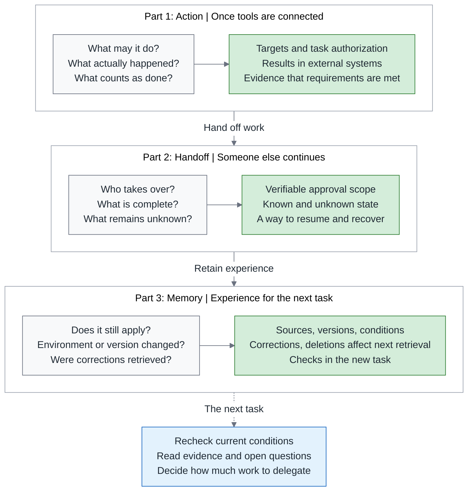
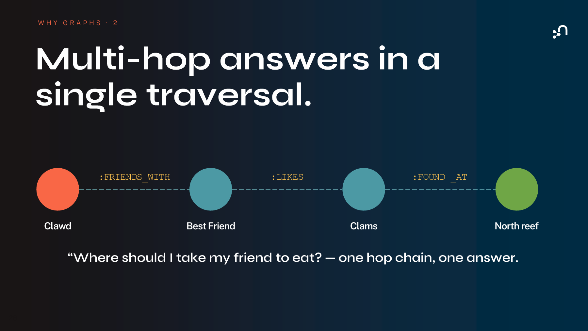
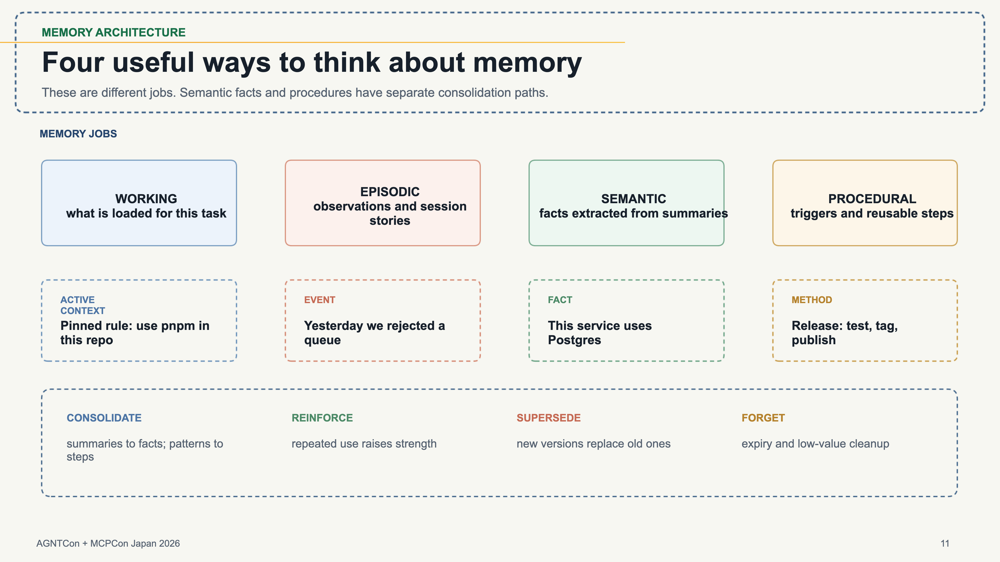
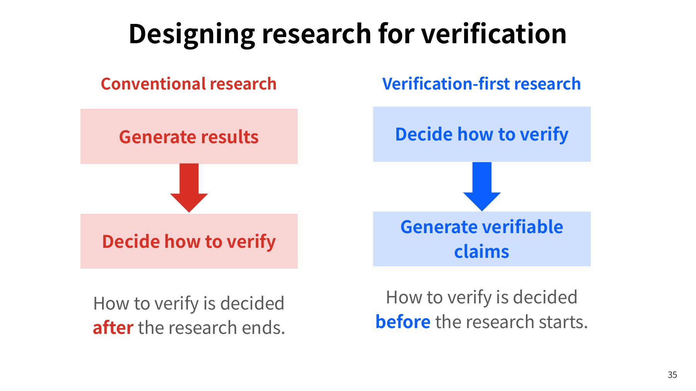

# Can We Still Trust What an Agent Remembers Next Time?

> **TL;DR** — When an agent remembers how it handled a task last time, it really does save the time spent explaining and investigating again. But once "the last test passed" is consolidated into "this system can be upgraded," the original environment, version, and unfinished work can disappear from the next task. This article asks one question only: after past experience has been carried into another environment, found to have missed a check, or formally corrected, will the next agent still reuse the original conclusion? It first separates what needs to be read within one round of work from the experience worth keeping for the next round, then follows three sets of Tokyo material: how to find the right target, how to correct a memory after it has been consolidated, and how to connect a conclusion back to checkable observations. My judgment: preserving sources and the conditions under which the experience applies, making sure a correction actually reaches the next retrieval, and letting the system admit what still needs checking are each required. Drop any one of them, and memory will make an ungrounded decision on the successor's behalf.

> Part 3 of my AAIF Tokyo notes. 中文版：[Agent 記住的經驗，下一次還能相信嗎？](https://medium.com/p/5380c278562e). Series: [Part 1, Action: "After Tokyo AGNTCon: Connecting an Agent Is Only the Beginning"](https://medium.com/p/565d3e375896) → [Part 2, Handoff: "Before One Agent Hands Work to Another: Authority, State, and Recovery"](https://medium.com/p/8b39e1abe616) → **Part 3, Memory (this article)**. This article carries forward the view of evidence set out in my series Green Is Not Done: [Overview](https://medium.com/p/c4fc9f3d8581) → [Testing](https://medium.com/p/51d001a6dcd5) → [Review](https://medium.com/p/4d36d0f2f9c1) → [Reliability](https://medium.com/p/4b6d147bff0d) → [Payment Walkthrough](https://medium.com/p/20452944263b); it also connects back to my series The Same Spec, Ten Runs: [Overview](https://medium.com/p/3700b5d771fd). This English edition is planned for November 18, 2026, following the Chinese edition on November 16. Sources checked through October 25, 2026.

The series starts with tool access, follows work as it passes to someone else, and then asks what experience should carry into the next task. At each transition, the next person or agent needs to distinguish what is established, what remains unknown, and what actions are currently authorized. The diagram below is the guide to the three parts; the reading map for this article's own material is in section 2.

Series overview: from action to handoff to memory, make the evidence and open questions visible to whoever takes over.

Gray boxes hold the questions, green boxes the evidence to preserve, and the blue box the judgment that evidence supports.

---

## 1. Photographs keep moments; sorting through them connects what came before and after

As I sorted through the album from the Tokyo trip, what stopped me first was a slide I had photographed at the venue on September 10: a research system proposes claims, a verifier checks them, and a paper can only be produced from claims that have been verified. I matched the photograph to page 40 of the official deck and went on to read the Agent Memory project's memory consolidation code. In that code, when the same sentence is extracted again, its timestamps and counter are updated. Put side by side, the two pieces of material brought out a difference worth pursuing: a memory can look updated while the evidence supporting it has not necessarily grown. That difference changed how much I was prepared to believe from then on.

The first two articles looked at how an agent uses tools, and then at how the one taking over confirms authorization, progress, and completion when work is handed to another agent. An agent here is a system that, given a task such as "assess whether we can upgrade," decides on its own which deployments to query first and which compatibility document to read next, and acts through tools. This article follows the work one stage further and asks one question only: after past experience has been carried into another environment, found to have missed a check, or formally corrected, will the next agent still reuse the original conclusion?

The album also held the Shibuya night view from the evening of September 11.

## 2. First separate what needs to be read this round from what is kept for the next

Start by picturing a colleague who has just taken over a project. What is spread out on their desk is what this round needs: today's ticket, the few wiki pages they have turned to, and the results they have just looked up. That is this round's working set. The records kept in the cabinet for later use, including the old tickets and the whole wiki, are external storage. An old ticket can become next time's experience, and a page of the wiki can also enter this round's working set. The problem is not the type of content but how to confirm that something taken from the cabinet to the desk still applies, and when a temporary decision on the desk should, and should not, be written back into the cabinet. That is the memory problem for an agent.

For the model, what is spread out on the desk is the context: the input it can read each time it is called, and that input has a capacity limit. Within one task the model is called many times, and the context is assembled afresh each time. The amount of input is measured in tokens, the small units the model cuts text into for counting; a token count is not quite the same as a word count. The capacity creates two kinds of limit. First, a whole log takes far more of the input space than a one-line summary, so old tool output crowds out what this round needs. Second, as the input grows, the model's ability to find and use the relevant information can also decline, as when "the report has not been accepted yet" is plainly in the input and the answer still fails to use it. Anthropic's engineering article from September 2025 calls the latter "context rot" and treats context as a resource that runs out.

The article recommends three countermeasures. The first is best shown by example. A long run of health-check output is condensed into a result such as "check passed, but the report has not been accepted." Here, a health check is a short request confirming that the service can still respond; it does not prove that the report was actually produced. This kind of condensation is called compaction: it keeps architectural decisions, unresolved bugs, and implementation details, and discards repeated tool output. The second has the agent write notes to files outside the context on a regular basis and read them back when needed. The third keeps only lightweight identifiers such as file paths, retrieving the content only when it is actually needed. [1] The Agent Memory session in Tokyo opened with the same distinction: context is the attention assembled for each call, memory is storage across work sessions, and memory is useful only when the right part of it comes back into the context. [2]

That distinction makes this article's question concrete. I will reuse the hypothetical scenario from Part 2: a platform team has to assess upgrading Kubernetes from 1.30 to 1.31. Kubernetes coordinates applications running across a group of machines, and that group is called a cluster. Suppose the team first completes a rehearsal in a test cluster and leaves behind a summary that says "upgrade successful." Some time later, another agent is asked to assess the production cluster and finds that experience in a search. Which lookups can it skip, and which things still have to be confirmed again? This is an example used to work out a design, not a record of an upgrade I actually performed.

The earlier result came with at least three conditions: which cluster was tested, which version of the plan was used, and which application behaviors were confirmed at the time. Production may use different plugins and run different services and background jobs; the programs Kubernetes manages are collectively called workloads. If all that remains of the summary is "can be upgraded," what has been cut is precisely the information the next decision needs. Go the other way and hand every raw record to the model indiscriminately, and the one taking over has to sort the essentials from the exceptions all over again.

So the question memory has to answer is not "how much was stored" but three things. This article takes them in this order:

| What memory has to answer | In one sentence | Which session supplies the evidence |
|---|---|---|
| Find the right target | Which cluster and which version does the retrieved experience belong to? | Neo4j's CrabRAG |
| Get corrections into the next retrieval | When a claim later turns out to be overstated, where does the fix go so it does not stop at the original document? | Agent Memory's consolidation and lifecycle |
| Connect conclusions back to observations | What observations actually lie behind "upgrade successful"? | NexaScience / RIKEN's verification of autonomous research |

In section 2 of "[The Harness Blueprint](https://medium.com/p/3facc281f633)," Part 2 of my Agentic Engineering series, I split the working instructions written for an agent (AGENTS.md) into three tiers by scope (company-wide rules, a project's operating notes, and local exceptions for a module), each with its own owner. That piece was about who maintains such documents. The [overview](https://medium.com/p/3700b5d771fd) of my series The Same Spec, Ten Runs separated standing guidance from one-off briefings. This article deals with the experience an agent leaves behind on its own. It too has classification and consolidation procedures, which section 4 looks at. What it really lacks is someone to confirm its scope of applicability and someone responsible for withdrawing it.

## 3. Retrieving a similar record still leaves the question of what it belongs to

In "CrabRAG: Why Automated Assistants Need Graph Memory, Not More Tokens," Stephen Chin of Neo4j introduces the memory problem through a crab assistant that keeps forgetting things. The session moves from files and similarity search toward graph data, asking how an assistant can retain the relationships among people, objects, and actions ([official agenda](https://agntconmcpconjapan26.sched.com/event/2WZJf/crabrag-why-automated-assistants-need-graph-memory-not-more-tokens-stephen-chin-neo4j), [official slides](https://hosted-files.sched.co/agntconmcpconjapan26/ea/CrabRAG__Graph_Memory_for_AI_Assistants_v0.6%20%28AGNTCon%20Japan%29.pdf)). [3] This session answers the first question: when past experience is retrieved, how do we know what it belongs to?

The crab's trouble is easy to understand: it wakes up with no memory each time, knowing only the files on its disk, and it says "nice to meet you" to its best friend for the hundredth time. Chin's diagnosis is that the log remembers "they talked" but forgets who talked to whom, and why: that is, the relationships. Pages 6, 8, and 9 of the deck describe how the crab's OpenClaw setup works: memory is a stack of plain-text notes like a README (Markdown files), reread in full at the start of every session, so the token bill is considerable. Chin's slogan on the slide: "Don't read more. Remember better."

### Similarity finds the material; relationships connect the question

If I ask "what problems did the last upgrade run into?" searching the notes by keyword is reasonable. But the same incident may have been recorded in different words: if I ask about an "upgrade failure" and need to find a record that says "would not start after the version update," the keywords do not match. Vector search addresses that need: it represents a text as a set of numbers, and a search compares the question's representation with that of a note to see whether they are close. Retrieving material first and then having the model consult it while answering is usually called retrieval-augmented generation (RAG).

Pages 22 to 25 of the deck use three small stories to show the limits of vectors. The crab wants an apple, and similarity returns the thing that looks most similar, except it is the other kind of "Apple." The food is two steps away, and a single vector nearest-neighbor search gives only the nearest thing, not the path that leads to it. Ten shells are all 99% similar, but the one that is "mine" is identified not by its appearance but by the relationship "the crab owns this shell." His summary on the slide: "Similar ≠ related. Nearest ≠ right." [3]

Chin handles this kind of relationship with graph data. People, services, clusters, or plans are nodes, and the nodes are joined by named connections such as "deployed on," "depends on," or "verified using this plan." GraphRAG brings these relationships into the retrieval step; it is a retrieval method, and does not mean a separate graph database has to be bought. The example on page 28 goes from the assistant to a friend, then to the clams the friend likes, and finally to the North Reef where those clams are found. The question spans several relationships, and the query advances along each of them.

Lay out the material from the upgrade case. Suppose the rehearsal record says that service A in the test cluster writes out its nightly report through version 2 of storage plugin B, and that after the upgrade to 1.31, service A's health check returned a normal response, but that check never reaches the step that writes the report. A separate inventory of the production cluster also records service A as using B version 2. And there is a compatibility document listing the settings B version 2 needs in order to support 1.31.

If the question is only "which plugin version does the production inventory record?" explicit environment and version fields are enough. Restrict the environment to the production cluster, and the test rehearsal will not be used to answer a question about the current deployment. When consulting the compatibility document, filter by plugin version and target version. These known fields can rule out the wrong targets up front, and a single table or a versioned configuration file is enough to handle that.

It is the next question, "has matching compatibility evidence been found for the plugin that service A uses?" that requires connecting several pieces of material: first look up, in the production cluster, the plugin that service A actually uses, then find the document that covers that same plugin version and configuration. The document mentioning 1.31 completes only one segment of the match. Whether the service really uses that plugin, and whether its configuration falls within the document's scope, each still need their own source. Graph data can keep these correspondences, so that later queries can continue along the same set of relationships.

### Follow the path to the answer, and follow it to the error

With the material above, the agent can lay out "production cluster → service A → B version 2 → compatibility document for 1.31." The platform engineer then checks the current configuration and finds that production has already switched to C version 3; the earlier inventory was never updated. What needs correcting is the relationship between the service and the plugin. The B version 2 document may still be accurate, but it can no longer answer this question about the production environment.

After the update, the query should stop at "compatibility data for C version 3 with 1.31 still to be checked," and point out which document and settings need to be supplied. This means the existing material is insufficient to confirm compatibility; it does not yet support the inference that C is incompatible. The earlier rehearsal in the test cluster with B also remains a valid historical observation. Changing one relationship changes which material can support the judgment at hand.

Page 29 treats traceable paths as the basis for explanation and auditing: the answer is itself the explanation, the path walked is the citation, and when something is wrong, you can trace which edge led the answer astray. This example helped me understand the practical use of such paths: a plausible-sounding answer is broken into correspondences that have sources and can be checked segment by segment. But to actually complete that kind of check, each relationship needs a way back to the evidence that established it. If two summaries were both copied from the same mistaken note, drawing two paths adds no new observation. In an implementation, I would have the system keep the source record and the time it was obtained, and distinguish relationships observed through tools from relationships a model inferred from text. That way, whoever takes over can see whether the next step is to check the configuration directly or to confirm the inference first.

### Put time and scope into the relationships

This also explains why relationships need to carry time. The production cluster once used B version 2 and today uses C version 3; the two records each describe a different period. If the old connection is simply overwritten, a historical investigation loses its clues; if everything is treated as currently valid, a query gets conflicting answers at the same time. I would handle "observed at the time" and "still valid now" separately. For each relationship, record the period in which it was observed or valid separately from the time the system ingested it. Keeping the two apart matters because an old deployment record entered today still belongs to the old environment, and a later acquisition date does not mean the record is closer to the present state. Then let the current configuration support the new relationship. For today's task, the query supports its conclusion only with data that matches the target and the validity period; historical data can serve only as historical grounds. For relationships not yet confirmed as changed or unchanged, the result marks them as still to be checked. This is a design recommendation extended from the deck, not a complete data schema that CrabRAG has published.

When choosing a data structure, I would first look at whether queries use these relationships repeatedly. With only the fixed-scope set of data about service A, joining tables through explicit identifiers and adding text search is enough to complete the comparison above. The value of continuously maintaining relationships rises when the team often asks the reverse question, "B's compatibility document has changed; which services' upgrade assessments need another look?" and has to trace it across many clusters, services, and versions. A graph representation does not remove the maintenance: the team still has to decide what counts as the same service, who is responsible for updating deployment relationships, and how to report when no current data can be found. My selection criterion is a cost comparison. For the same set of questions, I would weigh how complex the queries get with the existing tables and identifiers, how many places have to change when a relationship is updated, and how much manual checking is needed when nothing can be found. Only when those add up to more than the cost of building and maintaining graph storage is the switch worth it. And switching storage does not by itself provide information about the current deployment, so the delay in updating relationships and the manual follow-up have to be counted in. The graph has one more limit: a query path can explain only the relationships that were recorded and cannot prove that none were missed; when the inventory is incomplete, the answer has to state its coverage.

Even with the right target found, a consolidated statement can still turn an observation into a larger conclusion. The next session is about where a correction has to go once memory has been consolidated.

**Graph memory is most useful for connecting experience back to specific targets and traceable relationships, and for letting whoever takes over see which segment still needs updating or checking.**

## 4. Memory gets consolidated, so it needs to be correctable

In "Architecture Behind the Most Viral Agent Memory Open Source Project," Rohit Ghumare opens with a new work session that has forgotten yesterday's decisions, and explains how Agent Memory captures events, consolidates memories, and retrieves material. The deck also lists Vinuja Khatode and shows the code for memory classification, search, and lifecycle directly ([official agenda](https://agntconmcpconjapan26.sched.com/event/2QlDp/architecture-behind-the-most-viral-agent-memory-open-source-project-rohit-ghumare-devrel-as-service), [official slides](https://hosted-files.sched.co/agntconmcpconjapan26/fe/agentmemory-agntcon-mcpcon-opening.pptx), [project repository](https://github.com/rohitg00/agentmemory)). [2] This session answers the second question: once a memory has been consolidated, where does a later correction have to go?

The opening on page 3 is close to everyday work: in the same repo, with a fresh work session, the agent is asked to continue yesterday's authentication refactor. It can inspect the code, but it cannot say what was decided yesterday, which option was rejected, or what is still unfinished. In the deck's words: "The code is there. The continuity is not."

For yesterday's decisions to come back today, they first have to be kept as the right kind of memory and be findable by search. Once they have been consolidated into facts, they still have to be correctable when they are wrong. "First separate the experience to preserve from what needs to be read this round" compares the four kinds of memory using the upgrade example, then looks at why the rankings from word matching, vector search, and their combination cannot decide which judgment is still valid. "A statement that keeps recurring still needs a fresh check" reads Agent Memory's consolidation code and shows why counts, timestamps, and confidence values do not amount to new evidence. "Updating and forgetting have to make the next retrieval actually different" covers how replacement and deletion reach the search entry points, and why similarity-based cleanup is not the same as detecting a contradiction. Readers already familiar with memory classification and hybrid search can start from the subsection on the consolidation code.

### First separate the experience to preserve from what needs to be read this round

Pages 6 and 7 put it this way: "Compaction preserves this run. Memory preserves lessons beyond this run." [2] The question to press is which qualifying conditions must not disappear during consolidation.

Page 11 explains the division of memory work through four jobs. The table below uses the upgrade example to lay out when each kind is updated and who confirms it:

| Type | Upgrade example | When it is updated | Who confirms it |
|---|---|---|---|
| working memory (what is currently loaded) | "assess the production cluster this time" | Can be released when the task ends; decisions and evidence needed for handoff or audit are kept separately | The owner of this task |
| episodic memory (a particular event and how it unfolded) | "last time the test cluster was upgraded to 1.31 and service A passed its health check" | Never rewritten; only corrections or withdrawals are added, with the time and environment attached | The platform engineer who checks observations |
| semantic memory (a fact that needs maintaining) | "service A in production now uses C version 3" | Updated whenever someone changes the configuration; the old value leaves the currently valid set | The owner of the configuration |
| procedural memory (a reusable step) | "check the actual plugin and its compatibility document before upgrading" | Its conditions of applicability are written with it; a version is recorded whenever the procedure is revised | The procedure maintainer |

One conversation may contain all four, but they should not share the same storage method or the same expiry.

From the keep-and-discard list on page 18, I note only two items: open work and handoff state must be kept, and secrets should not enter memory. [2] The session summary on page 14 keeps "one edge case open," so the event is not rewritten in the summary as fully finished.

Once something is stored, retrieval is the problem: when a valid correction and a frequently cited old summary both exist, which comes back first? Finding the relevant material does not mean finding the valid correction. A search ranking cannot decide which judgment is still valid, so the candidates have to be limited first by the valid version and the scope of applicability; only then is ranking worth discussing.

For the ranking itself, Agent Memory works like this. Word matching can directly find strings such as the plugin name `plugin-c` or the error message `CrashLoopBackOff` and rank the matching records by lexical relevance; that is BM25, though confirming that it is the same plugin still takes an explicit identifier. A record phrased differently, such as "would not start after the version update," has a better chance with vector search. How are two rankings merged? Suppose the same note sits third in the word list and first in the vector list. Scores from the two lists cannot be compared directly, so the ranks are merged instead, and that note ends up ahead of any note that appears in only one list. This is called reciprocal rank fusion (RRF), and results from the relationship graph can be added too; what RRF merges is relevance ranking, and it does not rule on validity. The retrieval result reported on page 33 answers only "can the relevant material be found?" The test uses 500 LongMemEval-S questions, each with search data drawn from its own set of roughly 48 conversation sessions. The proportion of questions whose top five results include at least one of the needed sessions (`recall_any@5`) was 95.2% with BM25 and vector search combined, against 86.2% for BM25 alone. No relationship graph was added and no final answer was generated; a question needing two pieces of experience counts as a hit when one is found; and the test never touched on whether a correction takes precedence. [4]

### A statement that keeps recurring still needs a fresh check

Search can only find existing records, but how a summary gets promoted into a fact decides what is actually found. In a configuration where the consolidation flow is enabled and a model provider is set, once at least five session summaries have accumulated, a model extracts facts from them so that later sessions need not reread every account of how the work unfolded. This step is appealing, because "how I found this last time" can finally be organized into "what conditions are already known about this project." The problem is that the consolidation process can just as easily lose the qualifying scope or treat a previous inference as this round's observation. A summary saves reading cost and discards detail: if "the report was verified" and "the report was not verified" are both compressed into the same sentence, "acceptance passed," nothing downstream can recover that difference from the summary alone. Facts can be compressed, but the necessary qualifying conditions have to stay, or an entry point to the sources from which they can be retrieved has to be kept. Otherwise, what is saved is a few lines of text, and the costs of later verification to fill the gaps, of follow-up questions, and of withdrawals all come back.

The implementation shown on page 15 is concrete. If a newly extracted fact is identical to existing text once case is ignored, the code increments a counter named `accessCount` (in this branch it counts re-extractions, not checks), updates the timestamps, and sets `confidence` to the higher of the existing and new values. Even with no new observation, reprocessing the same batch of summaries refreshes these fields. I checked the corresponding [pinned source code](https://github.com/rohitg00/agentmemory/blob/70517d2bdf302a0aed11ca470151ee854e74c678/src/functions/consolidation-pipeline.ts). The `confidence` value comes from the extracting model itself, with no separate external checker, and it is not an accuracy rate obtained by measuring the external fact again; the deck itself also states that the comparison is case-insensitive text equality. The more direct problem is the subject. The same sentence is not the same fact: "service A can be upgraded to 1.31" is one thing in the test cluster and another in production, so the subject and the scope have to be confirmed before merging. Whether this version of the code has other protections in an outer layer is a question this article did not pursue.

The code has another limit: a new fact's source field is filled with the session IDs of the whole batch of recent summaries, and when the same sentence appears again, that branch adds no new source link. [5] Listing the source sessions is not the same as knowing which observation supports which fact. The approach taken up later, "let the correction travel along the citations," needs a starting point, so item-by-item support relationships have to be kept.

Consolidation, forgetting, and search also run on different data paths. In this project, `semantic`, `memories`, and `observations` are three separate storage collections, not the same set of names as the four memory types above. The facts the consolidation extracts live in the `semantic` collection, the automatic forgetting in the next subsection works on the `memories` collection, and the hybrid search retrieves from `observations` and `memories`. What this article checked is the meaning of each field, not the downstream effect on retrieval results, so the conclusion goes only as far as "the fields do not stand for added evidence." The path most worth following is withdrawal. Automatic forgetting marks the older record as no longer the latest, but the preserved hybrid search code does not directly check that field when enriching results. This article cannot determine whether an outer layer adds protection, and that is exactly the gap to verify first when adopting Agent Memory.

Suppose "this system can be upgraded" first came from a summary whose scope was too broad, and several later work sessions then cited it. When the consolidation procedure extracts the same sentence again, the counter goes up and the timestamp becomes newer. That counter update comes from re-extraction; it does not necessarily mean anyone actually read the record, and it certainly does not require the production cluster to be queried again. What actually supports the conclusion may still be only that earliest test rehearsal. Reading these fields as the number and dates of independent checks would overstate what this memory rests on. This is exactly the difference the two pieces of material at the opening brought out: a memory looks updated, but the evidence has not grown.

That difference affects how memory should be presented. I want the person taking over to be able to tell apart when a record was last read, when it was last modified, and when external evidence for it was last obtained. Frequently used experience can be given higher retrieval priority, but extending the environments it applies to should require new evidence from the corresponding environment. Likewise, when all three search methods retrieve the same note, that means the note is related to the query in several ways, but it may still have only one source. RRF makes material easier to find; whether that material is true comes back to the observations and methods that produced it.

### Updating and forgetting have to make the next retrieval actually different

Page 28 organizes what happens to a memory afterward into reinforcement, replacement, decay, and forgetting: a memory is strengthened when it is seen or retrieved again; a new version replaces the old one; long-unused memories lose weight; expired or low-value ones are deleted. It also notes that source links and version history help in reviewing updates, while deletion and old snapshots need retention rules of their own.

For example, service A in production has moved from B version 2 to C version 3. If the database merely gains another sentence saying "now uses C," the next search may still return both B and C. If retrieval also weights by usage count, the old record may even rank first. The preserved hybrid search code, though, uses ranks, weights, and a bonus for agreement across methods rather than usage counts directly, so that is a hypothetical risk, not an observation of the code. The update process needs to take the old content out of the candidate set treated as "currently valid" while keeping the necessary historical links. When an old record is retrieved for a retrospective, it should carry its superseded status with it.

Updating also has a shortcut worth looking at, and it shows why neither usage frequency nor creation time can settle a conflict between sources. The cleanup code compares only candidates that share a concept label, splits the content on whitespace, and drops words of two characters or fewer; when the similarity of the word sets exceeds 0.9, it marks the earlier-created one as no longer the latest. [5] That is not a semantic test for contradiction. If two English notes of a dozen or so words differ only in that the newer one has gained an environment name, their similarity crosses the threshold; if one word is replaced by another, the sentences have to be longer before their similarity crosses it. And the word that was added or replaced does not necessarily carry new evidence; it may just be old content pasted again. In the other direction, a Chinese sentence has no spaces, so the whole sentence becomes one word: identical sentences score 1 and different ones close to 0. The check therefore cannot effectively identify near-duplicates or contradictions between different Chinese sentences, and it compares only the first 1,000 of the latest candidates. The deck describes the lifecycle, and this version of the code uses a shortcut. The correction rule I would recommend is a third thing: preserve the difference first and hand it to a person or system that can supply the missing data, without taking sides on occurrence count or creation time.

Deletion also has to reach the retrieval entry points. Set up the problem first: the primary record has been deleted, the search catalog still holds the old words, and an earlier exported copy is still around. That search catalog is the index, a separate data structure maintained to find content quickly. Page 29 of the deck and the corresponding [expiry cleanup code](https://github.com/rohitg00/agentmemory/blob/70517d2bdf302a0aed11ca470151ee854e74c678/src/functions/auto-forget.ts) handle the memory data and the search index together. [5] If only the primary record is deleted, the index, summaries already generated, or exported old snapshots may still hold the content. The team first has to decide which copies need deleting and which history may be consulted only by specific roles, then check whether every entry point conforms to that decision.

Nor should "unused for a long time" be taken straight to mean "no longer important." Section 2 of the Reliability piece in Green Is Not Done gives every rule an owner and an expiry date, and treats the expiry as a reminder to review rather than a reason to delete. For automatically consolidated memory, the new question is how to apply that responsibility for human review to the memory and its copies. A rarely used incident lesson may become valuable only at the next anomaly; a one-off maintenance approval, even if cited often, has a definite task scope and expiry. An "approved" status in old memory serves only as a historical record and cannot authorize the current operation; that is Part 2's conclusion carried into the memory layer.

Go back to the hypothetical memory that "this system can be upgraded." Its count, timestamp, confidence value, and source field all record how it was consolidated; none of them tells us whether a single test rehearsal could justify that statement in the first place.

**Consolidating memory should spare the next task wasted effort while keeping an entry point for correction, with usage counts, recency, and external checks each playing a clearly separate role.**

## 5. Connect the conclusions in memory back to claims that can be checked

In "Towards Trustworthy Autonomous Research," Wataru Kumagai of NexaScience and RIKEN puts the question in the setting of automated research: when a system can search the literature, form hypotheses, run experiments, and write a paper, how do we confirm that the final research claims actually have support? He proposes a design for checking claims during the research process and introduces the open-source project AIRAS ([official agenda](https://agntconmcpconjapan26.sched.com/event/2RqMK/towards-trustworthy-autonomous-research-wataru-kumagai-nexascienceriken), [official slides](https://hosted-files.sched.co/agntconmcpconjapan26/63/AGNT-Con_2026_v7.pdf), [project repository](https://github.com/airas-org/airas)). [6] This session answers the third question: what observations actually lie behind a remembered conclusion?

This session may seem further removed from memory, but it picks up what the previous section left unanswered: once sources and versions have been kept, by what method do we decide that a statement deserves to be reused? Research output becomes other people's source of knowledge, and an agent's work summary enters the next round's context. Both need to keep a statement still awaiting verification from gradually acquiring the status of "known fact" during consolidation.

This section follows one claim from the moment it is made, through its withdrawal, to the correction reaching the next summary. "Decide what counts as support before the results appear" looks at why the talk fixes the verification method before producing claims, and brings that back to how "upgrade successful" should be defined. "The observations have not changed, yet the conclusion may still need to be withdrawn" uses the division of labor among the research system, the database, and the verifier to walk through how that upgrade memory missed the report check and was withdrawn. "Let the correction travel along the citations into the next summary" sets out the correction in three records, defines a minimal contract for "correction complete," and deals with whether an old conclusion can come back to life when a withdrawal and a summary rebuild interleave.

### Decide what counts as support before the results appear

Pages 23 and 24 take the claim "our method outperforms all baselines on every benchmark" as an example, and point out that a reviewer still needs to confirm whether the comparison is fair, whether the result can be reproduced, and whether only favorable results were shown. A benchmark compares how methods perform on data and tasks designed in advance; if two methods were given different data or resources, the apparent gap in scores may include the effect of those conditions.

Page 35 then turns to choosing the verification method before the research begins. The deck contrasts choosing the method of verification after the fact with defining it in advance: Kumagai argues for deciding how to verify first and then producing verifiable claims. Otherwise, choosing metrics and explanations only after the results are in makes it easy to frame any kind of result as a success. Defining the verification method in advance limits later changes to the story, but it can also mean that a valuable new discovery is missed. My practice: the original claim is judged by the original standard; a new discovery becomes a separate claim with its own verification, and the original record is not revised. Revising the criteria has a cost. First sort out which old judgments can be re-evaluated from the original observations and which require a new run because a necessary measurement is missing; otherwise, keeping every version still does not tell us which maintenance action to take.

An upgrade rehearsal needs the same order. Does "upgrade successful" mean that the nodes show the target version, that the services restarted, or that the business operations the team requires also completed? If the only requirement set in advance was reaching the target version, memory should preserve that scope. To support an adoption decision for production, the service owners still need to define which behaviors must not be affected. The basis for judging right from wrong here is the service owner's acceptance checklist of three items: version reached, health check, and the nightly report. In the contract piece (coming soon) of my series The Same Spec, Ten Runs, I called this kind of basis the oracle. That piece also points to the third way an oracle can fail: the producer and the checker may share the same misunderstanding, so the acceptance checker has to be tested first against known positive and negative cases. Memory consolidation should keep a conclusion together with its oracle: not just "passed," but under which version of the requirements and by which version of the checker it passed. Defining requirements in advance does not forbid learning afterward: a compatibility problem nobody had thought of, discovered midway through the rehearsal, is of course worth a new check. What matters is to record the requirement as it was before the change, why it changed, and which result used the new requirement.

### The observations have not changed, yet the conclusion may still need to be withdrawn

Pages 36 to 40 divide the architecture into a research system, a research database, and a verifier: the research system submits claims and material, the database keeps the records, and the verifier is the party that checks claims by agreed rules against designated material and records a judgment. The three principles: every claim states what holds and how it is to be verified; every claim is verified outside the research system, which cannot influence the verifier; and every paper can be produced only from verified claims in the database. When this is put into a team's implementation, I would further require that the producer cannot change the verifier's rules or results, and that the maintainers of those rules and permissions are named; otherwise the verifier is just one more agent.

I also photographed page 40 that day. In the diagram, the direct path from the research system to the paper is blocked; the paper should be produced from the verified claims in the database. This figure moves the question from how to make a report read well to which piece of evidence allows which sentence to appear in the report.

Bring this division of labor back to the hypothetical "upgrade successful" memory. The original execution record left two observations: the test cluster's node version reached 1.31, and service A's health check returned a normal response. Whoever consolidated it, however, wrote "all of service A's required functions passed acceptance on 1.31," and a later plan condensed that further into "service A can be upgraded to 1.31." Each condensation made the text shorter and made the originally limited observations carry a larger conclusion.

Later, the service owner compares the acceptance checklist drawn up beforehand with the rehearsal configuration and finds that the checklist also required the nightly report job to complete and write its output to the designated location. This kind of time-triggered background job had been paused during the rehearsal, so no report result was obtained from that run. The health check could still come back normal, because it only confirms that the service can respond; it never went through the flow of generating and storing the report. This is the same kind of acceptance gap as the real case recorded in section 7 of [Green Is Not Done, Testing](https://medium.com/p/51d001a6dcd5): the tests were all green, yet the replay had never run. That piece had implementation output to compare against. The new question here is how, once a skipped check is discovered, the mistaken success summary drops out of the grounds used in the next round. For now, that part rests only on static checks and a test design, and it still lacks at least one comparison of storage, tool responses, context, and answers from before and after a correction.

At this point the judgment "all required functions passed" should be withdrawn and replaced with "the test cluster reached 1.31 and service A passed its health check; the report job has not yet been accepted." The original observations of node version and health check still stand, and the original report requirement has not changed. What changed is that we now know what went unverified at the time. This correction has not shown that the report job is incompatible with 1.31; what is needed next is the missing verification, and a fresh judgment based on its result. The platform engineer keeps the execution record and the configuration from that time, the service owner points out the required behavior that was missed, and the person responsible for acceptance checks the correction. The agent that proposed the success summary can help organize the material, but it cannot remove the report from the requirements on its own.

### Let the correction travel along the citations into the next summary

In the [pinned AIRAS documentation](https://github.com/airas-org/airas/blob/e1c37b5600acb4d717111b7a5789a2144a184959/README.md) I checked, this direction takes concrete form as claims submitted before the experiment, a research record that only ever gains new entries, and numbers in the paper filled in from execution results. The workflow the README describes also has two automated checks: one checks the research record, and the other checks whether the numbers in the paper come from verified claims. They run in continuous integration (CI), and the main branch is set as a protected branch, so a change cannot get in if the designated checks fail. What the README describes is a design that checks the record and the paper's numbers separately. This article has not verified, in an actual deployment, who can change the checks, who holds exception permissions, or whether bypass paths exist. The README itself also lists benchmark hacking, test data leaking into the development process, and design deviation as things that can still pass the gate. Traceable numbers, a judgment that meets a fixed standard, and a valid research method are three different things. [7]

I would borrow this division among claims, records, and checks to design memory corrections. Below, the report case is set out in three records, all with hypothetical data. From the start, the requirement version was v3, which includes the nightly report, so it is the judgment that was wrong, not the requirement:

| Record | Claim | Requirement version and observations | Status and relationships |
|---|---|---|---|
| Old judgment J-17 | All of service A's required functions passed acceptance on 1.31 | Requirement v3 (version reached, health check, nightly report); cites observations O-41 (node version 1.31) and O-42 (health check passed); no report observation | Withdrawn because the report job was paused during the rehearsal, yet consolidation recorded all required functions as passed without any report result |
| New judgment J-18 | The test cluster reached 1.31 and service A passed its health check; the report job has not yet been accepted | Requirement v3; cites O-41 and O-42; notes that verification of the report job's execution and output is missing | Valid; supersedes J-17; confirmed by the service owner |
| Derived summary P-9 | The upgrade plan condensed J-17's judgment into "service A can be upgraded to 1.31" | Based on J-17 | Not valid grounds until rebuilt; after the rebuild it cites J-18 instead |

If it was the checker that missed the check, record its version separately. A genuinely new report requirement is a different case, which is left for the end of this section. What should be visible at a glance: the observations stay, the wrong judgment is withdrawn, and the derived summary loses its validity. Two kinds of authority also have to be kept apart: anyone who can produce evidence may suspend the use of a doubtful old conclusion, but it is the service owner who makes a new conclusion a valid judgment. Once the verifier is separated out, the bottleneck may move to the queue for approving corrections, so someone must be able to suspend use at any time, and only formal approval waits in line. Changing only the text of the original record cannot automatically repair a conclusion that has already been copied elsewhere.

"Correction complete" also has to be defined, or this design can be tested only on corrections that arrive in the normal order. The minimal contract: a correction points to a fixed judgment identifier; the data service checks the currently valid version on every query; a derived summary is not valid grounds until its rebuild is complete, rather than merely carrying an "awaiting update" flag in the hope that every search entry point understands it; and the correction takes effect at an observable point in time.

There is also an ordering that brings an old conclusion back to life: process A starts rebuilding P-9 from J-17, process B completes the withdrawal, and only then does process A write back the summary based on J-17. Checking the version on every query does not check the supporting judgment's version at write time, and even checking once more before publishing leaves a gap between the check and the write in which someone may still withdraw the judgment. So the check of the supporting judgment's version and the publication of the summary have to be bound into one indivisible commit, and the write is refused on a version mismatch. A retry after an interruption must not reinstate a withdrawn judgment either. The commitment about when a correction takes effect also has to be written down: new queries after that point must no longer obtain the old conclusion as a currently valid result, and an answer produced later from context loaded before that point has to carry the version of the judgment it rests on, so that its basis can be identified afterward. During the window when the primary record has been withdrawn and the index has not yet caught up, the old summary may still be treated as valid grounds; the responsibility for holding it back lies with the data service's query and write layer, not with the model.

So the next time someone asks about this rehearsal, the retrieval flow should bring back at least the current correction, the traceable original observations, and the note that acceptance of the report job is still missing. If the old summary appears alongside them, it too should link to the correction, so that whoever takes over can understand why it was called a success last time and why it now needs further verification. The updates and indexes discussed in the previous section acquire a definite purpose here: letting the same question receive an answer that fits the current scope of the evidence. This way of maintaining memory is a design this article extends from the AIRAS division of labor.

Once the data can be traced all the way back to its sources, the method itself still has to be reviewed. The AIRAS roadmap explicitly lists problems still being worked on: experiment code that deviates from the design, exploiting the evaluation method to obtain a high score, and letting data that should be used only for testing enter method development early. [7] A number can come faithfully from a run, and that run can still have asked the wrong question. Back in the report example, if the team's original requirement said only "health check normal," an automated check could confirm that the record met that requirement, but it would have no way of knowing on its own that the report also belonged in acceptance. The earlier case was an agreed check left undone; this one is a check design that was itself incomplete. Only by keeping the two kinds of correction apart do we know whether the next step is to run the check that was missed or to rewrite the criteria first.

The three records are hypothetical data, and the correction contract is still only a design. Whether they are of any use will become clear only when an agent that took no part in the correction asks about this rehearsal in a new work session.

**When a conclusion in memory is corrected, the observations that still stand, the reason for the withdrawal, and the verification still missing should all enter the material retrieved next time, together.**

## 6. How I would run acceptance tests on memory for the next task

Now that I have read the three sessions this far, what I want acceptance to check is no longer "does it still remember after a restart?" The more useful question is: **when experience applies, expires, or is corrected, does the next agent's judgment change accordingly, and can it explain its basis?**

I would first confine acceptance to a read-only assessment: designate a simulated cluster, and ask the agent to state whether there is enough data to recommend an upgrade, which items remain to be checked, and what evidence it cited. At this stage the agent has no tool permission to change the cluster. The platform engineers prepare queryable data on versions, plugins, and workloads; the service owners define the assessment requirements first; and a separate acceptance reviewer then checks the results. In section 1 of [Green Is Not Done, Review](https://medium.com/p/4d36d0f2f9c1), I wrote that when output exceeds the capacity to review it, who reads what has to be reassigned. Following that principle, this article adds a division of labor: the platform engineer checks observations, the service owner approves withdrawals, and the maintainer of the memory system owns the retrieval flow. This matches the split between the platform and domain teams in section 2 of the [organization piece](https://medium.com/p/92343384d987) in my Agentic Engineering series. What follows is a test design that has not been executed, and it is not an operations manual for a production environment.

The acceptance design falls into three subsections, in order. "First confirm that memory saves repeated investigation, not required checks" compares a normal control with and without memory, then relabels the same success summary as one left by a different test cluster, and explains why every trial has to restore the same memory snapshot. "Whether a correction reaches the answer has to be checked layer by layer" brings in the correction case from the previous section, including the interleaving of a withdrawal and a write-back, and explains where to look when a failure occurs: in storage, search, the context, or the interpretation. It then uses a table to set out what the one taking over should do in seven situations, and tests deletion and access separately. "Which results support widening the use of memory" covers how to avoid rewarding blanket refusal, which records have to be handed over for each case, how to fill in the acceptance card, and when a question set stops being useful for evaluation; it ends with three stages for moving from a diagnostic pilot to wider use.

### First confirm that memory saves repeated investigation, not required checks

Start with a useful normal control. With the same task and the same current environment, run once without any historical memory and once with a rehearsal record whose target is correct, whose source can be checked, and which still applies. Beforehand, the acceptance reviewer uses the assessment requirements to list which conditions may be carried over and which still have to be queried; that list is the common criterion for both results. Both runs should obtain sufficient current evidence; the version with memory can use the existing record of how things were checked to speed up finding the compatibility conditions that need checking. Record the number of searches and tool queries, and the items the owner still had to ask about, to tell whether what was saved was repeated investigation or a necessary check that was skipped.

Next, keep the same success summary but change only the environment it belongs to, so that it comes from a different test cluster. The current task still targets the production cluster, and the external data stays the same. The expected result is that the agent uses the old experience to propose where to check, and then establishes the conditions of this environment; success elsewhere must not be taken directly as a compatibility confirmation already completed for this one.

Before every trial, restore the same starting test data, search catalog included, which means a fixed memory snapshot and index version. Fix the current environment and data permissions too, and state whether automatic writes are allowed this time. When testing retrieval, keep the existing memory content fixed; enable the corresponding writes only when testing the update flow. A new work session is not a new memory state: if the previous query incremented a counter, left a summary, or triggered consolidation, the next one no longer differs only by the specified correction, and both failures and improvements become hard to attribute.

### Whether a correction reaches the answer has to be checked layer by layer

For the correction case, reuse the rehearsal record from the previous section. First store the node version and health check results, the judgment miswritten as "all required functions passed," and the upgrade plan summary that cites it. Then supply the original acceptance checklist and the setting that paused the report schedule, and add the correction through the normal process. Both before and after the update, open two new work sessions: one asks "which of service A's required functions were accepted in its last 1.31 rehearsal?" and the other asks "did the earlier upgrade success already include acceptance of the nightly report?" The acceptance reviewer sets the expected results aside in advance, and the agent under test obtains its material through the normal query entry points. Only then can we observe whether the correction can be found, rather than telling the agent the new answer directly within the same conversation. Arrange one interleaving as well: have a process read J-17 to start rebuilding P-9, then complete the withdrawal, and only afterward let the process attempt to write back the summary; check whether the write is blocked.

After the update, what is retrieved should include the narrower valid judgment, together with sources that lead back to the original observations, the report requirement, and the pause setting. If the old judgment or the plan summary is still retrieved, it must be recognizable as withdrawn or awaiting update. A reasonable answer should state that the test cluster's node version and service A's health check have been confirmed and the report has not yet been accepted, and ask the service owner to supply the report job's execution results and output. It must no longer say that all required functions passed, nor switch to saying that the report is known to be incompatible. The acceptance reviewer then lines up the stored records after the correction, the tool responses, the content actually loaded into the model, and the final answer, so that a failure can be located:

- If the stored records still list the old judgment as valid, or fail to mark the affected plan summary, fix the update process and the citation relationships first.
- If the stored state is correct but the search returns only the old summary, check the index and the retrieval rules; if the tool returns the correction but the task input leaves it out, check the context assembly and summarization steps.
- If the correction and its sources make it into the task input and the answer still says everything passed acceptance, only then does the problem fall on how the evidence is interpreted and the conclusion produced.

Once the correction case has been walked through, two more situations have to be handled separately. They are not this article's main question but preconditions for adoption: content that has evidence but that the retention rules require to be deleted, and content that has evidence but should not be supplied to the current role. The main acceptance table concentrates on applicability, correction, conflict, and the propagation of corrections. These two rows are listed separately at the end of the table so that it is clear which segment of capability each one tests:

| How the memory relates to current data | What the one taking over should do | What the acceptance reviewer examines |
|---|---|---|
| Target, version, and requirements match; source can be checked | Use the experience to narrow the investigation, and obtain the current evidence still needed | Cited sources, necessary queries, and items still to be confirmed |
| The old result came from a different environment | Treat it as a lead, and reconfirm the conditions of this environment | Whether a cross-environment inference was written up as a verified fact |
| The old conclusion has been corrected by new evidence | Retrieve the correction relationship, and adjust the recommendation to the new evidence | Whether the original text, summaries, and search entry points still push the outdated conclusion |
| The primary record has been withdrawn, but the index or derived summaries have not yet been rebuilt | Do not treat the old summary as currently valid grounds; report that a correction is in progress | Whether the query layer holds back the old conclusion, rather than relying on a flag alone |
| Two sources conflict, and the data needed to resolve the conflict is missing | Preserve the dispute, and identify who needs to supply which data | Whether it took sides on its own based on occurrence count or update time |
| Content has been deleted under the retention rules | Do not re-supply the content through summaries, indexes, or exported copies | Each copy that needs clearing, and the actual search results |
| The same question is asked by a role without read access | The data service restricts what is retrieved according to the current role | Tool responses, content loaded into the model, and the final answer |

The access case should check the data service directly: have two roles with different read scopes ask the same question, and compare the tool results each obtained and the content actually loaded into the model. If data that should be restricted has already entered the model, then even if the final answer happens not to write it out, the test has not verified that the access rule actually took effect. Run the deletion case and the access case separately, so that it is possible to tell whether the problem lies in cleaning up copies or in the identity and scope check at read time. When testing conflicts, deliberately leave one key condition out of both pieces of material; a reasonable result identifies which setting is still needed and where to query for it. If all that is left is a vague "please confirm manually," a colleague still has to redo the whole investigation, and the handoff is not yet complete.

### Which results support widening the use of memory

These tests also have to avoid rewarding blanket refusal. When the material is complete and meets the requirements, the agent should be able to produce an assessment with sources; when data is missing, it should preserve the unknown and spell out what remains to be checked. I would tally the two outcomes separately: whether it completed the expected work when the data was sufficient, and whether it drew a wrong conclusion when the data was insufficient. Then I would look at whether the necessary information was retrieved, whether old conclusions were still carried forward, and whether human checking time went down, without compressing them into a single "memory accuracy" metric. For each case, hand over one record containing the case description, the expected judgment, the stored state, the tool responses, the context actually loaded, the final answer, the human checking time, and who is responsible for the failure. The cost of rebuilding summaries and maintaining relationships is counted separately, and fewer tool queries do not necessarily save time. The acceptance card for the smallest task can be filled in directly:

| Field | Content for this case |
|---|---|
| Task and target | Production cluster prod-a, service A, target 1.31; read access only |
| Original requirement | The same acceptance checklist v3, including the nightly report |
| Existing observations | Test cluster: version reached, service A's health check passed; no report result |
| Conclusions allowed after the correction | Two items confirmed in the test cluster, report pending; not yet enough to claim all required functions passed |
| Forbidden conclusions | All required functions passed; the report is known to be incompatible |
| Propagation acceptance | Neither a normal query nor a summary rebuild can restore J-17 |
| Human authority and backup | Who may suspend the use of the old conclusion, who approves the replacement judgment, who takes over when the owner is away |

To compare different memory approaches, hold the task, model, available tools, and current environment fixed, and change only the memory material or the retrieval method first. For runs with randomness, repeat them several times and keep the individual results. This continues the question from the [Overview](https://medium.com/p/c4fc9f3d8581) of Green Is Not Done: what evidence did the check obtain, and how much work can the team hand over on the strength of that evidence?

Two other boundaries mark when a question set loses its value for evaluation. The first comes from the variance piece (coming soon) of The Same Spec, Ten Runs: once this batch of acceptance questions has been used to tune the memory system, it can no longer serve as a holdout whose answers were never seen. Section 8 of that piece also distinguishes three kinds of recheck: check the grader when the yardstick changes, check the new candidate when the artifact changes, and check the delivery method when the method changes. This article adds a fourth, re-evaluating an old judgment from existing observations, because a judgment in memory can be withdrawn without rerunning the task. The second is the saturation that Anthropic's eval article describes: once the agent passes every question in a set, that set can only catch regressions and gives no signal for improvement. That applies only to a success metric that has already saturated, though; checking time and cost still show differences. [8] The two boundaries are not the same thing.

If any step of the acceptance uses a model to score, follow the requirement from Part 1's PagerDuty session that the scorer be calibrated. This article then separates three kinds of material: questions never used to tune the system (the holdout, for instance a fresh set of cluster-inventory questions), answers already judged by people (used to calibrate the scorer), and the deployment and rehearsal records the agent may query (the evidence). At least two calibration contrasts are specific to this article: "not yet accepted" must not be scored as "incompatible," and "has a link to a correction" must not be scored as "the old conclusion has left the valid candidates."

These scenarios are a diagnostic pilot: they can find defects, but they cannot estimate the error rate or the benefit in real work. Moving toward wider use therefore has three stages. While a correction still fails to reach the answer, memory stops at helping to find material and organize the items to be checked, and the owner interprets conflicting evidence. Once the diagnostic cases pass, move to a small trial that retains human approval and is limited to this kind of upgrade assessment. Each use is approved by the service owner, and the trial stops as soon as a correction fails to reach the answer. The trial is owned by the maintainer of the memory system, and the actual handover and maintenance costs are recorded. Only after evidence of benefits and maintenance costs has been gathered from representative work does expansion come up for discussion. This is the adoption boundary from section 10 of the overview of The Same Spec, Ten Runs, applied to memory.

At this point the acceptance design can show at which layer a correction stops. But this is a whole battery of tests; where can the team start?

## 7. Let experience stay, and give the next person grounds to correct it

My [Facebook post saying farewell to Shibuya](https://www.facebook.com/kochi.chuang/posts/pfbid0289Daa2XFPzSEuCuHxAfDoHha5exgSuPfJqDTiGNdmg5QTAEU9o9YsLMJkWgfzKoQl) on September 12 gave the trip its ending; the photograph below, taken the evening before, shows SHIBUYA SKY's "天空夢祭" exhibition. [9]

This checking changed how much I am prepared to believe. In the venue photograph, the paper can be produced only from verified claims; in the memory code I read afterward, merely consolidating the same sentence again gives it a newer timestamp and a higher count. So I would start by picking one small task the team keeps investigating over and over, connect its most recent experience back to the original observations and acceptance requirements, and then arrange a handoff that includes a correction. Only one decision has to change after the handoff: the old success summary can no longer serve as grounds for release. Completing the missing report verification and confirming compatibility for production become preconditions for release, and whoever holds that authority decides the schedule and how to handle the remaining risk. The evidence still missing has to be stated too: a comparison of storage, tool responses, context, and answers from before and after a correction. This article has only static checks and a test design.

This article itself should be subject to the same check. Its code observations correspond to pinned versions, and its extended cases await actual acceptance. If a source or a result changes in the future, the passages that cite it need to change with it. I hope that when the next reader picks up this material, they can see which judgments still have grounds, which have been corrected, and where they can continue checking for themselves. Only when corrected experience reaches the next person does the material brought back from this Tokyo trip connect to the next stretch of work.

### Series

- [Part 1: After Tokyo AGNTCon: Connecting an Agent Is Only the Beginning](https://medium.com/p/565d3e375896): the conference story, the Kong hands-on, and eight sets of material answering three questions (what is permitted, what happened, and what counts as done).
- [Part 2: Before One Agent Hands Work to Another: Authority, State, and Recovery](https://medium.com/p/8b39e1abe616): what a handoff carries across and what must be rechecked, plus an acceptance design for one interruption.
- **Part 3: Can We Still Trust What an Agent Remembers Next Time? (this article)**

### Further reading: the pieces this article connects to

- [The Harness Blueprint](https://medium.com/p/3facc281f633) (Agentic Engineering, Part 2), section 2: AGENTS.md split into three tiers by scope, each with an owner; section 2 of this article goes on from there to ask who is responsible for automatically extracted experience.
- The [overview](https://medium.com/p/3700b5d771fd) of my series The Same Spec, Ten Runs: after one success, what to write into the team's defaults, and who is responsible for withdrawing it; the oracle in section 2 of the contract piece and the three kinds of recheck in section 8 of the variance piece (coming soon) are the basis for sections 5 and 6 of this article.
- [Green Is Not Done, Review](https://medium.com/p/4d36d0f2f9c1), section 1: when output exceeds the capacity to review it, reassign who reads what; section 6 of this article follows that principle and adds three roles for the memory layer.
- The [organization piece](https://medium.com/p/92343384d987) (Agentic Engineering, Part 1), section 2: the division of responsibility between the platform and the domain teams; the three roles in section 6 of this article map back to it.
- [Evals, Unit Economics, and Scaling](https://medium.com/p/1cb1855a2046) (Agentic Engineering, Part 3), section 2: the three traps of a judge, and human calibration; section 6 of this article adds two calibration contrasts specific to memory.
- [Green Is Not Done, Reliability](https://medium.com/p/4b6d147bff0d), sections 2 and 5: the owner and expiry date of each rule (expiry as a reminder to review), the frozen holdout, and the gate on expanding authorization; section 4 of this article places that review responsibility on automatically consolidated memory.

### References

1. Anthropic — [Effective context engineering for AI agents](https://www.anthropic.com/engineering/effective-context-engineering-for-ai-agents) (2025-09-29): context as a finite resource, what compaction keeps and discards, structured note-taking, and just-in-time retrieval through lightweight identifiers. [Section 2]
2. Rohit Ghumare; deck co-credited to Vinuja Khatode — [Architecture Behind the Most Viral Agent Memory Open Source Project](https://agntconmcpconjapan26.sched.com/event/2QlDp/architecture-behind-the-most-viral-agent-memory-open-source-project-rohit-ghumare-devrel-as-service); [official slides](https://hosted-files.sched.co/agntconmcpconjapan26/fe/agentmemory-agntcon-mcpcon-opening.pptx), pages 3–19, 24–29, 33, and 36. [Sections 2 and 4]
3. Stephen Chin / Neo4j — [CrabRAG: Why Automated Assistants Need Graph Memory, Not More Tokens](https://agntconmcpconjapan26.sched.com/event/2WZJf/crabrag-why-automated-assistants-need-graph-memory-not-more-tokens-stephen-chin-neo4j); [official slides](https://hosted-files.sched.co/agntconmcpconjapan26/ea/CrabRAG__Graph_Memory_for_AI_Assistants_v0.6%20%28AGNTCon%20Japan%29.pdf), pages 6 and 8–9 on file-based memory and 21–29 on retrieval and relationships; pages 12–14 discuss the adaptation, selection, and composition problems of skills, which this article does not take up. The [AI Engineer recording](https://www.youtube.com/watch?v=Q0VkgCyNVUg) of the same title predates the Tokyo session; it can serve as further viewing but is not treated as a recording of this session. [Section 3]
4. Agent Memory — [LongMemEval-S Benchmark Results](https://github.com/rohitg00/agentmemory/blob/70517d2bdf302a0aed11ca470151ee854e74c678/benchmark/LONGMEMEVAL.md), the project-reported retrieval-only evaluation on 500 questions: `recall_any@5` of 95.2% for BM25 plus vector search, against 86.2% for BM25 alone; not rerun for this round. [Section 4]
5. Agent Memory — [pinned source code](https://github.com/rohitg00/agentmemory/tree/70517d2bdf302a0aed11ca470151ee854e74c678), checked `consolidation-pipeline.ts`, `hybrid-search.ts`, `auto-forget.ts`, and `observe.ts`; the [README](https://github.com/rohitg00/agentmemory/blob/70517d2bdf302a0aed11ca470151ee854e74c678/README.md) serves as that version's description of functionality and lifecycle. [Section 4]
6. Wataru Kumagai / NexaScience and RIKEN — [Towards Trustworthy Autonomous Research](https://agntconmcpconjapan26.sched.com/event/2RqMK/towards-trustworthy-autonomous-research-wataru-kumagai-nexascienceriken); [official slides](https://hosted-files.sched.co/agntconmcpconjapan26/63/AGNT-Con_2026_v7.pdf), pages 23–30 and 34–41. [Section 5]
7. AIRAS — [pinned README and roadmap](https://github.com/airas-org/airas/blob/e1c37b5600acb4d717111b7a5789a2144a184959/README.md), checked for pre-registered claims, the research record, the provenance of execution results, CI checks, and the method-integrity work still outstanding. [Section 5]
8. Anthropic — [Demystifying evals for AI agents](https://www.anthropic.com/engineering/demystifying-evals-for-ai-agents) (2026-01-09): the distinction between capability evals and regression evals, and "An eval at 100% tracks regressions but provides no signal for improvement." [Section 6]
9. My travel record — [Farewell to Shibuya](https://www.facebook.com/kochi.chuang/posts/pfbid0289Daa2XFPzSEuCuHxAfDoHha5exgSuPfJqDTiGNdmg5QTAEU9o9YsLMJkWgfzKoQl), 2026-09-12. The Shibuya night view and exhibition photographs were taken on September 11; the venue photograph of research verification was taken on September 10. [Sections 1, 5, and 7]
10. Richmond Alake / MongoDB — [Architecting Agent Memory: Principles, Patterns, and Best Practices](https://www.youtube.com/watch?v=W2HVdB4Jbjs), AI Engineer World's Fair 2025: another way of organizing memory types and memory management, for further viewing. [Sources and method]

### Sources and method

This article analyzes three official agenda attachments, using complete text extraction together with visual checks of the cited pages. As of October 25, 2026, the search for this article had not found Tokyo recordings on the official AAIF channel that could be confirmed as matching these three sessions, so the analysis rests mainly on the decks and on pinned versions of the project documentation. The CrabRAG video of the same title was published by AI Engineer before the Tokyo conference and is listed as further viewing. The AI Engineer talk by Richmond Alake of MongoDB, which organizes memory types and memory management, is likewise listed as further viewing; its content was not checked word for word for this article. [10]

The Anthropic engineering article was checked against the online version with no snapshot saved, while the Agent Memory benchmark notes were saved as text. CrabRAG, Agent Memory, and AIRAS were not rerun for this article, and the static checks of code and documentation are pinned to the versions listed in the References; they cannot substitute for verification in an actual deployment. Agent Memory's 95.2% comes from the project's reported retrieval test and is read separately from final-answer quality. The upgrade scenario, the memory-maintenance approach, and the acceptance design in section 6 are all hypothetical cases and design recommendations extended by this article. My three photographs were checked against the dates and content in my own album and then saved as clean display captures, not camera originals; the other two Shibuya photographs stay in the figures directory and do not appear in the text. The four official slide images each show a complete page; the two from Agent Memory were rendered from the official PPTX.

### AI collaboration disclosure

Codex assisted the research and first draft by organizing material, checking sources, inspecting the pinned code, and writing; this version was re-analyzed, reorganized, and rewritten by Claude from the same set of sources, then reviewed and finalized by me. Checking by two models does not amount to independent review; the views and judgments in this article are mine, and the responsibility for them is mine as well.

*Kochi Chuang (莊軻齊) | 榮民叔叔的藏書筆記*
