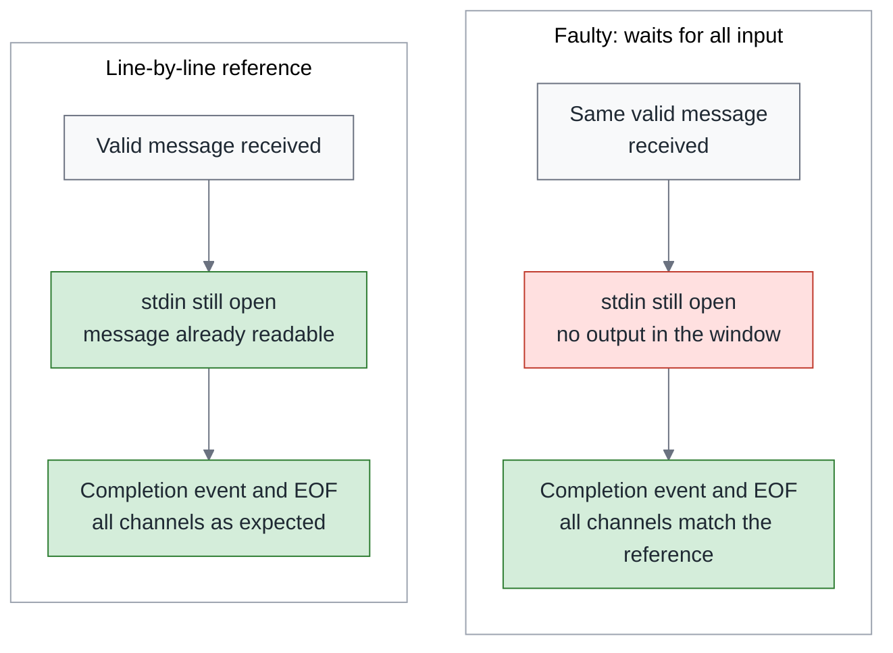

# The Same Spec, Ten Runs, Part 2 — Contract: The Judgments Still Missing Between a Requirement and an Acceptance Check

> **TL;DR** — A tool treated the number `123` as review text and then reported success. After the fix, forty programs passed every check; but which errors can this green light actually see? This piece is written for QA, authors of acceptance tooling and code reviewers, and it deals with the judgments that sit between a one-line requirement and a single check. It starts with three lines of input and works out, step by step, the normal output, the diagnostic and the exit code they should produce; it then feeds in a few deliberately faulty programs to see whether the yardstick misses errors, and whether it wrongly rejects legitimate ways of writing the code. Readers will see that checking only the final result can miss a message that should have been sent out mid-process, and that demanding identical formatting can wrongly reject a CSV whose content is correct. Finally, the requirements, the derivations and the parts not yet covered are written into an obligation table, so that the next person who takes over knows whether the red light in front of them means fixing the check, rejecting the program, or asking the responsible owner to supply a requirement nobody has decided yet. The deliberately faulty versions and the CSV replay used for teaching here were all built after the study ended; they add no model samples to the formal study.

> Series: [Overview](https://medium.com/p/3700b5d771fd) → [Part 1, Specification](https://medium.com/p/3c356327ea3c) → **Part 2, Contract (this piece)** → Part 3, Variance (coming soon). Chinese edition: [同一份規格，跑十次（二）：契約篇—把要求變成驗收，中間還缺哪些判斷？](https://medium.com/p/f7684c057c0e).

## 1. Two green lights, and what each one leaves out

The task studied in this series comes from a small tool in my `medium-articles` repo: `research/scripts/codex_jsonl.py`. It reads an agent's work log, in a format called JSONL, where each line holds one JSON record. Some lines carry review text; some lines say the work is complete. The tool, a parser, has to recognize each line and pass the results on to the next program, the caller.

The caller receives three kinds of information: stdout carries the normal review content, stderr carries diagnostics saying where something went wrong, and the exit code reports the result of the whole run as a single number. This article calls them the three channels. The study froze a starting version, the seed commit, and reproduced the problem from there: a message whose `text` is the number `123`, followed by a valid completion event. The program prints `123` as review content and ends with exit 0, the code that means success.

Seen from the caller, this is a green light: the program ended normally, and stdout has content. But the behavioral agreement the study later froze, which this article calls the contract, requires that a `text` value that is neither a string nor null be treated as a format error, called malformed from here on. Under that agreement, stderr has to carry a diagnostic and the exit code should be 6. The program returned 0 while violating a key requirement: a number is not valid message text.

The second green light comes from the study itself. The model generated ten patched programs from each of the four briefs, the four task documents handed to it; this article calls each program awaiting acceptance a candidate. All forty candidates passed 102 batch cases: send the whole input, wait for the program to finish, then check the result. One more check deliberately withholds EOF, the end-of-input signal, and watches whether the program sends its message out first; that is the pre-EOF streaming probe discussed later. Each candidate faced 103 checks: 102 batch cases and one pre-EOF streaming probe.

How much that result says depends on what the checks can see: whether the inputs reached the edges, which channel was examined, and when. The Overview of this series already explained that these results cannot rank the four documents. This piece goes one layer further down: even confining ourselves to these forty candidates, how much can "all passed" guarantee? For example, the formal grader, the program that scored the candidates, did not comprehensively check extra command-line options, nor did it fully check the entry-point interface named `main`. The 103 checks are a finite set, and there are things they never asked.

I recorded the same kind of gap at the pattern-language-driven development workshop in August 2026. Method A passed all 5 of its tests, yet passed only ten items on a sixteen-item compliance checklist. That was a single observation (N=1), not data from this series' study. In the Green Is Not Done series it reminded me: "all tests green" tells you only about what the tests asked; the six items those five tests did not cover still had to be found by the checklist.

This piece is written for QA, authors of acceptance tooling and code reviewers. You usually receive a one-line requirement, such as "fix the handling of the text type" or "format the date column as specified." Turning it into a check that shows red or green takes at least six judgments along the way:

1. For this requirement, what is to be observed from the outside?
2. How is the expected value derived?
3. On what basis, and by what method, is the comparison made?
4. Can this yardstick reject known faults while accepting legitimate variation?
5. Which situations does it still not cover?
6. Who is responsible for taking over those gaps?

Skip any one of these and a green light may mean something else; a red light may also wrongly blame a legitimate candidate. The whole article follows these six judgments: first derive the answer to one problem, then look for the yardstick's blind spots, and finally hand the derivations and the gaps to the next person who takes over.

So that these judgments can be redone, a [teaching workbench](https://github.com/fantasybz/medium-articles/blob/774759192ab0e0b2da3d8b163eb3f07f3d12f4c3/research/2026-10/same-spec-ten-runs/rebuild-2026-09-28/workbench/README.md) was built after the study was complete: a set of replayable programs, inputs and checks. It holds a reference implementation whose answers have been checked on the specified cases, six deliberately faulty versions, and one legitimate version that changes only the wording of a diagnostic. These eight programs, fixed for use in testing, are called fixtures from here on. They call no model and add no samples to the formal study.

## 2. The oracle: who judges right from wrong, on what basis, and where it can misjudge

Suppose the normal output contains an extra `123`. On what grounds do we call it wrong? Because the contract requires that a message which is neither a string nor null leave only a diagnostic; it must not be treated as review text. That requirement, together with the expectation derived from it, is the basis for judging right from wrong; the testing field calls such a basis an oracle. The grader is the program that carries out the scoring; the oracle decides what it should take as the answer and which differences it tolerates.

The Overview of Green Is Not Done borrowed James Bach's distinction and treated checking as a procedure that compares results against written propositions, one that can be handed to a machine. I want to add one sentence to that distinction: where the propositions come from, and how the comparison is made, still require human judgment. However stable the comparison program, it will only faithfully apply the standard we hand it.

The Overview also cited Leslie Lamport's short 2013 essay "Why We Should Build Software Like We Build Houses." He argues for writing a specification before writing the code, and holds that descriptions can be written at different levels of precision: simple things can be stated clearly in ordinary prose, and only the subtle or critical parts deserve more precise methods and tools. He also explains that a specification cannot guarantee the program is free of errors; eliminating coding bugs still needs other methods ([Lamport, 2013](https://lamport.azurewebsites.net/pubs/wired.pdf)).

Acceptance needs that same choice of precision. For each obligation, derive the expectation first, then choose how to observe it. A fixed diagnostic string can be compared directly; the exit code first requires untangling the precedence among several states; to check output before EOF, the test author must also arrange when the driver reads it. This arrangement is my extension of his essay, not a claim he made about testing.

How can the answer be obtained? Some work it out step by step from the spec; some find a reference program to compute it; some record the old version's output first and treat it as a snapshot that must not change next time. The table below compares these sources; the point is why each deserves trust, and which kind of error it may preserve along with the answer.

| Oracle source | What it is for | Blind spot |
|---|---|---|
| Expected values derived from the spec | Every expectation can state its basis | Undecided behavior yields no expectation; the derivation itself can be miscalculated |
| Reference implementation | Produces many expected outputs quickly | Its incidental choices get treated as requirements, and its bugs become the standard |
| Old output (snapshot) | Protects existing compatible behavior | Locks in old bugs too; preserves only one legitimate representation |
| Human judgment | Can handle gaps in the spec and context | Slow and hard to repeat; if the basis is not written down, it cannot be checked next time |

Record a snapshot at the seed version and the faulty behavior, `123` printed as review content with exit 0, gets protected; a candidate that genuinely fixes it turns red instead. The reference carries a similar risk: it explains the error with `text must be a string or null`, and if the oracle demands a word-for-word match, one choice of wording has been promoted into a requirement.

The approach here is to derive expected values independently from the contract, so that every answer can be traced to its basis, and then have another person check the derivation. Some answers do not exist at all yet. For example, when the Overview's hypothetical CSV tool meets a null date, should it output an empty field or reject the whole record? Check the existing requirements first; if it genuinely has not been decided, hand it to whoever has the authority to decide the requirement, the spec owner. That is a responsibility, not necessarily another job title. Record who decided and why, so that the test has a basis.

An oracle can go wrong in three ways. A yardstick that is too loose, accepting anything with exit 0 and some content on stdout, lets `123` through. A yardstick that is too strict, demanding that the diagnostic reason match the reference word for word, rejects rewordings the contract allows. The third is harder to spot: the implementation and the check share the same misunderstanding, for example both treating `false` as no message, and together they miss the diagnostic that should be there.

Kiro's Correctness documentation also notes that generating tests from requirements can still run into this problem: if the property to be checked is too weak or written wrongly, problematic behavior can pass; external systems and non-deterministic situations need other methods too ([Kiro Correctness](https://kiro.dev/docs/specs/correctness/)). Such property-based tests are not formal verification; section 6 walks through one with concrete inputs. The inference I draw from this: generating both the implementation and the check from the same misread requirement can produce a consistent error.

EvalPlus shows from the other direction that a yardstick's ability to detect faults changes the verdict. The researchers expanded the tests on the 164 HumanEval Python function tasks across 26 models, found errors the original tests had not identified, and even changed the ranking among models. Acceptance checks with different abilities to detect faults produced different conclusions about the same programs. They also used precondition assertions first to delimit the range of inputs allowed for testing, the input domain, so that undefined inputs would not punish implementations that differ but are reasonable ([EvalPlus, arXiv 2305.01210v3](https://arxiv.org/html/2305.01210v3), §2.3, §3).

HumanEval is mostly small functions, a long way from work inside a repo, and more tests do not amount to complete correctness; what I borrow is the boundary it draws. Applied to the parser, `text` values that look "invalid," such as `false`, `0` and arrays, fall exactly on the rejection path the contract specifies, and so are part of what acceptance has to check. Whether an input lies inside or outside the contract is only known after reading the requirements.

Finally, every test rests on assumptions: that the input falls within some range, that it is observed at some point in time, that it runs in some environment. Tests that share the same assumptions are blind to the same thing together. The formal study's 102 batch cases all send the whole input, close standard input (stdin), and then read the result; on their own they cannot tell whether a candidate produces output before the input ends. That 1 pre-EOF probe exists precisely to fill this gap; section 5 returns to it. Set the method names aside for now and work out one expected value by hand; only then does it become clear what the yardstick really has to ask.

## 3. Read the rules first, then derive once: after `false` there is still `after`

In this section I ask you to derive the expected values yourself. Read a few rules first; R02, R03 and so on are requirement numbers, so that every step has original text to check against. As you read the list below, keep two things in mind: bad data has to leave a diagnostic, and the good data that follows still has to be processed. The "physical line number" counts the actual input lines from 1, blank lines included; to flush is to send the data already written straight to the caller rather than leaving it in the program's buffer. Here are the six rules this section uses; the frozen original is at [R01–R13](https://github.com/fantasybz/medium-articles/blob/774759192ab0e0b2da3d8b163eb3f07f3d12f4c3/research/experiments/same-spec-ten-runs/results/formal-2026-09-25/source/requirements.json).

- **R02**: Each line is first decoded as JSON. Blank lines and text that cannot be decoded are skipped silently, but still count toward the physical line number. A decoded value that is not an object (for example `[]`) is malformed.
- **R03**: Each malformed line leaves exactly one diagnostic on stderr, in the form `[codex malformed event] line N: REASON`. N is the physical line number, and REASON is a nonempty single-line explanation. The program then continues with the next line, and this line has no other effect (`turn.failed` is the one exception, and this article does not use it).
- **R05**: When an agent message's `text` is missing, null or the empty string, nothing is output and it does not count as a spoken message, the spec's term for an agent message that was actually said and therefore counts toward the review output. A nonempty string is printed unchanged and flushed immediately, and a whitespace-only string still counts. Every other non-string value, including `false`, `0`, arrays and objects, is malformed.
- **R08**: A valid `turn.completed` counts as one completion. The completion event's `usage` field records token usage; when both token values are non-negative integers (booleans excluded), the program prints an empty line and then `<!-- tokens: in X out Y -->`.
- **R11**: At EOF, decide in order: any explicit failure returns 3; otherwise any malformed event returns 6; otherwise no valid completion returns 4; otherwise a completion with no spoken message returns 5; only when none of these applies does it return 0. This is a decision order; it has nothing to do with the size of the numbers or the sequence of the events.
- **R12**: For exit codes 3, 4 and 5, the parser appends the legacy end summary; for 0 and 6, it appends none.

Start with the simplest two-line input to show how the rules apply. The first line is an agent message whose `text` is `"ok"`; the second is a valid completion event with usage of 10 and 5. The first line's `text` is a nonempty string, so the parser prints `ok` plus a newline to stdout and counts it as a spoken message. For the second line, the parser prints an empty line and the token comment. At EOF there is no explicit failure, no malformed event, a valid completion and a spoken message, so R11 works all the way through to its last step and returns 0; under R12, 0 appends no summary. Written as strings with the newlines made visible:

```text
stdout = "ok\n\n<!-- tokens: in 10 out 5 -->\n"
stderr = ""
exit   = 0
```

Now switch to the three lines below. Before reading on, write down one prediction each for stdout, stderr and the exit code.

```jsonl
{"type": "item.completed", "item": {"type": "agent_message", "text": false}}
{"type": "item.completed", "item": {"type": "agent_message", "text": "after"}}
{"type": "turn.completed", "usage": {"input_tokens": 10, "output_tokens": 5}}
```

The line-by-line derivation:

1. Line 1 decodes to an object, the event type is a string and `item` is also an object, so it reaches the R05 judgment. `false` is neither a string nor null, so it is malformed. Under R03, stderr gets one `line 1` diagnostic; this event contributes nothing to stdout and does not count as a spoken message, and the program continues with the next line.
2. Line 2's `text` is a nonempty string: the parser prints `after` plus a newline to stdout, and it counts as a spoken message.
3. Line 3 is a valid completion, both usage values are non-negative integers, and the parser prints another empty line and the token comment.
4. At EOF the four states are: no explicit failure, a malformed event, a valid completion, a spoken message. R11 first asks whether there was an explicit failure: no. It then asks whether there was a malformed event: yes, so it stops at 6. Under R12, exit 6 appends no summary.

```text
stdout = "after\n\n<!-- tokens: in 10 out 5 -->\n"
stderr = "[codex malformed event] line 1: REASON\n"
exit   = 6
```

Two steps in this derivation are easy to get wrong. First, JSON's `false` becomes the boolean `False` once read into Python; a test such as `if text:` takes the false branch, and it is easy to treat it as "no message." R05, however, lists it as malformed, so stderr must have a diagnostic and the exit code cannot be 0. Second, normal content on stdout does not pull the exit code back to 0; nor does exit 6 require taking back the `after` already printed. My understanding is that this fits the nature of a streaming tool: output already sent cannot be recalled, so the problem can only be flagged through stderr and the exit code.

`REASON` only has to be a nonempty single-line explanation; the contract does not prescribe the wording. What the reference actually writes is `text must be a string or null`. The workbench also made a legitimate rewrite that changes only the reason, to `invalid optional text: text`. Its actual output for this problem is:

```json
{
  "stdout": "after\n\n<!-- tokens: in 10 out 5 -->\n",
  "stderr": "[codex malformed event] line 1: invalid optional text: text\n",
  "returncode": 6
}
```

This rewrite's stderr differs from the reference, yet it passed all four teaching batch cases. That is a positive control: prepare an output that ought to be accepted, and check whether the yardstick wrongly rejects it. Had the oracle quietly taken the reference's wording as a requirement, this legitimate rewrite would have been rejected, and the problem would have surfaced.

RFC 2119 §6 reminds us that normative terms should be used sparingly and should not be used to impose practices unrelated to interoperability; RFC 8174 adds that text which does not use the capitalized key words may still carry normative force ([RFC 2119](https://www.rfc-editor.org/rfc/rfc2119.html); [RFC 8174](https://www.rfc-editor.org/rfc/rfc8174.html)). Those statements belong to the IETF's context. I borrow them to make one point: every detail the oracle compares is, in effect, speaking on the contract's behalf. Once the reference's wording becomes a comparison condition, there is one more requirement that nobody ever decided.

An author of acceptance tooling can write that freedom into the comparison program. Below is a comparison sketch organized from the workbench; it is not the workbench's source code. The first draft used a regular expression (regex) to recognize the format, but wrongly accepted reason text containing a CR character. CR moves the cursor back to the start of the line, and the single-line reason this case requires does not admit it; the mistake was found in review and corrected, then checked with fixed positive and negative strings, within the scope described at the end of this section. stdout and the exit code are compared exactly; stderr is compared line by line, the diagnostic strings the contract fixes must match word for word, and a malformed diagnostic is checked only for its format, its line number, and whether the reason is nonempty single-line text.

```python
# Comparison sketch (not the workbench's source code; revised, then given a limited check with fixed strings)
# Each item of `expected`: an int stands for one malformed diagnostic and its physical line number;
# a str stands for a diagnostic string fixed by the contract, which must match word for word.
import re

MALFORMED = re.compile(r"\[codex malformed event\] line (\d+): ([^\r\n]+)")

def stderr_matches(actual: str, expected: list[int | str]) -> bool:
    if actual == "":
        return expected == []
    if not actual.endswith("\n"):
        return False
    lines = actual[:-1].split("\n")
    if len(lines) != len(expected):          # a missing or extra line is rejected
        return False
    for line, want in zip(lines, expected):
        if isinstance(want, str):            # a fixed legacy diagnostic
            if line != want:
                return False
            continue
        match = MALFORMED.fullmatch(line)    # REASON only has to be nonempty and single-line
        if match is None or int(match.group(1)) != want:
            return False
    return True
```

Writing the comparison program brings out the places the contract does not make clear. Does a REASON containing only whitespace count as "nonempty"? Does `line 01` count as line 1? This sketch provisionally takes the literal reading: `[^\r\n]+` accepts a whitespace-only reason, and `int()` reads `01` as 1. Neither choice should be made silently by the comparison program. If the frozen text does not settle them, record them as open questions, hand them to the spec owner, and note the provisional reading in the oracle's version notes.

The limited check after the revision covers a legitimate reason, a fixed diagnostic, empty stderr, a missing line, an extra line, CR, a wrong line number, an empty reason and a missing trailing newline. It checks only the specified inputs to the function above; it does not prove that every format is covered, and it is not added to the counts of the workbench or the formal experiment.

Finally, your turn to derive one. This exercise is not among the workbench's cases; the answer below is what I derived from the rules, and it has not been replayed.

```text
line 1: (blank line)
line 2: {"type": "item.completed", "item": {"type": "agent_message", "text": " "}}
line 3: {"type": "item.completed", "item": {"type": "agent_message", "text": 0}}
line 4: {"type": "turn.completed", "usage": {"input_tokens": 10, "output_tokens": 5}}
```

Line 1 is blank: under R02 it is skipped, but it occupies physical line number 1. Line 2's `" "` is only whitespace, yet it is still a nonempty string, so the parser prints one space plus a newline to stdout, and it counts as a spoken message. Line 3's `0` is neither a string nor null, so it is malformed, and stderr gets a `line 3` diagnostic. For line 4, the parser prints the empty line and the token comment. At EOF there is a malformed event, so the exit code is 6, with no summary:

```text
stdout = " \n\n<!-- tokens: in 10 out 5 -->\n"
stderr = "[codex malformed event] line 3: REASON\n"
exit   = 6
```

This case distinguishes two common implementation mistakes. If the implementation first strips leading and trailing whitespace (trim) and then tests for the empty string, stdout loses that opening space and its newline; but line 3 is still malformed and the exit code is still 6, so this error shows up only on stdout. If the implementation uses a truthiness test and treats `0` as no message, stderr loses the `line 3` diagnostic and the exit code becomes 0, while stdout is entirely correct. In the same problem, two wrong ways of writing the code land on different channels. That is exactly what the next section is about.

## 4. Watching only one channel: which kind of error gets through

The workbench's 8 fixtures fall into three kinds with different uses. The reference matches expectations on this set of checked cases, and may still have errors not yet found. The 6 deliberately faulty versions are negative controls: prepare behavior that ought to be rejected, and see whether the yardstick catches it. Each targets one kind of contract violation, to confirm whether the observation can tell them apart; one small change may also affect other behavior at the same time. The 1 legitimate rewrite changes only the wording of a diagnostic, to confirm that the oracle does not add requirements.

These faulty versions are test devices chosen in advance, not errors found among the forty formal candidates. They can therefore only show the discriminating power of a given observation; they cannot be used to estimate how often such errors occur in real work.

Run only `happy` first: `text` is `"ok"`, followed by a valid completion. All 8 fixtures pass, even though this case already compares all three channels exactly. Writing the comparison precisely is evidently not enough. Normal input never touches the places those faulty versions changed, so naturally no difference surfaces.

To make differences surface, the input has to reach the edges. The workbench prepares three more cases. The first is `false-text`, derived in section 3. The second is `continue-after-malformed`: in order, `[]`, `text: "after"` and a valid completion. The third is `explicit-failure-priority`: in order, `[]`, a top-level error event that declares an error outright with the message `refused`, `text: "after"` and a valid completion.

The exit codes of the latter two can be derived the same way as in section 3. In the second case, `[]` decodes to something that is not an object, so line 1 is malformed, but the program has to keep reading; `after` and the token comment are printed as usual, and at EOF it stops at 6. The third case also begins with a malformed line, but line 2 records an explicit failure under R09. At EOF, R11 first asks whether there was an explicit failure, so it stops at 3 and, under R12, appends the end summary. The malformed line came first, but order of appearance does not affect the decision.

The table below shows three examples the workbench actually recorded. Each faulty version differs from the reference on only one channel. As you read, suppose the oracle in your hands looks only at the other two channels.

| Deliberate fault / case | Channel that differs | Reference | Deliberately faulty version |
|---|---|---|---|
| Early stop after malformed / `continue-after-malformed` | stdout | `"after\n\n<!-- tokens: in 10 out 5 -->\n"` | `""` |
| Omitted malformed diagnostic / `false-text` | stderr | `"[codex malformed event] line 1: text must be a string or null\n"` | `""` |
| Wrong precedence / `explicit-failure-priority` | exit | `3` | `6` |

The faulty version in the first row returns 6 as soon as it meets a malformed line. It leaves the correct `line 1` diagnostic on stderr and its exit code is correct; only stdout is missing `after` and the token comment. If, in a CI pipeline that runs checks automatically, the grader only verifies "does the actual exit equal this case's expected 6," it would judge this version compliant, while downstream never receives the review content it should.

In the second row, stdout is correct and the exit code does not report success; only the diagnostic R03 requires has vanished. A reviewer who reads only stdout, and a grader that only verifies the expected exit 6, would both fail to notice, yet whoever later has to trace which line went wrong has one clue fewer.

The third row needs one more sentence: this faulty version deliberately keeps every expected diagnostic, so that the error appears only in the exit code. A program that really gets the precedence wrong might also get R12's end summary wrong and leave traces on the other channels; the workbench deliberately isolates the error in the exit code in order to see clearly what the exit code carries on its own. If the caller uses the exit code to distinguish "explicit failure" from "bad data in the input" and handles them differently, the difference between 3 and 6 is its only basis.

Once the six faulty versions are sorted by which channels expose their differences, the question can be turned around: if the oracle compares only one channel, which faulty versions get through? The table below is derived from each faulty version's designated case in the workbench.

| Channel compared | Deliberate faults it identifies | Faults it still lets through |
|---|---|---|
| stdout | Non-string coerced to string; early stop after malformed | Falsy value treated as no message; wrong precedence; omitted diagnostic; whole-input buffering |
| stderr | Non-string coerced to string; falsy value treated as no message; omitted diagnostic | Early stop after malformed; wrong precedence; whole-input buffering |
| exit | Non-string coerced to string; falsy value treated as no message; wrong precedence | Early stop after malformed; omitted diagnostic; whole-input buffering |
| Batch end state on all three channels | The first five | Whole-input buffering |

"Non-string coerced to string" is the only faulty version that exposes a difference on all three channels: `false` becomes a line reading `False` on stdout, stderr has no diagnostic, and the exit code is no longer 6. The other faulty versions leave traces on only one or two channels, so a comparison on any single channel lets at least three faulty versions through. The problem is not that the comparison is written too coarsely; the three channels carry different obligations to begin with. stdout is the content downstream will read, stderr is the clue for tracing which line went wrong, and the exit code is the caller's basis for a decision. When one requirement governs all three at once, the oracle has to observe all three separately. This is also why, back in the opening, the seed's `123` bug could pass both of the checks "exit 0 means success" and "stdout has content."

The last row of the table still leaves one faulty version that the end state of all three channels cannot distinguish in these four batch cases. The next section deals with it.

## 5. The batch end state is all correct, yet the output before EOF is missing

The sixth faulty version changes only one line, turning line-by-line reading into reading the whole input first:

```python
# reference: read and process line by line
for line_number, line in enumerate(sys.stdin, 1):

# teaching faulty version: start processing only when stdin reaches EOF
for line_number, line in enumerate(sys.stdin.read().splitlines(True), 1):
```

On the four batch cases, all three channels of this faulty version match expectations. The reason is simple: a batch run sends the whole input and closes stdin, and only then reads the result. By the time of reading, both programs have received the whole sequence of events and leave identical content on these four cases. This particular change also alters how lines are split: `splitlines()` treats Unicode separators such as U+2028 as line boundaries, so it cannot be claimed that the end state is identical for every input. A separate check made during review, using in-memory strings, confirmed that the line splitting and the JSON decoding results do differ, without adding this as a new model sample. The question here remains the timing obligation: does correct final content prove that it was sent out before EOF?

R01 requires that valid output be readable before EOF. Observing that obligation means switching to a different test driver, the program responsible for feeding in the data and collecting the results. The workbench uses the following two-line input:

```jsonl
{"type": "item.completed", "item": {"type": "agent_message", "text": "stream-before-eof"}}
{"type": "turn.completed", "usage": {"input_tokens": 10, "output_tokens": 5}}
```

The observation procedure has five steps:

1. Start the fixture with stdin, stdout and stderr all connected to pipes.
2. Send only the first line and flush stdin, keeping stdin open.
3. Within a 1-second observation window, try to read `stream-before-eof\n` from stdout.
4. Only after the observation is complete, send the second line, then close stdin.
5. Wait for the program to finish, then compare the three channels as usual.

The reference printed that line within the observation window; the whole-input-buffering version did not. Once the input was fully sent, their complete results were again identical:

```json
{
  "stdout": "stream-before-eof\n\n<!-- tokens: in 10 out 5 -->\n",
  "stderr": "",
  "returncode": 0
}
```

The figure below places the two independently executed probes side by side, to make their difference at the same observation point easy to compare. It is a conceptual diagram: each fixture was run once on its own, not raced against the other in a performance experiment; the observation window in the figure is not a production latency threshold of any kind.



Read the middle box first. Both sides have received the same valid message, and stdin is still open on both; the only difference is whether, at this moment, anything can be read from stdout. In the figure, and in the current four batch cases, the bottom box is the same; from that end state alone there is no way to know when the content was sent. To verify directly that output is readable before EOF, an observation point has to be added; even if other batch cases can find the line-splitting error, that cannot stand in for evidence of the timing obligation. Conversely, a test named streaming does not mean it actually verified streaming. What has to be confirmed is whether the driver read output before EOF.

This probe has assumptions of its own, and its result has to be kept together with them. The 1 second is a local waiting budget, not a latency the contract prescribes. If even the checked reference fails to produce output within the window, the first step is to check the fixture, the environment and the driver's timing; it cannot simply be counted as a candidate failure. Only once the observation's assumptions are confirmed invalid should the run be recorded as inconclusive; and the name reference does not rule out an error in the program itself.

The workbench allows `--stream-window-seconds 3` for re-checking local timing; whatever observation window is used each time has to be saved with the result.

The probe checks only the first valid message; it does not verify whether later messages, command comments, the token comment or stderr are output promptly, and stdout and stderr are compared separately, with no measurement of how the two interleave. Of the formal study's 103 checks, only 1 is a pre-EOF probe. That all forty candidates passed it says only that, under that probe's conditions, they sent the checked output before EOF; what the probe did not check, this result cannot speak to.

Taken more generally, this example exposes a class of problems: the end state is the same, yet the process may still violate the contract. Besides timing, resources and permissions may also need records taken during execution. Resource usage has to be measured while the program runs; for permissions, observe what the program actually tried to do, and also confirm that the interception mechanism really covers that route; section 10 discusses an example where it did not.

Compatibility is another dimension: the existing diagnostic strings and exit-code mapping in this example can still be checked through the end state, as long as the expected values are preserved according to the settled contract. Kiro's bugfix documentation splits a fix into three parts: current, expected and unchanged behavior. I find that split practical: which behavior must stay as it was is part of the fix from the start, and it needs its own regression acceptance ([Kiro Bugfix Specs](https://kiro.dev/docs/specs/bugfix-specs/)). These obligations each need a different way of observing, and not all of them can be handled by the same kind of test; some can only be covered by review or runtime monitoring. This article does not promise that one method covers every obligation.

The authors of τ-bench likewise acknowledge that a matching final database state is only a necessary condition, and can still miss process constraints such as "obtain the user's consent first" ([τ-bench, arXiv 2406.12045v1](https://arxiv.org/pdf/2406.12045v1)). That is research on simulated customer-service settings, unrelated to a parser; what can be shared is the order of judgment: first settle what to observe and at what point in time, then choose the probe.

The counterexample matters just as much. The Overview's hypothetical CSV case only requires delivering a complete CSV file; it does not require record-by-record output in real time. There, batch output is entirely legitimate. Copying the parser's pre-EOF probe would add, on the owner's behalf, a streaming obligation nobody asked for. A test should not quietly become policy. If the caller genuinely needs to read record by record, that is a new requirement, to be returned to the owner for a decision, after which observable conditions can be set.

## 6. From one case to more: which results should stay the same, and which must change

Section 3 worked out the answer to one problem. If two blank lines are placed in front of it, does a new answer have to be written from scratch? Some results carry over; others must change along with the input. Transforming the input first and then checking the relation that should hold between the old and new outputs is called metamorphic testing. It reduces the work of hard-coding an expected value for every problem, provided the relation itself is correct.

T. Y. Chen, S. C. Cheung and S. M. Yiu pointed out in their 1998 technical report that even when a successful case reveals no error, follow-up cases can still be derived from domain knowledge to find problems the original case did not expose. The report consists mainly of motivation and examples, and the authors say the full methodology remained to be developed ([Chen et al., 1998](https://www.cse.ust.hk/~scc/publ/CS98-01-metamorphictesting.pdf), §1–§4).

When I use it, I first write down the source input, how it is transformed, which observations stay unchanged, which must change, and the preconditions under which the relation holds. Below, two relations that look intuitive are tried first, to see where the problem lies.

The first is "insert blank lines into the input, and all three channels stay unchanged." Try it on `false-text` by inserting two blank lines at the start. Under R02 the blank lines are skipped and the three events are processed as before, so stdout is unchanged; the state at EOF is the same too, so the exit code is still 6. But R02 also requires blank lines to count toward the physical line number: the `false` that was on line 1 has now moved to line 3, and under R03 the diagnostic must read `line 3`. This relation would make the correct reference fail.

```text
Wrong relation:   after inserting blank lines, all three channels stay unchanged.
Correct relation: stdout and exit stay unchanged; the line number of every malformed
                  diagnostic increases by the number of blank lines inserted before it.
```

The corrected relation also writes in the observations that must change. If a blank line is inserted in the middle, only the diagnostics after the insertion point shift. For example, inserting one blank line between lines 1 and 2 of `false-text` leaves the diagnostic at `line 1`, because no blank line was added before it. This derivation for insertions at several places is my own addition from the rules; it is not among the workbench's cases. When this wrong relation rejects the reference, what needs fixing is the relation itself, not the parser's line counting.

The second is "repeated events do not affect the result." The workbench takes `text: "same"` followed by a valid completion as a fragment and sends the whole fragment twice; the result below can be derived from R13 and has also been replayed in the attachment. R13 accepts repeated messages and repeated completions, accepts further events after a completion, and forbids adding uniqueness or terminal-state restrictions. So both `same` messages have to be printed, and both completions have to print their token comment:

```text
stdout = "same\n\n<!-- tokens: in 10 out 5 -->\nsame\n\n<!-- tokens: in 10 out 5 -->\n"
stderr = ""
exit   = 0
```

Sending the same fragment once and sending it twice give different stdout. So this operation is not idempotent; idempotent means that repeating the same operation leaves the result the same as doing it once. Demanding unchanged output here amounts to demanding that duplicate events be removed, which would exclude behavior the contract explicitly preserves. The correct relation for this fragment is: stdout equals the single-run result repeated twice, stderr is still empty, and the exit code is unchanged.

This relation has a precondition: the fragment contains no malformed line. If it does, the diagnostic line numbers in the second copy must also be increased by the fragment's length; if it contains an explicit failure, the end summary cannot simply be copied twice along with the whole of stderr, and still has to be recalculated under R11 and R12. These extensions are derivations from the contract, not replayed results.

Nor can R13 be carried over to every protocol. Some protocols do require deduplication; that is for their own contract to decide. The CSV case later also preserves duplicate rows, but it has its own requirement as the basis; it does not have to follow suit just because the parser does.

The two wrong relations share the same flaw: seeing the words "skipped" or "identical events," they infer "output unchanged" without going back to the text to confirm which observations should change along with the input.

One more step is possible. Section 3 tried only `false`, but R05 also has to reject numbers, arrays and objects. Rather than filling in inputs by hand one at a time, a tool can keep generating these values, checking each time the set of requirements "must not be printed as a message, must be diagnosed, later events must still be processed." That is property-based testing: letting many different inputs jointly check one property.

Hypothesis, the Python property-based testing library, splits this into two parts: the property is the relation to check, and the strategy is the rule for generating inputs. "Generate only strings" and "also generate booleans," for example, are two strategies with different coverage. The documentation explains that the user chooses the input range, while the generation distribution is aimed at finding bugs; it does not simulate real traffic and is not uniform sampling ([Hypothesis, Domain and distribution](https://hypothesis.readthedocs.io/en/latest/explanation/domain.html)).

Below, R05 is written as a sketch; this article did not execute it. `run_parser` is assumed to be supplied by the test runner, responsible for running the program and collecting the three channels; a complete set of tooling that arranges input, execution and observation like this is called a harness. `stderr_matches` reuses the sketch from section 3.

```python
# Design sketch (not executed in this article): run_parser feeds in the whole input, closes stdin,
# and returns (stdout, stderr, exit); stderr_matches is the sketch in section 3.
import json
from hypothesis import given, strategies as st

# Input domain: values standard JSON can represent; NaN and Infinity deliberately excluded
numbers = st.integers() | st.floats(allow_nan=False, allow_infinity=False)
json_values = st.recursive(
    st.none() | st.booleans() | numbers | st.text(),
    lambda children: st.lists(children) | st.dictionaries(st.text(), children),
    max_leaves=10,
)
# text that is neither a string nor null: booleans must be listed explicitly
bad_text = (
    st.booleans()
    | numbers
    | st.lists(json_values)
    | st.dictionaries(st.text(), json_values)
)

def message(text):
    return json.dumps({"type": "item.completed",
                       "item": {"type": "agent_message", "text": text}})

DONE = json.dumps({"type": "turn.completed",
                   "usage": {"input_tokens": 10, "output_tokens": 5}})

@given(bad_text)
def test_non_string_text_is_malformed(value):
    stdout, stderr, code = run_parser([message(value), message("after"), DONE])
    assert stdout == "after\n\n<!-- tokens: in 10 out 5 -->\n"
    assert stderr_matches(stderr, [1])
    assert code == 6
```

What most needs review in this code is the strategy. If the strategy generates only strings, it never reaches `false`. If `assume(value)` is added "to avoid invalid input," it excludes `false`, `0`, `[]` and `{}`, and those are exactly the values that the "falsy value treated as no message" bug of sections 3 and 4 mishandles.

The same review applies to R08. Python's `bool` is a subclass of `int`, and `isinstance(True, int)` returns True; generating token values with `st.integers(min_value=0)` alone never tests the boundary "a bool does not count as an integer," so the negative input domain must explicitly include booleans. R08 also states plainly that a float is invalid even when its value equals an integer. So `10.0` must be included among the inputs expected to be rejected; R08 has already settled its treatment, and it cannot be reopened as an undecided policy.

Only when the existing requirements have been checked and still give no answer does the question go to the spec owner; a strategy should neither leave out rules already settled nor decide open questions on its own.

The examples in this section are also a reminder of two things. First, a property passing ten thousand generated inputs is not ten thousand successes in production: the generation distribution is not real traffic, and these inputs are not model samples.

Second, Kiro's Correctness documentation lists generating properties from requirements as an optional feature, and says plainly that a property that is too weak or written wrongly can let problematic behavior through. Generating acceptance checks automatically from requirements can take over part of the translation work; but once a requirement is misread, the implementation and the property can be wrong in the same place. The two wrong metamorphic relations above are exactly the properties most easily written when the text is read carelessly. When reviewing a property, ask which requirement it protects, what its input domain excludes, and whether a failure leaves behind a minimal reproducing case.

## 7. Verify the yardstick first: positive and negative controls, surviving changes, and inconclusive results

The code that implements an oracle can be wrong too. Before using it to judge candidates, I would first check it with four kinds of input: output known to be legitimate, to confirm that it accepts; output known to be wrong, to confirm that it rejects; boundary and exceptional situations, to confirm that its comparison really covers those places; and situations where the observation itself is invalid, to confirm that it reports "inconclusive" rather than counting an environment problem as the candidate's fault.

The previous section widened "which inputs to ask with." This section turns back to check "whether the judge itself can misjudge"; the two have to be done together for added cases to mean anything.

The evolution of the workbench shows exactly why the first kind of input cannot be skipped. The initial version had only the reference and the six faulty versions: 7 fixtures and 23 workbench checks. It could check whether the oracle rejected those faulty versions, but it lacked a legitimate implementation with different wording, so it could not confirm whether the oracle would wrongly reject. The later version added the legitimate REASON rewrite, and after rerunning there were 26 workbench checks in total. That positive control can be used to check whether the oracle is too strict. Both versions' records are archived: the initial 23-check run is [kept in the attachment](https://github.com/fantasybz/medium-articles/blob/774759192ab0e0b2da3d8b163eb3f07f3d12f4c3/research/2026-10/same-spec-ten-runs/rebuild-2026-09-28/workbench/runs/initial-results.json), and the current 26-check run is the observed-results record listed in the References; they are not added together into new research samples.

The workbench also has 3 oracle unit tests that check the comparison rules themselves directly. They confirm that the oracle accepts legitimate differences in diagnostic wording, and that it rejects a missing line, an extra line, an empty reason, a wrong line number, and an error on any one of the channels.

Before running the cases, the script parses and compiles every fixture. Parsing and compiling rule out broken syntax, but cannot rule out a NameError, where a name is not found at runtime, or a TypeError, where a type is misused. The actual three channels on the specified cases then have to be examined, to confirm that what shows up is the intended fault rather than an accidental crash; otherwise one may only have tested that the program fails to run, while overestimating the oracle's ability to discriminate behavior. The 8 fixtures passing parse and compile, together with the replayed case outputs above, is what makes up this limited check; it cannot guarantee that other inputs will not crash either.

Deliberately breaking the program and then seeing whether the existing checks turn red, as above, borrows the idea of mutation testing. PIT, a mutation-testing tool for Java, explains it in its official documentation with small changes: change `>=` to `>`, for example, and a value that sat exactly on the boundary may take the wrong branch. That a test executed that line does not mean its assertion actually noticed the difference.

PIT also sorts results into Survived, a change the tests did not catch; No coverage, a change never executed; and categories for changes that could not run normally, timed out, or hit memory or runtime errors ([PIT, Basic Concepts](https://pitest.org/quickstart/basic_concepts/)). PIT works on Java bytecode, while this article's parser is Python; the workbench does not use PIT. What I borrow is its definitions and classification, above all this: a change that was not caught does not necessarily mean the yardstick missed an error.

When a change is not judged a violation, I first trace the reason and separate the following four situations.

The first kind really does break a requirement; the observation just did not see it. The whole-input-buffering fault surviving the four batch cases here belongs to this kind; what has to be added is the pre-EOF observation.

The second kind is legitimate variation. The REASON rewrite is the example; it should pass in the first place, and it is worth keeping as a positive control.

The third kind has no visible consequence within the contract's scope of observation. Suppose only that `false` is wrongly recorded as "a message was spoken," while the malformed flag, the output and every other state stay correct. At EOF, an explicit failure selects exit 3, and otherwise the malformed flag selects exit 6; either way, "was a message spoken" never gets to decide the exit code. R12's fixed summaries carry no message count, and exit 6 has no summary at all. Derived from these clauses, then, this isolated state change shows no difference on the contract's channels; this is called observational equivalence. This example was derived from the contract; no mutant, a program carrying this change, was written. Do not demand that the implementation expose internal state just to make it fail; that would add a requirement to the contract.

The fourth kind is a tool or environment problem. For example, the fixture has been confirmed correct, but the host or the driver cannot provide a valid observation; the only option then is to record the result as inconclusive. A reference failure is only a signal to investigate; on its own it does not yet prove an environment problem.

The three common methods address different doubts, and each has its preconditions. Mutation answers: "Can this set of tests notice this change in behavior?" It still needs a person to judge first which changes really violate the contract. A metamorphic relation answers: "When an exact expected value is hard to pin down, does the relation between related inputs hold?" Its precondition is that the relation can be derived from the text. A property answers: "Beyond the hand-written examples, does a larger input domain still satisfy the requirement?" Its precondition is choosing the right range of inputs to generate. All three can strengthen the oracle; none of them can replace the line-by-line derivation of section 3.

Finally, please do not take "all 26 passed" as the conclusion. All that those 26 checks and the 3 unit tests confirm is that these 8 fixtures, on these few cases, received the verdicts we wrote down in advance. They cannot prove that R01–R13 are fully covered; they are not a mutation score measuring how many changes the tests catch; and they are not any model's pass rate. The formal study has 103 checks; how much discriminating power they have for the other clauses can only be answered by building positive and negative controls for those clauses separately.

This record of controls, "requirement × faults to reject × rewrites to accept," is best maintained alongside the oracle. Section 10 explains that when the grader's version changes, it is the regression asset used to check whether the yardstick has regressed.

## 8. Change the task: a semantic oracle for CSV export

Changing the task while keeping the same set of judgments makes it easier to see which steps carry over and which have to be redone. Below, the Overview's hypothetical CSV case is reused and walked through the six judgments above. It is a teaching hypothetical, not a second formal study task in the author's repo. The [teaching replay](https://github.com/fantasybz/medium-articles/blob/774759192ab0e0b2da3d8b163eb3f07f3d12f4c3/research/2026-10/same-spec-ten-runs/rebuild-2026-09-28/workbench/csv-transfer.md) uses only fixed data and Python's standard library, and sends no model requests.

**Requirements and decisions.** A CSV export tool has added date-column formatting, and the caller requires that the order of the input rows and any duplicate rows be preserved. Check the existing contract first; if the policy for handling null dates genuinely has not been decided, hand it to the owner, and the test author must not choose the answer in its place. Suppose the owner decides that a null date is output as an empty field, and confirms three format conditions with the person responsible for acceptance (the QA owner): the header line is fixed as `name,date,note`; each data record may end with LF or CRLF, where the former is a single line-feed character and the latter first uses CR to move the cursor back to the start of the line and then adds the LF line feed; and commas and newlines inside field content must be preserved.

**Observable obligations.** After parsing, the header must equal the expected one; the records' content, order and count must also equal the expected ones, including the two duplicates; field content must not be split or rewritten. This contract has no requirement for record-by-record real-time output, so no pre-EOF observation is needed.

**Expected values.** The input is three records: the first is `王,小明`, with a null date and a note containing a newline; the two that follow are identical records for `李`. Under the contract, the expected result is three records in order: the first one's date is an empty field, and both of the latter two are kept. These expected values are written directly as constants from the contract; the export function is not called to obtain the answer, and the export result is not copied back in.

**Choosing the oracle.** The sketch below follows csv-transfer's comparison method; it is not the replay's source code, and this article did not execute it. Comparing only after understanding the field content in this way is called semantic comparison. It first decodes and parses the CSV, then checks the header and the complete, ordered records; along the way it neither converts the data into a set nor re-sorts it.

```python
# Design sketch (organized from the csv-transfer teaching replay's way of judging; not its source code; not executed in this article)
import csv
import io

EXPECTED_HEADER = ["name", "date", "note"]
EXPECTED_RECORDS = [                      # written directly from the contract, not obtained by calling the exporter
    ["王,小明", "", "第一行\n第二行"],      # a null date becomes an empty field; the newline inside the field is kept
    ["李", "2026-09-28", ""],
    ["李", "2026-09-28", ""],             # duplicate rows must be kept
]

def semantic_ok(data: bytes) -> bool:
    try:
        text = data.decode("utf-8")
        rows = list(csv.reader(io.StringIO(text, newline=""), strict=True))
    except (UnicodeDecodeError, csv.Error):
        return False                      # invalid UTF-8 or an unclosed quote: reject
    return rows[:1] == [EXPECTED_HEADER] and rows[1:] == EXPECTED_RECORDS
```

**Positive and negative controls.** The teaching replay uses `csv.writer` to produce two legitimate outputs, ending each record with CRLF and with LF respectively. It also builds four deliberately wrong outputs: duplicate rows removed, header column names swapped, data row order changed, one date value altered. Every output is handed to three yardsticks. One of them, byte-for-byte comparison, demands that every byte match the template; LF and CRLF, though both legitimate, are judged different. The table below is organized from the actual replay results; compare each yardstick's verdicts across its row.

| Yardstick | Legitimate CRLF | Legitimate LF | Four deliberate faults | This yardstick's problem |
|---|---|---|---|---|
| Parses successfully | Accept | Accept | All accepted | Too loose |
| Byte-for-byte equal to the CRLF template | Accept | Reject | All rejected | Too strict |
| Parse, then check the header and the ordered records | Accept | Accept | All rejected | As expected on these six outputs |

The yardstick that accepts anything that parses let all four faults through, because they are all syntactically correct CSV. Parsing is only the first step in understanding the output; the content still has to be judged by the contract. Byte-for-byte comparison, for its part, rejected the legitimate LF, because the template preserved only one of the representations the contract allows.

The third yardstick made the expected verdicts on these six fixed outputs, but it has not proved that every CSV format or the whole export behavior is protected. The attachment's 11 self-tests further confirm that the teaching replay's semantic judgment accepts both legitimate representations, rejects the four faults, preserves commas, newlines inside fields, null dates and duplicate data, and also rejects invalid UTF-8 and data with an unclosed quote. All 11 passed on CPython 3.14.5. They are counted separately from the parser workbench's 26, and they are not part of the formal study.

**Gaps and owners.** Record endings and field content have to be judged separately. If the program also converts the LF that was already inside the note into CRLF, the parsed note becomes `第一行\r\n第二行`; this case already requires field content to be preserved, so the rejection has a basis and is not a new open question. An extra blank line at the end of the file, if parsed as an empty record, also violates the expectation of three ordered records. Another product that wants to ignore empty records or normalize newlines inside fields can set its own policy; it must not quietly alter this case's yardstick.

The real scope limits are these: this case decides only how a null date is output; it defines no behavior for other inputs such as a missing column or an empty string. The only non-null date is `2026-09-28`, kept as is, so general date-format conversion has not been verified. Other CSV dialects and the tool as a whole are likewise not yet covered.

With the six steps walked through, how to handle three situations becomes clear.

In the first, the existing acceptance check uses byte-for-byte comparison, and the LF candidate is rejected because of it. Here the yardstick is what is wrong: fix the oracle, keep the old template and the original scoring records, label the new version, then re-score the same batch of existing outputs consistently with the new version. This step needs no new model outputs to be generated. After the fix, confirm once more with the four faults, so that accepting a legitimate line ending does not loosen the content requirements along with it.

In the second, the candidate really did remove the duplicate rows: reject this candidate and return to the requirement that duplicates be preserved. The output difference by itself cannot show whether the model missed the requirement, misunderstood it, or chose the wrong helper; nor can it prove that adding a self-check section (questions asking the implementer to recheck the existing requirements) would improve the result.

In the third, someone wants to add the parser's streaming probe. First ask whether the caller has that need; if not, do not let a test decide policy on the owner's behalf.

## 9. The obligation table: handing derivations, gaps and owners to whoever takes over next

If the derivations above stay only in the head of whoever wrote the tests, the next person to take over sees nothing but a row of passing case names. The purpose of the obligation table is to write these judgments down. The table below is excerpted from the attachment's [filled-in example](https://github.com/fantasybz/medium-articles/blob/774759192ab0e0b2da3d8b163eb3f07f3d12f4c3/research/2026-10/same-spec-ten-runs/rebuild-2026-09-28/workbench/obligations.md). Read along each row from left to right: first derive the observable result from the requirement, then see which freedoms the oracle leaves and which known faults it can distinguish. The rightmost column matters most: it records what is still unproven after this row passes.

| Requirement | Observable obligation | Freedom the oracle leaves | Known faults it distinguishes | Still unproven |
|---|---|---|---|---|
| R05 + R03: `text` neither string nor null | `false` is not printed; stderr has exactly one line 1 diagnostic; later events processed as usual | REASON wording unrestricted | Printing it as `False`; treating a falsy value as no message; omitting the diagnostic | JSON types, fields and Unicode cases not exhausted |
| R02 + R03: decoded value not an object | `after` and the token comment still appear after `[]` | Main loop and helper structure unrestricted | Early stop after malformed | Longer event sequences and multiple malformed lines not fully covered |
| R09 + R11 + R12: explicit failure takes precedence | Malformed first, top-level error later, EOF returns 3 | Follows the decision order, not the order of events | Every diagnostic correct, yet exit returns 6 | Only one combination observed |
| R01: output before EOF | First valid message readable while stdin is still open | Function names and program structure unrestricted | Reading the whole input before processing | Only the first message tested; one second is not a latency threshold |
| R02 + R03: blank lines count toward line numbers | Two blank lines inserted at the start: stdout and exit unchanged, line number goes from 1 to 3 | Constrains only the specified observations | A relation wrongly written as all three channels unchanged | Insertions at several places need the shift computed one by one |
| R13: repeated events handled separately | Fragment sent twice: stdout repeated twice, exit 0 | No deduplication may be added | A relation wrongly written as idempotent | Not extrapolated to protocols that require deduplication |

The "known faults" in the last two rows are not faults in the program but faults in the test. I kept these two rows deliberately, because what the obligation table protects includes the oracle. Writing a requirement as a wrong relation produces wrong verdicts just as a wrong implementation does.

The table also makes the responsibility for taking over concrete. The spec owner is responsible for meaning: why `false` counts as malformed, how the precedence is ordered, whether repeated events are preserved. Whether a whitespace-only REASON meets the requirement is the open question left earlier; `10.0`, on the other hand, has already been decided by R08 as rejected, so QA should add the case rather than wait for policy again.

The QA owner is responsible for making the cases reach the edges, comparing all three channels properly, and maintaining the positive and negative controls and the oracle's versions. The harness owner is responsible for the tooling that feeds data and observes: whether the driver's timing is right, whether the observation window is valid, what assumptions the pre-EOF probe rests on. One person may hold all three responsibilities, but each still has to be fulfilled.

The reviewer uses the table to judge the scope of a green light. If a candidate's change falls into the "still unproven" column, it needs a focused review of the relevant code or additional test cases, not just a look at the pass count.

The attachment's blank template has several more fields; I suggest keeping at least four. First, the requirement's source and version: who decided this behavior? Second, the applicable preconditions: how are missing values, boundaries, or several conditions occurring at once handled? Third, inconclusive situations: when time or the environment is insufficient, or the spec is ambiguous, how is that distinguished from a violation by the artifact? Fourth, change handling: after an oracle fix, which existing artifacts are re-scored, and how are old and new versions kept?

Once the template is filled in, ask another person who will take over to derive the expected values independently, looking only at the requirements and the inputs. If the two of you need to add an assumption that is not in the requirements before you reach the same answer, return that assumption to the spec owner. Do not let it slip quietly into the test code and become a contract nobody has confirmed.

## 10. Understand the yardstick first, then talk about isolation, freezing and grader versions

The nine sections so far have all dealt with one thing: what the oracle has to see in order to judge a candidate. Isolation, freezing and version management come after that because their job is to keep candidates from obtaining the answers, and to let every verdict be traced to the yardstick that was used. First identify what the yardstick has to enforce; only then is it clear what has to be kept apart.

The first is source isolation. If the side producing the candidate can read the expected values or the grader, passing acceptance may just mean copying the answer. An agent session with tool access may even modify the tests themselves; the [Testing part](https://medium.com/p/51d001a6dcd5) of Green Is Not Done deals with that kind of situation. The formal study's model had no tools and could only deliver a single file in one shot. That defines what information the generation stage could obtain, and it still has to be checked against the archived inputs and traces.

During external acceptance, the candidate programs were further restricted by macOS Seatbelt, the operating system's sandbox. The study actually attempted three out-of-bounds operations: reading a protected test file, writing a file, and opening a network listener on the local machine; all three were denied. The file used to test the read restriction is called the oracle canary; it is not the real grader. These three probes speak only for the routes that were tested; nor can runtime restrictions be used to infer backward that the generating side never saw the answers.

The formal study judged the operating conditions, such as the CLI, the trace, the specified model and tool use, separately from artifact acceptance; only when both held was a slot, one pre-assigned generation opportunity, counted as accepted. In a workflow where tools are available, I think keeping these records matters even more, together with permissions and actual probes of each route. A trace with no record of reading the answers says only that it was not observed; it does not say directly that they could not be read.

The SaltBench report records a counterexample of a route that was not isolated. The authors later found that the tool they used to read files was not protected by the subprocess sandbox's rule "forbid reading specific paths"; no read event being observed did not mean that path was actually blocked ([SaltBench, arXiv 2609.11076v1](https://arxiv.org/html/2609.11076v1), §3.2). In §8 the authors also explain that every cell of the price matrix lacks build provenance, the record of how each was individually built and run. So I would not hold that study up as a model of perfect isolation; its value is in honestly recording where it fell short. For authors of acceptance tooling, the use of this counterexample is direct: a probe has to go through the route the candidate will actually use, and it has to record which routes were tested and which were not.

The workbench's degree of isolation also has to be stated plainly. It uses Python's `-I -B` options and the standard library's subprocess, and runs only fixed, trusted fixtures. `-I` is Python's isolated mode, not an OS sandbox. The workbench provides no interface for running arbitrary candidates; it cannot replace or bypass the formal study's Seatbelt, and it makes no claim of equivalence to it. It first verifies the SHA hashes of the four frozen sources, using those content fingerprints to confirm the versions, and it accesses those sources read-only, neither importing nor rewriting the formal evaluator. Anyone who wants to adapt the workbench to run agent-generated candidates must first add real isolation; this teaching environment cannot be carried over.

To replay the workbench, run the following commands from the repo root; the environment needs Python 3.10 or later and uses only the standard library. The environment actually used was CPython 3.14.5, Darwin 25.6.0, arm64; other environments have not been verified.

```sh
python3 research/2026-10/same-spec-ten-runs/rebuild-2026-09-28/workbench/workbench.py --output research/2026-10/same-spec-ten-runs/rebuild-2026-09-28/workbench/my-results.json
python3 -B -m unittest discover -s research/2026-10/same-spec-ten-runs/rebuild-2026-09-28/workbench -p 'test_workbench.py' -v
```

The second is freezing and timing. The formal study made a local archive before execution, but that is not pre-registration, where a third party holds the study plan in advance, and some operating-system information was filled in only after the start. Only after all generation was complete did the shared external acceptance begin. The point of this arrangement is that the pre-execution freeze fixed the definition of "pass" before any candidate was seen; adjusting the grader after seeing the candidates makes it easy for the standard to drift toward them.

SaltBench uses append-only amendments, which I think suit acceptance tooling well: a new grader version records, by appending, the reason for the change and the scope in which it takes effect, while old versions and old verdicts are all kept.

Third, and most easily confused: after the grader changes version, what exactly has to be redone? There are three different actions here.

The first is re-scoring existing artifacts with the new grader. Changing the CSV byte-for-byte comparison to a semantic one is an example; if the formal study's grader added a check confirming that a candidate added no CLI options, that would be this kind too. Re-scoring only updates the verdicts on that batch of old artifacts; it adds no model samples. Before changing version, use the checked positive and negative control fixtures to confirm that the new yardstick neither wrongly rejects legitimate behavior nor misses known faults; the workbench's 8 fixtures are this kind of asset. This step is the grader's own regression check: having changed the yardstick, confirm again that the examples that should be accepted and rejected have not been misjudged along with it.

The second is running the same contract's cases on a newly submitted candidate, confirming that it still meets the requirements already covered. Re-scoring old candidates cannot stand in for this step.

The third is regenerating. Evaluating a delivery method under a new requirement, a new task packet (the brief, the seed code and the shared instructions assembled into one input), a new model or a new execution tool needs new generated results; if the question is only whether old artifacts meet the new contract version, the old artifacts can still be re-scored with the new oracle first.

This series' study happens to have an example. On new CLI arguments, A0, the compact brief, says only that no new ones "are required"; A, the expanded brief, goes further in R13 and lists "adding CLI options" among the things "outside this task"; B and C carry A's wording. The formal grader did not comprehensively check extra CLI options, so the effect of this difference is still unclear. Suppose the owner decides to forbid extra options and adds that check to the grader: re-scoring A0's candidates can tell us whether those files meet the new rule. But A0's packet never required extra options to be forbidden, so that verdict cannot be read as a failure of the A0 brief.

This round has not comprehensively checked the archived candidates for extra CLI options. To compare different briefs fairly, the requirements must first be aligned, written into new packets, and then regenerated; a frozen packet cannot be modified after the fact.

Finally, this set of problems and scoring data has already been read by the research and manuscript agents, and the repo keeps the attachments available for checking. They remain useful regression assets, but saving another copy cannot make them a holdout again: a set kept untouched while the method was being designed and reserved for the final evaluation. Anthropic, discussing agent evals, likewise separates capability evals and regression evals as two different uses ([Demystifying evals for AI agents](https://www.anthropic.com/engineering/demystifying-evals-for-ai-agents)); this data suits the latter.

## 11. Fix the oracle, reject the candidate, or go back to the requirements owner

By this point, whether the light is red or green, the first question is no longer "did it pass" but "whose problem is this": the yardstick, the candidate, the requirement, or the observation itself? The table below organizes the examples from the preceding sections into an order of judgment. Read from left to right: look at the signal first, then confirm the most critical precondition, and only then decide the action and who takes over.

| Signal observed | Confirm first | Action | Who takes over |
|---|---|---|---|
| Legitimate variation rejected (LF, REASON rewrite) | Whether the contract allows this difference | Fix the oracle, label the version, re-score the affected existing artifacts consistently | QA owner |
| A relation or property rejects the reference | Check the clause, the input domain, the reference and the environment | Fix the relation only if the relation is wrong; if the reference violates the contract, fix it and revoke its positive-control status | QA owner and implementer; ambiguity goes to the spec owner |
| A derivable expected value is violated (printing `False`, removing duplicate rows, stopping early) | Whether the derivation needs no new assumption | Reject this candidate; other test items do not offset it | Reviewer, under the existing approval process |
| No expected value can be derived even after checking the existing requirements (for example the null date before the owner's decision) | Which decision is missing, and whether it is genuinely undecided | Mark as inconclusive for now and raise the question | Requirements or spec owner |
| The reference itself fails the observation | Check the reference/fixture version and behavior first, then the environment, timing and tooling | Record inconclusive only if the observation's assumptions are invalid; fix according to the identified cause and retest | QA and harness owner; a program error goes to the implementer |

The key to the first row is the positive control. Without a known-legitimate rewrite, an oracle that is too strict is usually discovered only after some legitimate candidate is rejected and someone presses the question. When fixing the oracle, hold both sides at once: accept the legitimate variation, and use the existing negative controls to confirm that the content requirements have not loosened along with it. After the fix, keep old and new versions and verdicts, and re-score the affected existing artifacts consistently with the new version.

The second row looks much like the first, but its handling is easier to get wrong. When the reference fails, the relation, the input domain, the reference and the environment can all be at fault; the name alone grants it no immunity. This piece's blank-line example checked R02 and confirmed that the line number was supposed to change, so what needs fixing is the relation "all three channels unchanged." Conversely, if the relation really does hold and the reference violates the requirement, fix the reference and revoke its positive-control status on that case.

The third row is the real rejection. When the expected value can be derived without relying on any new assumption and the candidate still violates it, this candidate cannot pass, and passing every other test item does not offset that. When rejecting, record which obligation was violated, but do not infer the cause from the output difference alone: it cannot show whether the model missed the requirement, misunderstood it, or chose the wrong way of writing it. Nor can this result prove that adding a self-check section would improve things; that is a question for a method comparison, and this series has planned a separate P/Q comparison, where P contains only the shared requirements and Q appends the self-check; that comparison has not been run. The final approval, under the team's existing review rules, rests with a person.

The fourth row needs the most patience. If the expected value can only be derived by relying on an assumption nobody has decided, the oracle should report "inconclusive for now" for that obligation, rather than casually handing out a pass or a fail. When Matt Wynne introduced Example Mapping, he recorded requirements, examples and open questions separately, and recommended that a question nobody can answer on the spot get its own question card ([Wynne, 2015](https://cucumber.io/blog/bdd/example-mapping-introduction/)). I suggest acceptance do the same: write down the question, the person responsible for answering it and the time to review it, and mark which tests temporarily depend on an assumption.

Only after the owner answers are the expected values derived, the oracle version updated and the artifacts re-scored. If the decision changes what the brief should say, and the team also wants to compare different briefs, regeneration is needed, for the same reason as the CLI arguments in section 10.

The fifth row is a reminder of something often overlooked: an invalid observation has to be recorded separately from a candidate failure. SaltBench classifies the different termination reasons separately. From that classification, I would adopt this practice: a run stopped because its budget ran out can count as "not completed" in the delivery analysis, but it must not be treated as a completed semantic test that failed. Use all assigned jobs as the denominator of the overall delivery rate; when reporting the results of completed checks, give the number of observations actually completed as a separate denominator. Both denominators have to be kept, so that readers can tell whether the candidate did something wrong or we failed to observe it.

One more situation is not in the table: the change in section 7 that the precedence masks. Under the isolated state change section 7 confined itself to, R11 and R12 yield no difference on the channels, so record it as observationally equivalent and do not write a test to force it into view. The obligation table's rightmost column should gain a line of explanation for it, so that the next person who takes over knows which clauses and assumptions this decision rests on; when the assumptions change, it has to be rechecked.

For a reviewer, this table condenses into three questions. When a candidate is marked "all passed," ask first: which rows of the obligation table does this change fall into? Has the "still unproven" column of those rows been touched? If it has, should cases be added, should there be targeted reading, or should it go back to the owner first? Answering these three questions needs no new tool, only an obligation table that actually exists and someone who keeps maintaining it.

## 12. Closing: before the green light comes on, say what it can see

Return to the two green lights from the opening. The seed version printed `123` as review content and returned 0. As long as the oracle derives from R05 and compares the three channels separately, that green light turns red: stderr should have a malformed diagnostic, and the exit code should be 6. The fact that all forty candidates passed can now be stated more precisely too: they passed 102 batch cases and 1 pre-EOF streaming probe. Those checks did not comprehensively cover extra CLI options or the `main` interface, cannot rank the four briefs, and still less prove that the whole spec has been satisfied. The green light is still real; the difference is that we can finally say what it saw, and what it did not.

That workshop record can be reread the same way. All 5 tests passed, yet only ten of the sixteen checklist items did. In that observation, the checklist was the one with the more complete coverage; the tests asked only part of it. What this piece wants to hand to QA and to authors of acceptance tooling is a way of making tests ask more of what they should, without asking for what the contract never required: derive observable obligations from the requirements, derive the expected values step by step, choose the oracle according to the obligation, check the yardstick with known faults and legitimate rewrites, and then hand the parts still unproven to whoever has the authority to answer.

These recommendations have a definite scope. The workbench's 8 fixtures, 26 workbench checks and 3 unit tests, and the CSV replay's 11 self-tests, are all teaching devices built after the study was complete. They do not add to the formal study's 40 generation slots or 103 checks, and they do not represent any model's success rate.

The stderr comparison sketch in this article has been checked to a limited extent with fixed strings; the property sketch and the CSV semantic oracle sketch themselves have not been executed, and must not be confused with the tooling the attachment has replayed.

The obligation table, the four sources of an oracle, and the five decision paths in section 11 are all my recommended practices; their effect has not yet been measured in other teams' work.

The Contract part deals with how one candidate is accepted. Once a whole set of candidates has passed, where should the next piece of evidence come from? More repetitions, more representative tasks, a better oracle, or a redesigned intervention? Those are the questions for Part 3, Variance. Until then, the next time I see "all passed," I will first ask whoever wrote the tests to bring out the obligation table and, pointing at the rightmost column, explain what this green light has still not asked.

> **The value of a green light depends on what the oracle behind it asked. Write down the questions, the expected values and the gaps clearly, and the next person who takes over can carry that judgment forward.**

### Series

This series, The Same Spec, Ten Runs:

- [The Same Spec, Ten Runs: What Justifies Making an Instruction a Team Default?](https://medium.com/p/3700b5d771fd)
- [The Same Spec, Ten Runs, Part 1 — Specification: Decide What You Need Before Deciding How to Describe It](https://medium.com/p/3c356327ea3c)
- **Part 2, Contract (this piece)**: The Same Spec, Ten Runs, Part 2 — Contract: The Judgments Still Missing Between a Requirement and an Acceptance Check
- The Same Spec, Ten Runs, Part 3 — Variance: All Ten Passed, So Where Does the Next Piece of Evidence Come From? (coming soon)

The previous series, Green Is Not Done: [Overview](https://medium.com/p/c4fc9f3d8581), [Testing](https://medium.com/p/51d001a6dcd5), [Review](https://medium.com/p/4d36d0f2f9c1), [Reliability](https://medium.com/p/4b6d147bff0d), [Payment Walkthrough](https://medium.com/p/20452944263b).

### References

1. Leslie Lamport — [Why We Should Build Software Like We Build Houses](https://lamport.azurewebsites.net/pubs/wired.pdf), the author's archived version, dated 2013-01-24, PDF pp. 1–3. [§2]
2. Liu et al. — [EvalPlus (arXiv 2305.01210v3)](https://arxiv.org/html/2305.01210v3), 2023-10-30; see §2.3 Program Input Contracts and §3 Setup / Table 3. [§2]
3. Kiro — [Correctness](https://kiro.dev/docs/specs/correctness/), page marked as updated 2026-08-04, accessed 2026-09-28; cited for its statement that PBT is not formal verification, the limits of weak or wrong properties, and its description of the optional property feature. [§2, §6]
4. Scott Bradner — [RFC 2119](https://www.rfc-editor.org/rfc/rfc2119.html), March 1997, §6; Barry Leiba — [RFC 8174](https://www.rfc-editor.org/rfc/rfc8174.html), May 2017, §2. [§3]
5. Kiro — [Bugfix Specs](https://kiro.dev/docs/specs/bugfix-specs/), page marked as updated 2026-08-04, accessed 2026-09-28; see the distinction between current, expected and unchanged behavior. [§5]
6. Yao et al. — [τ-bench (arXiv 2406.12045v1)](https://arxiv.org/pdf/2406.12045v1), 2024-06-17; see the evaluation definition in §3 and the design and limitations discussion in §5. [§5]
7. T. Y. Chen, S. C. Cheung, S. M. Yiu — [Metamorphic Testing: A New Approach for Generating Next Test Cases](https://www.cse.ust.hk/~scc/publ/CS98-01-metamorphictesting.pdf), Technical Report HKUST-CS98-01, 1998; see §1–§4 (pp. 2–11). [§6]
8. Hypothesis team — [Quickstart](https://hypothesis.readthedocs.io/en/latest/quickstart.html) and [Domain and distribution](https://hypothesis.readthedocs.io/en/latest/explanation/domain.html), documentation version 6.168.2, retrieved 2026-09-28. [§6]
9. PIT maintainers — [Basic Concepts](https://pitest.org/quickstart/basic_concepts/), accessed 2026-09-28; see Mutation Operators, Mutants, Equivalent Mutations and Running the tests. [§7]
10. arXiv 2609.11076v1 — [SaltBench](https://arxiv.org/html/2609.11076v1); see §2.1, §3.1–3.6 and §8. [§10, §11]
11. Anthropic — [Demystifying evals for AI agents](https://www.anthropic.com/engineering/demystifying-evals-for-ai-agents), 2026-01-09; see Capability vs. regression evals. [§10]
12. Matt Wynne, Cucumber — [Introducing Example Mapping](https://cucumber.io/blog/bdd/example-mapping-introduction/), 2015-12-08; see Known unknowns. [§11]
13. This series' research attachments (every link below points to a fixed version in the public repo): [frozen text of R01–R13](https://github.com/fantasybz/medium-articles/blob/774759192ab0e0b2da3d8b163eb3f07f3d12f4c3/research/experiments/same-spec-ten-runs/results/formal-2026-09-25/source/requirements.json) [§3]; [contract teaching workbench notes](https://github.com/fantasybz/medium-articles/blob/774759192ab0e0b2da3d8b163eb3f07f3d12f4c3/research/2026-10/same-spec-ten-runs/rebuild-2026-09-28/workbench/README.md), [actual output record](https://github.com/fantasybz/medium-articles/blob/774759192ab0e0b2da3d8b163eb3f07f3d12f4c3/research/2026-10/same-spec-ten-runs/rebuild-2026-09-28/workbench/observed-results.json) and [results summary](https://github.com/fantasybz/medium-articles/blob/774759192ab0e0b2da3d8b163eb3f07f3d12f4c3/research/2026-10/same-spec-ten-runs/rebuild-2026-09-28/workbench/RESULTS.md) [§3–§7, §10]; [initial workbench record](https://github.com/fantasybz/medium-articles/blob/774759192ab0e0b2da3d8b163eb3f07f3d12f4c3/research/2026-10/same-spec-ten-runs/rebuild-2026-09-28/workbench/runs/initial-results.json) [§7]; [CSV teaching replay notes](https://github.com/fantasybz/medium-articles/blob/774759192ab0e0b2da3d8b163eb3f07f3d12f4c3/research/2026-10/same-spec-ten-runs/rebuild-2026-09-28/workbench/csv-transfer.md), [results file](https://github.com/fantasybz/medium-articles/blob/774759192ab0e0b2da3d8b163eb3f07f3d12f4c3/research/2026-10/same-spec-ten-runs/rebuild-2026-09-28/workbench/csv-transfer-results.json) and [self-tests](https://github.com/fantasybz/medium-articles/blob/774759192ab0e0b2da3d8b163eb3f07f3d12f4c3/research/2026-10/same-spec-ten-runs/rebuild-2026-09-28/workbench/test_csv_transfer.py) [§8]; [acceptance obligation table and blank template](https://github.com/fantasybz/medium-articles/blob/774759192ab0e0b2da3d8b163eb3f07f3d12f4c3/research/2026-10/same-spec-ten-runs/rebuild-2026-09-28/workbench/obligations.md) [§9]; [formal run manifest](https://github.com/fantasybz/medium-articles/blob/774759192ab0e0b2da3d8b163eb3f07f3d12f4c3/research/experiments/same-spec-ten-runs/results/formal-2026-09-25/manifest.json) and [frozen results summary](https://github.com/fantasybz/medium-articles/blob/774759192ab0e0b2da3d8b163eb3f07f3d12f4c3/research/experiments/same-spec-ten-runs/results/formal-2026-09-25/summary.json) [§1, §5, §10].

### AI collaboration note

- The formal study's 40 candidates were generated by `claude-opus-5-5` at high effort with CLI 2.1.282; no tools were provided during generation, and each candidate was produced in a single shot. Each candidate was checked against 102 batch cases and 1 pre-EOF probe. The study was designed and executed in collaboration with AI agents; I set the research direction and read the design and the reports. AI collaboration does not mean that an outside party has independently reproduced the results.
- The contract teaching workbench (8 fixtures, 26 workbench checks, 3 oracle unit tests) and the CSV teaching replay (11 self-tests) are both teaching material added on 2026-09-28, after the study was complete, built and replayed in collaboration with AI agents. They call no model and are not counted toward the formal study's 40 generation slots, its 103 checks, or the roughly USD 5.69 estimate of CLI list-price generation cost. The stderr comparison sketch was revised after review found that it wrongly accepted CR, and was separately given a limited check with fixed strings; the property and CSV sketches themselves were not executed, and none of these checks are added to the counts of the original experiment or the workbench.
- The Chinese manuscript was written by Claude Code (Opus 5.5, max effort), then polished paragraph by paragraph and fact-checked by a Codex lead agent. Writing the manuscript at max effort and generating the formal study's candidates at high effort are different processes; writing, review and after-the-fact re-scoring are not counted toward the formal samples or the generation cost.
- The record of this round's writing, paragraph-by-paragraph revision, and language and publishing-package checks is in [STATUS.md](https://github.com/fantasybz/medium-articles/blob/main/research/2026-10/same-spec-ten-runs/manuscripts/STATUS.md).
- This English edition was written by Claude Code (max effort) from the final Chinese text, then polished paragraph by paragraph and fact-checked by a Claude lead agent, and reviewed by a separate Claude reader agent and in three Codex review rounds against the Chinese and the frozen study; the English-edition section of the same STATUS.md records the writer settings, each review round and the final checks.

*Kochi Chuang (莊軻齊) | Medium @fantasybz. Chinese edition: [中文版](https://medium.com/p/f7684c057c0e).*
